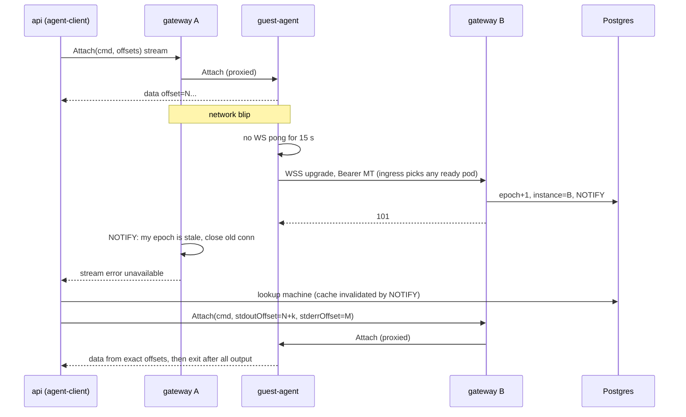
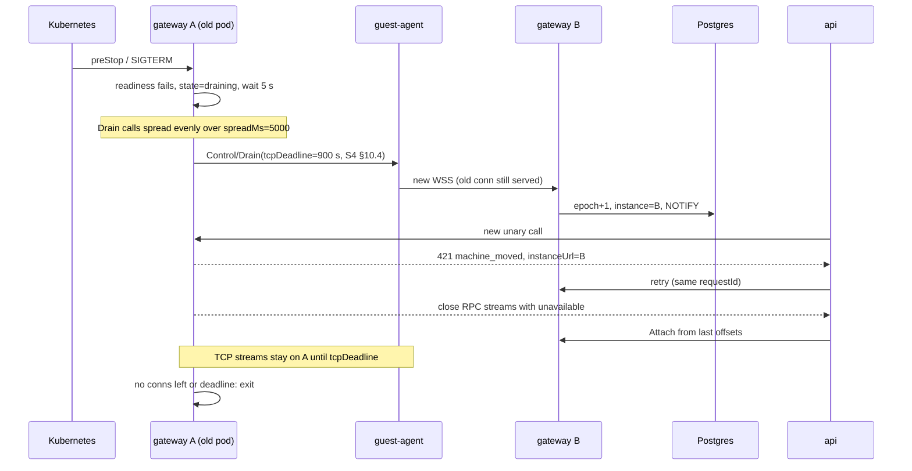
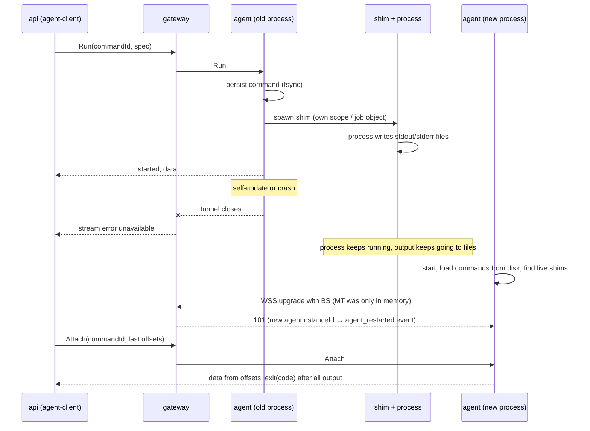

# S2. Протокол туннеля агент ↔ gateway

Статус: согласовано, 2026-10-29. Область S2 из `docs/roadmap.md`. Архитектура: `docs/architecture.md` (§4, §10, §11).

Документ задаёт контракт между гостевым агентом (Go, внутри каждой VM), `gateway` (Go, в Kubernetes) и control plane (`api`, `worker` на TS). Что агент умеет делать (exec, files, ports, claim), решает S3, здесь только общие правила, по которым это вызывается. HTTP-маршрутизация `*.umiak` и публичный TLS — S4.

Пометка **[исполнитель]** означает решение, которое принял автор спеки в рамках брифа; его можно менять без нового согласования, если причина изменения записана.

## 1. Зачем и что считается успехом

Принцип: **состояние живёт в агенте, а не в соединении.** Обрыв туннеля — штатная ситуация.

Сценарии по приоритету:

1. **Длинная команда.** AI-агент или CI запускает через API команду на 20–60 минут (сборка, тесты, coding-агент). Посреди неё туннель обрывается или gateway передеплоивается. Процесс этого не замечает. Клиент переподключается по `commandId` + offset и получает вывод байт в байт, без пропусков и дублей, и правильный код выхода. Вызывающий API видит паузу не больше 30 s или retryable `503`, который SDK повторяет сам.
2. **Rolling deploy gateway.** Ни одна команда не теряется и не выполняется дважды. Агенты переезжают на другой экземпляр за несколько секунд, новые вызовы идут на нужный экземпляр, человек не нужен.
3. **Интерактивный терминал.** Обрыв до ~10 s восстанавливается автоматически, scrollback на месте. PTY живёт до 10 минут без клиента.
4. **Перезапуск или самообновление агента.** Запущенные процессы и их вывод сохраняются, attach после этого работает.

**Допустимые потери:** сырые TCP-потоки (SSH-сессия, WebSocket приложения пользователя через публичный URL, HTTP-запрос в полёте) могут оборваться, клиент переподключается. Прозрачное возобновление — фаза 2 (§11).

## 2. Цели, не-цели, анти-цели

**Цели:** один исходящий канал от VM; мультиплексирование RPC и TCP-потоков с flow control; аутентификация machine без секретов на диске гостя; быстрое обнаружение обрыва; drain без потерь при деплое; возобновление вывода по offset; идемпотентность мутаций; один proto для Go и TS; работа на Linux и Windows одним кодом.

**Не-цели:** набор функций агента (S3); публичный HTTP-прокси, TLS `*.umiak`, SSH gateway (S4); операции Proxmox (S1); модель данных и машины состояний (S6); публичный API и его NDJSON (S7).

**Анти-цели** (провал, даже если формально работает):
- команда выполнилась дважды после повтора;
- вывод после переподключения отличается от реального хотя бы на байт;
- секрет machine попал на диск гостя и уехал в fork или saved snapshot;
- деплой gateway требует ручных действий или рвёт команды;
- gateway стал разбирать RPC агента, и его версия жёстко связана с версией агента.

## 3. Обзор

```
 VM (Linux / Windows)                         Kubernetes
 +---------------------------+                +----------------------------------+
 | guest-agent               |   WSS :443     | ingress tunnel.<domain>          |
 |  h2 SERVER on the WS conn |--------------->|   (no oauth2-proxy)              |
 |  Connect: umiak.agent.v1.*  |  agent dials   +----------------+-----------------+
 |           umiak.tunnel.v1.* |                                 |
 |  /files/* (plain HTTP)    |                +----------------v-----------------+
 |  CONNECT host:port        |                | gateway pod (Deployment)         |
 |  shim per command         |                |  h2 CLIENT on the WS conn        |
 +---------------------------+                |  internal listener (ClusterIP):  |
                                              |   /v1/machines/{id}/rpc/*        |
                                              |   /v1/machines/{id}/files/*      |
                                              |   /v1/machines/{id}/tcp/{port}   |
                                              +--+----------------+--------------+
                                                 | registry       ^ service token
                                                 v Postgres       |
                                              +--------------+  +-+--------------+
                                              | tunnel_*     |  | api / worker   |
                                              | tables       |  | agent-client   |
                                              +--------------+  +----------------+
```

Соединение открывает агент (в VM нет входящих портов), но на нём роли развёрнуты: **агент — HTTP/2-сервер, gateway — HTTP/2-клиент.** Так устроен Cloudflare Tunnel. HTTP/2 даёт мультиплексирование, flow control на поток и на соединение, справедливый планировщик кадров, PING и CONNECT. Свой mux не пишем.

Gateway для RPC — authenticated reverse proxy: тела Connect-запросов он не разбирает. Control plane вызывает агента сгенерированными Connect-клиентами через `/v1/machines/{id}/rpc/<service>/<method>`.

Схема проверена одноразовым экспериментом (2026-10-29): агент открывает WebSocket и обслуживает на нём `http2.Server.ServeConn`, gateway делает `http2.Transport.NewClientConn`. Потоковый ответ с flush, CONNECT к TCP-серверу с half-close и h2 PING работают.

## 4. Транспорт

### 4.1 Соединение

- `GET wss://tunnel.<domain>/v1/connect`, WS subprotocol `umiak-tunnel.v1`.
- Сообщения WS бинарные; поверх WS — поток байт (`websocket.NetConn`), на нём HTTP/2 с prior knowledge (h2c внутри уже зашифрованного WSS).
- Заголовки upgrade-запроса:

| Заголовок | Значение |
|---|---|
| `Authorization` | `Bearer <MT>` или `Umiak-Bootstrap <BS>` (§5.2) |
| `Umiak-Machine-Id` | machineId из smbios |
| `Umiak-Boot-Id` | id загрузки ОС (Linux `/proc/sys/kernel/random/boot_id`, Windows — эквивалент, выбирает S3/S9) |
| `Umiak-Agent-Instance-Id` | случайный id, новый при каждом старте процесса агента |
| `Umiak-Vmgenid` | VM Generation ID |
| `Umiak-Agent-Version` | semver агента |

- Ответ `101` содержит `Umiak-Gateway-Instance` и `Umiak-Conn-Epoch`. Ошибки — в §5.3.
- После `101` gateway вызывает у агента `umiak.tunnel.v1.Control/Info` (capabilities, версии, §10), при необходимости `Control/SetToken`, и открывает `Events/Subscribe` (§9.6).

### 4.2 Что ходит по HTTP/2

| Что | Как | Инициатор |
|---|---|---|
| RPC агента (`umiak.agent.v1.*`) | Connect, unary и server-streaming | control plane → gateway → агент |
| Служебные RPC (`umiak.tunnel.v1.*`) | Connect | только сам gateway |
| Файлы | обычный HTTP `/files/*` (§9.5) | control plane → gateway → агент |
| TCP-потоки (порты, SSH, сигналинг рабочего стола) | `CONNECT <addr>:<port>`, полный дуплекс, half-close через END_STREAM | gateway → агент |

Все запросы инициирует gateway: агент — только сервер. Сообщения агента наружу идут как ответы в долгом `Events/Subscribe`.

CONNECT агент разрешает только на адреса самой VM: loopback и адреса её интерфейсов. Другие хосты (LAN, соседние VM) — `403`. Порт 0 и порты вне 1–65535 — `400`.

### 4.3 Параметры HTTP/2

| Параметр | Значение |
|---|---|
| `MaxConcurrentStreams` на агенте | 1000 |
| Начальное окно потока | 1 MiB |
| Окно соединения | 16 MiB |
| Максимальный кадр | по умолчанию (16 KiB) |
| Планировщик записи | round-robin (по умолчанию в Go) |
| Максимальное сообщение Connect | 16 MiB |

### 4.4 Head-of-line

HTTP/2 делит одно TCP-соединение, поэтому большой поток файла может задержать терминал на уровне TCP. Правило: **одно соединение на агента**. Отдельное bulk-соединение добавляем, только если перф-тест (§14.3) покажет p99 эха терминала больше 50 ms во время передачи 1 GB. Протокол к этому готов: `Umiak-Lane` в upgrade зарезервирован, в v1 не используется.

### 4.5 Транспорт за интерфейсом

Код протокола не знает, что под ним WebSocket. **[исполнитель]** Форма интерфейсов:

```go
// Agent side: produces connections on which the agent serves HTTP/2.
type Dialer interface {
	Dial(ctx context.Context, hello Hello) (net.Conn, ConnInfo, error)
}

// Gateway side: one live tunnel to one machine.
type MachineConn interface {
	RoundTrip(req *http.Request) (*http.Response, error) // RPC and /files
	DialTCP(ctx context.Context, port uint16) (net.Conn, error)
	Ping(ctx context.Context) error
	Drain(ctx context.Context, opts DrainOptions) error
	Close() error
}
```

Userspace WireGuard (wireguard-go + netstack) в фазе 2 встаёт под тот же интерфейс: агент обслуживает HTTP/2 на listener-е netstack. Тот же интерфейс используется в тестах: in-memory транспорт с инъекцией сбоев.

### 4.6 Windows

Агент — тот же код, как служба Windows (`golang.org/x/sys/windows/svc`). Весь стек на чистом Go, cgo не нужен: `coder/websocket`, `x/net/http2`, `connect-go`, `protobuf`. Препятствий нет. Отличия: нет `TCP_USER_TIMEOUT` (полагаемся на ping), smbios читается через `GetSystemFirmwareTable` или WMI.

## 5. Идентичность и аутентификация

### 5.1 Идентификаторы

| Изменился | Что произошло | Последствия |
|---|---|---|
| только `connId` (новое соединение) | короткий обрыв | ничего, стримы продолжаются по offset |
| `agentInstanceId` | агент перезапустился | процессы и PTY живы |
| `bootId` | VM перезагрузилась | незавершённые команды → `lost`, PTY закрыты |
| `machineId` в smbios ≠ сохранённому агентом | fork или VM из saved snapshot | смена идентичности (S3), журнал и кэши агента сбрасываются |

`machineId` — UUID (v7), его выдаёт control plane. **Machine никогда не переиспользуется между sandbox:** после delete VM уничтожается, новая sandbox получает новую machine. Поэтому bootstrap secret не переживает одного арендатора.

### 5.2 Учётные данные

- **Bootstrap secret (BS).** 32 случайных байта, свой у каждой VM. Worker кладёт его в конфиг VM при создании (`docs/specs/s1-proxmox-foundation.md` §6.4, допущения — S2 §15). В БД хранится SHA-256. Многоразовый, действует, пока machine не списана. **На диск гостя не попадает.**
- **Machine token (MT).** 32 случайных байта, opaque, выдаёт gateway. Живёт **только в памяти агента**: после перезапуска агента или VM агент снова предъявляет BS. В БД хранятся SHA-256 текущего и следующего токена.
- **Ротация MT.** Двухфазная: gateway пишет `mt_next_hash`, вызывает `Control/SetToken`, после ответа переносит `next` в `current`. Если связь оборвалась посередине, действуют оба токена; подключение с `next` завершает ротацию. Поводы: claim (control plane вызывает `POST /v1/machines/{id}/rotate-token` на gateway), раз в 24 h, по запросу оператора.
- **Следствие.** Секретов на диске нет, значит fork, снапшоты и пользовательские шаблоны не уносят чужие учётные данные. Новая VM получает свои `machineId` и BS в собственном smbios.
- **Одно активное соединение на machine.** Новое соединение получает `epoch+1` и вытесняет старое (§8.3). Исключение — короткое окно make-before-break при drain. Два живых соединения с одной machine вне drain дают метрику тревоги `tunnel_duplicate_sessions_total`.
- **Списание.** Worker ставит `retired_at`. Gateway закрывает соединение (по `NOTIFY`) и отвечает `403` на новые попытки.

Формат smbios **[исполнитель]**: `smbios1: uuid=<machineId>,serial=<base64("umiak1:" + machineId + ":" + base64url(BS))>,base64=1`. Версия `umiak1` позволяет поменять формат позже. Длину поля проверить в S1.

### 5.3 Ответы на upgrade и поведение агента

| Ответ | Значит | Агент |
|---|---|---|
| `101` | принято | работает |
| `401` с MT | токен неизвестен или отозван | забывает MT, сразу пробует BS |
| `401` с BS | BS неверен | перечитывает smbios, backoff 60 s |
| `403` | machine списана | попытки раз в 5 min |
| `426` | версия протокола не поддерживается или агент ниже минимума по безопасности | backoff 5 min; восстановление через запасной канал QEMU guest agent (S3) |
| `503` + `Retry-After` | экземпляр в drain или перегружен | ждёт `Retry-After` с jitter, затем обычный backoff |

### 5.4 TLS

- Отдельный приватный **tunnel CA**. Сертификат `tunnel.<domain>` выпущен этим CA. TLS терминирует ingress или gateway (TLS passthrough), это решает S12. Важно только, чтобы агент видел сертификат от tunnel CA.
- Агент доверяет только бандлу CA из своего конфига (текущий и следующий CA, для ротации). Системные корни не используются. Бандл обновляется вместе с агентом (S3).
- Публичный TLS для `*.umiak` и `api.<domain>` (S4, S12) с этим не связан.

### 5.5 Control plane → gateway

- Внутренний listener gateway (ClusterIP Service и pod IP), h2c, NetworkPolicy пускает только `api`, `worker` и другие поды gateway.
- `Authorization: Bearer <service-token>`. Токен свой для каждого вызывающего (`api`, `worker`, `gateway`), хранится в Kubernetes Secret. Одновременно действуют два токена на вызывающего, чтобы ротировать без простоя. mTLS — позже.
- Обратное направление — `POST /internal/v1/agent-events` в `api` — тоже по сети кластера, с service token gateway, мимо oauth2-proxy.
- Через `/rpc/` прокси пропускает только `umiak.agent.v1.*`, через `/files/` — только `/files/*` агента. `umiak.tunnel.v1.*` вызывает только сам gateway, снаружи — `403`.

## 6. Живость и переподключение

| Что | Значение | Зачем |
|---|---|---|
| WS ping от агента | каждые 5 s; мёртв через 15 s без pong | агент быстро решает переподключиться |
| h2 PING от gateway | `ReadIdleTimeout` 10 s, `PingTimeout` 5 s | gateway чистит мёртвые соединения |
| TCP keepalive | 15 s, обе стороны | |
| `TCP_USER_TIMEOUT` | 20 s, Linux | зависшая отправка |

В §4 архитектуры было 10/30 s. Ужесточили, потому что бюджет паузы — 30 s: обнаружение до 15 s + переподключение 1–3 s.

**Backoff агента:** первая попытка через случайные 0–250 ms, дальше от 500 ms ×2 до потолка 10 s, full jitter. Сброс после 30 s стабильной работы. Ответы из §5.3 задают свои задержки.

**Grace.** Запись в реестре переходит в `disconnected` с `disconnected_at`. Control plane считает sandbox `degraded`, если агент недоступен дольше 60 s (S6). Отдельный вызов API ждёт агента до 30 s (§8.4). Gateway в течение grace ничего не держит: состояние в агенте.

**Ingress для WSS** (контроллер не выбран, требования):
- WebSocket upgrade, соединения живут часами и днями, без лимита на длительность;
- idle timeout не меньше 60 s (ping каждые 5 s, запас многократный);
- без буферизации запросов и ответов;
- снятие пода из endpoints по readiness probe;
- сертификат `tunnel.<domain>` от tunnel CA (§5.4).

## 7. Drain при деплое и падение экземпляра

Gateway — HTTP/2-клиент, поэтому GOAWAY от него не значит «переподключись». Используем явный RPC `Control/Drain{reason, tcpDeadline}`.

Gateway работает как Kubernetes Deployment, drain — часть завершения пода:

1. `preStop` (или SIGTERM) переводит экземпляр в `draining`: readiness probe падает, `gateway_instances.state = draining`, новые upgrade получают `503`.
2. Экземпляр ждёт удаления из endpoints ingress (по умолчанию 5 s).
3. Он вызывает `Control/Drain` у своих агентов, равномерно размазывая вызовы по `spreadMs` (по умолчанию 5000). Темп задаёт только gateway: он знает, сколько у него агентов. RPC отвечает сразу.
4. Агент, получив `Drain`, сразу (jitter 0–250 ms) делает **make-before-break**: открывает новое соединение, а старое продолжает обслуживать. Ingress ведёт его на готовый под. Если он попал на draining-под и получил `503`, агент повторяет попытку.
5. Новый экземпляр пишет в реестр `epoch+1` и шлёт `NOTIFY`.
6. На старом экземпляре:
   - unary-вызовы в полёте завершаются сами;
   - новые вызовы для переехавшей machine получают `421 machine_moved` с `instanceUrl` нового владельца, `agent-client` повторяет туда;
   - RPC-стримы (`/rpc/`: attach, events) закрываются с Connect `unavailable` сразу после переезда, `agent-client` продолжает их по offset на новом экземпляре;
   - TCP-потоки (`/tcp/`) живут до `tcpDeadline` (по умолчанию 2 min), потом закрываются.
7. Когда соединений не осталось или истёк общий срок, процесс выходит. Агент сам закрывает старое соединение через `tcpDeadline + 10 s`.

`terminationGracePeriodSeconds` должен покрывать шаги 2–7. С одним `tcpDeadline` 2 min это было бы 5 s + 5 s + 120 s + запас → 180. **S4 переопределяет:** gateway передаёт `tcpDeadline` = 15 min, чтобы дожили SSH-потоки, а остальные TCP-потоки закрывает сам через 2 min (`docs/specs/s4-gateway.md` §10). Итог — **960**.

**Падение без drain** (OOM, нода умерла): агенты замечают это по ping не позже чем через 15 s и переподключаются. Записи `tunnel_sessions` указывают на экземпляр, чей `heartbeat_at` устарел. Через 15 s `agent-client` считает такие machine отключёнными и ждёт новую запись.

**Sweep устаревших экземпляров.** Каждый gateway раз в 5 s ищет экземпляры с `heartbeat_at` старше 15 s (`FOR UPDATE SKIP LOCKED`, чтобы sweep делал один). Их ещё не переехавшие сессии он переводит в `disconnected` (`disconnected_at` = последний heartbeat), шлёт `NOTIFY` и событие `disconnected`, затем удаляет запись экземпляра. Так правило `degraded` в S6 работает и после падения пода.

## 8. Реестр и маршрутизация

### 8.1 Таблицы

Postgres, схема `tunnel`. Redis не нужен.

```
gateway_instances(
  id text pk,              -- pod name + start uuid
  internal_url text,       -- http://<podIP>:<port>, from the Downward API
  state text,              -- active | draining
  started_at, heartbeat_at -- heartbeat every 5 s, stale after 15 s
)

tunnel_sessions(
  machine_id uuid pk,
  instance_id text, epoch bigint, conn_id text,
  agent_instance_id text, boot_id text, vmgenid text,
  agent_version text, proto_version text, capabilities text[],
  state text,              -- connected | disconnected
  connected_at, disconnected_at
)

tunnel_credentials(
  machine_id uuid pk,
  bs_hash bytea,                    -- written by worker at machine creation
  mt_hash bytea, mt_next_hash bytea, mt_issued_at,
  retired_at                        -- written by worker at delete
)
```

Владение: `gateway_instances` и `tunnel_sessions` пишет gateway. В `tunnel_credentials` worker пишет `bs_hash` и `retired_at`, gateway — поля MT. Остальное читают все.

`internal_url` — адрес конкретного пода (pod IP), а не Service: после `421` API должен попасть именно в этот экземпляр.

### 8.2 Запись

Реестр пишется только при подключении и отключении, не на каждый ping. При подключении, в одной транзакции:
1. проверить учётные данные;
2. `epoch = epoch + 1`;
3. записать экземпляр;
4. `NOTIFY tunnel_sessions, '<machineId>'`.

### 8.3 Fencing

Экземпляр, у которого для machine локальный epoch меньше, чем в реестре, по `NOTIFY` закрывает своё соединение. Исключение — окно drain, там он только закрывает RPC-стримы, а TCP держит до `tcpDeadline`. Вызовы к устаревшему соединению он не обслуживает, а отвечает `421`.

### 8.4 Как control plane вызывает агента

Пакет `packages/agent-client` (TS):
- клиенты сгенерированы `protoc-gen-es` из `proto/umiak/agent/v1`, transport — `@connectrpc/connect-node`, HTTP/2;
- `baseUrl = <internal_url>/v1/machines/{machineId}/rpc`, заголовок `Authorization: Bearer <service-token>`;
- поиск экземпляра: `tunnel_sessions` join `gateway_instances`, где `state = connected` и heartbeat свежий. Результат кэшируется, кэш сбрасывается по `LISTEN tunnel_sessions`;
- **повтор:** на `421`, ошибку соединения, Connect `unavailable` — заново найти экземпляр и повторить. Если machine не подключена, ждать `NOTIFY` (с опросом раз в 1 s на всякий случай) до 30 s, затем ошибка `agent_unavailable` с `retryable: true`, которую API отдаёт как `503`;
- повторять можно любой вызов: мутирующие несут `requestId` или `commandId` (§9.2);
- server-stream (attach, PTY) `agent-client` продолжает сам с последнего полученного offset (§9.1), вызывающий видит паузу;
- `invalid_argument`, `not_found`, `permission_denied`, `failed_precondition` не повторяются.

Gateway как прокси:
- проверяет service token и путь;
- снимает `Authorization`, ставит `Umiak-Caller: api|worker`;
- пробрасывает заголовки Connect (`Connect-Timeout-Ms`, `Umiak-Request-Id`);
- стримит тела без буферизации.

Для S4 и SSH:
- `CONNECT /v1/machines/{id}/tcp/{port}` на внутреннем listener-е — для вызова из другого экземпляра gateway, когда публичный запрос попал не туда, где туннель. **Уточнение S4 (§7.2):** обычный HTTP/2 CONNECT не несёт `:path`, а extended CONNECT в Go включается только глобальным GODEBUG. Поэтому на проводе это `CONNECT <machineId>:<port>` (цель в `:authority`) с service token; `MaxConcurrentStreams` внутреннего listener-а — 10 000;
- Go-интерфейс `MachineConn.DialTCP` внутри процесса.

## 9. Возобновляемость

### 9.1 Команды и вывод

- **`commandId`** (ULID) генерирует control plane до вызова и сохраняет запись Command. `Process/Start(commandId, spec)` идемпотентен по нему: повтор с тем же id и тем же spec возвращает существующую команду; с другим spec — `already_exists`.
- Агент записывает команду на диск с fsync **до** запуска процесса. После ответа `Start` команда durable.
- Процесс запускается под **shim** — отдельным процессом (тот же бинарник агента в другом режиме). Shim:
  - пишет stdout и stderr прямо в файлы;
  - держит PTY master;
  - записывает код выхода в файл;
  - живёт вне жизни агента: на Linux в systemd scope, на Windows в job object с breakaway.
  
  Механизм — S3 и S9, контракт — здесь.
- **Offset** — байтовая позиция в файле потока (`stdout`, `stderr` или `pty`), `uint64`, монотонная.
- `Process/Attach(commandId, stdoutOffset, stderrOffset)` — server stream с событиями:

| Событие | Поля | Когда |
|---|---|---|
| `data` | `stream, offset, bytes` (≤ 64 KiB) | вывод |
| `heartbeat` | — | после 15 s тишины |
| `truncated` | `stream, availableFrom` | запрошенный offset вытеснен по retention |
| `exit` | `status (exited/killed/lost), code, signal, stdoutEnd, stderrEnd` | **только после** того, как отдан весь вывод до `*End` |

- `Process/Run` — `Start` + `Attach` в одном стриме, первое событие `started{commandId}`.
- **Backpressure сквозная.** Агент читает файл с той скоростью, с какой забирает потребитель через flow control HTTP/2, и ничего не копит в памяти. Медленный клиент не раздувает память ни в агенте, ни в gateway.
- **Склейка в `agent-client`** по каждому потоку:
  - `offset == expected` → принять;
  - перекрытие → обрезать;
  - разрыв → повторный attach с `expected`.
- Внешний клиент тоже может переподключиться к API по `commandId` и offset (S7).
- Сколько хранить вывод на диске VM, решает S3. Контракт: offset-ы не сдвигаются при вытеснении, вытесненное отдаётся как `truncated`.

### 9.2 `requestId`

- Заголовок `Umiak-Request-Id` (UUID или ULID) **обязателен** на мутирующих unary. Без него агент отвечает `invalid_argument`.
- Освобождены методы с `option idempotency_level = IDEMPOTENT` или `NO_SIDE_EFFECTS`, а также `Start` (ключ — `commandId`).
- Middleware агента хранит на диске `requestId → (hash запроса, код, тело ответа)` с TTL 24 h и ограничением размера (S3).
  - Повтор с тем же телом → сохранённый ответ.
  - Тот же id с другим телом → `invalid_argument`.
  - Параллельный дубль ждёт результата первого вызова.
- `requestId` генерирует control plane: из публичного `Idempotency-Key`, если он есть, иначе новый на каждую логическую операцию. При повторах тот же.

### 9.3 Ввод и PTY

- `Process/SendInput(commandId, inputSessionId, seq, bytes)`, unary. Дубли с `seq ≤ last` для данного `inputSessionId` отбрасываются. Клиент может склеивать нажатия за 5 ms.
- Размер окна PTY — `Process/Update(commandId, cols, rows)`.
- PTY — команда с `pty: {cols, rows}` и одним потоком `pty`. Scrollback — хвост этого лога.
- PTY master держит shim, поэтому сессия переживает перезапуск агента.
- Через 10 min без подключённого клиента (таймер на агенте от последнего detach) PTY закрывается с SIGHUP.

Bidi-стримы не используются: всё работает по HTTP/1.1 и HTTP/2 и одинаково переживает переподключения.

### 9.4 Kill и прочее

`Process/Signal(commandId, signal)` идемпотентен сам по себе. Остальные мутации (move, delete, mkdir, claim, quiesce) — с `requestId`.

### 9.5 Файлы

Обычные HTTP-ручки агента `/files/*`, как в E2B `envd`. Снаружи они доступны как `/v1/machines/{id}/files/*` на внутреннем listener-е gateway.

- **Скачивание:** `GET /files?path=` с `Range`, `ETag` (inode + size + mtime) и `If-Range`. Докачка штатными средствами HTTP.
- **Загрузка:**
  1. `PUT /files/uploads/{uploadId}?offset=` — чанки до 8 MiB (рекомендуется 4 MiB) во временный файл рядом с целевым;
  2. `HEAD /files/uploads/{uploadId}` — текущий размер, чтобы продолжить;
  3. `POST /files/uploads/{uploadId}/commit {path, sha256?, mode?}` — атомарный rename. Идемпотентен по `uploadId`.
  
  Незавершённые загрузки удаляются через 24 h.
- Мелкие операции (stat, list, mkdir, move, delete) — Connect unary (S3).

### 9.6 События агент → control plane

- Агент ведёт **durable-журнал событий** с `seq` (`uint64`). Seq монотонный через перезапуски агента, сбрасывается только при смене machineId.
- Конверт: `{seq, time, bootId, type, payload (protobuf Any)}`.
- Типы событий определяют S3 и S6: команда завершилась, PTY закрыт, изменились порты, фаза готовности, простой и т.д.
- Поток доставки:
  1. Gateway после подключения вызывает `Events/Subscribe(afterSeq)`, где `afterSeq` — последний подтверждённый seq, его хранит сам агент.
  2. Gateway шлёт пачки (до 500 событий или раз в 1 s) в `POST /internal/v1/agent-events` в `api`.
  3. `api` пишет их durable, дедуплицирует по `(machineId, seq)` и отвечает `{ackedSeq}`.
  4. Gateway вызывает `Events/Ack(seq)`, агент чистит журнал.
- Доставка **at-least-once**. Если `api` недоступен, gateway перестаёт читать стрим, журнал копится на агенте (лимит — S3).
- Синтетические события `connected`, `disconnected`, `agent_restarted`, `rebooted`, `identity_changed` gateway выводит из §5.1 и шлёт в ту же ручку. Это отдельный класс событий без `seq`: ключ `(machineId, epoch, type)`, поля `time` и `instanceId`. Порядка относительно событий агента и между экземплярами нет. `api` дедуплицирует их по ключу, а текущее состояние подключения берёт из `tunnel_sessions`, а не из порядка событий. `disconnected` после падения пода шлёт sweep (§7).

## 10. Схема и версионирование

### 10.1 Proto

- `proto/umiak/tunnel/v1/` — владеет S2:
  - `Control`: `Info`, `SetToken`, `Drain`;
  - `Events`: `Subscribe`, `Ack`;
  - общие сообщения: `ErrorDetail`, конверт события.
- `proto/umiak/agent/v1/` — наполняет S3: `Process` (`Start`, `Run`, `Attach`, `SendInput`, `Update`, `Signal`, `List`), `Filesystem`, `System` (claim, quiesce, identity) — по соглашениям из этой спеки.
- Codec — protobuf binary. JSON Connect принимается всегда, для отладки через curl.
- Ошибки: коды Connect + деталь `ErrorDetail{code string, retryable bool}`. `retryable` — истина для `unavailable` и `deadline_exceeded`.

### 10.2 Три уровня версий

1. **Провод.** WS subprotocol `umiak-tunnel.v1` и заголовки §4.1. Gateway поддерживает текущую и предыдущую major-версии. Ломающее изменение — `umiak-tunnel.v2`.
2. **RPC.** Пакеты `v1`, только добавление (новые поля, методы, сервисы). `buf breaking` в CI сравнивает с `main`. Ломающее — `v2` рядом с `v1`.
3. **Возможности.** `Control/Info` возвращает `{agentVersion, os, arch, protoPackages[], capabilities[]}`, например `process.pty`, `files.upload.v1`. Это сохраняется в `tunnel_sessions.capabilities`. API проверяет нужную возможность до вызова, иначе отвечает `409 agent_outdated`.

Старые агенты при подключении **не отвергаются**: они живут в warm pool и остановленных VM. Единственное исключение — минимальная версия по безопасности в конфиге gateway (`426`). Обновление агента — S3.

Gateway не разбирает `umiak.agent.v1`, поэтому его версия не связана с версией агента. Связаны только `umiak.tunnel.v1` и проводной уровень.

## 11. Что рвётся и фаза 2

**Рвётся:**
- TCP-потоки (CONNECT): при любом обрыве туннеля, по истечении `tcpDeadline` при drain и при перезапуске агента (сокеты к `localhost:port` принадлежат агенту);
- при перезагрузке VM: незавершённые команды получают `exit{status: lost}`, PTY пропадают.

**Варианты на фазу 2:**
- **(a) Возобновляемые TCP-потоки на уровне туннеля.** У каждого потока id, seq/ack и буфер повтора 1–4 MiB с обеих сторон. При переподключении поток продолжается. Если агент переехал на другой экземпляр, публичный экземпляр строит мост через `/tcp/`. Спасает от обрывов и деплоев, не спасает от перезапуска агента.
- **(b) Userspace WireGuard** под интерфейсом §4.5. TCP идёт от конца до конца через netstack и переживает короткие обрывы. Состояние TCP живёт в netstack конкретного пода gateway, поэтому деплой и перезапуск агента его всё равно рвут.

Рекомендация, если дойдёт: **(a)**.

## 12. Диаграммы последовательностей

### 12.1 Первое подключение (BS → MT)

```mermaid
sequenceDiagram
  participant W as worker
  participant DB as Postgres
  participant A as guest-agent
  participant G as gateway
  W->>DB: tunnel_credentials(machineId, bs_hash)
  W->>W: create VM with smbios1 uuid=machineId, serial=umiak1:machineId:BS (S1)
  A->>A: boot, read smbios: machineId, BS
  A->>G: WSS upgrade, Authorization: Umiak-Bootstrap BS, Umiak-Machine-Id, Boot-Id, ...
  G->>DB: check bs_hash, retired_at; epoch+1; tunnel_sessions=connected; NOTIFY
  G-->>A: 101, Umiak-Conn-Epoch
  Note over A,G: HTTP/2 inside the WS: agent = server, gateway = client
  G->>A: Control/Info
  A-->>G: version, capabilities
  G->>DB: mt_next_hash = sha256(MT)
  G->>A: Control/SetToken(MT)
  A-->>G: ok (MT kept in memory only)
  G->>DB: mt_hash = mt_next_hash
  G->>A: Events/Subscribe(afterSeq)
```

### 12.2 Переподключение после короткого обрыва



### 12.3 Drain gateway при деплое



### 12.4 Перезапуск агента во время длинной команды



## 13. Наблюдаемость

Метрики Prometheus в gateway и агенте:
- подключённые агенты по экземпляру;
- подключения и переподключения в минуту по причине (blip, drain, agent restart, reboot);
- длительность разрыва (от `disconnected_at` до нового подключения);
- `421` и повторы в `agent-client`;
- `tunnel_duplicate_sessions_total`;
- отказы upgrade по коду;
- RTT h2 PING;
- отставание журнала событий (`seq − ackedSeq`);
- байты через туннель по типу (rpc, files, tcp);
- активные потоки.

Журнал агента пишет каждую смену соединения с `connId`, `epoch` и причиной.

## 14. Приёмка

Где идут тесты **[исполнитель]**:
- **CI:** in-memory транспорт за интерфейсом §4.5 с инъекцией сбоев, реальный Postgres в контейнере.
- **Локальный кластер** (kind или k3s, любой ingress с WebSocket): 2–3 пода gateway, агенты — процессы реального бинарника агента в контейнерах с фиктивными machineId, не VM. Так идёт drain-тест на 50 агентов (на `pve` всего 8 GB RAM).
- **Стенд `pve`:** 1–2 реальные VM для chaos-, перф- и терминального тестов.

### 14.1 Chaos-тест (главный)

Детерминированная команда длительностью не меньше 20 min:
- пишет в stdout и stderr пронумерованные строки с известным содержимым (суммарно ≥ 200 MiB);
- создаёт файл-маркер один раз за запуск;
- выходит с кодом 42.

Во время работы инжектор случайно, раз в 10–60 s, делает одно из:
- обрыв TCP туннеля;
- блокировку трафика на 20 s;
- SIGKILL пода gateway;
- graceful rollout gateway;
- SIGKILL агента;
- рестарт службы агента.

Клиент читает вывод через API с прозрачным resume. Второй клиент сам переподключается по offset.

**Проходит, если:**
- sha256 stdout и stderr совпадают с ожидаемыми у обоих клиентов;
- код выхода 42;
- маркер создан ровно один раз;
- пауза в выдаче после каждого сбоя не больше 30 s;
- ни один вызов API не завершился ошибкой, кроме retryable `503`, которую клиент повторил.

### 14.2 Drain-тест

2–3 пода gateway, 50 агентов, у каждого идут команды и attach-стримы. Делается rolling update gateway.

**Проходит, если:**
- 0 потерянных и 0 двойных команд;
- все стримы продолжились по offset;
- p99 времени переезда агента (от получения `Drain` агентом до нового `101`) не больше 5 s; все агенты пода переехали не позже `spreadMs + 5 s` от начала шага 3;
- новые вызовы после `421` доходят с первого повтора;
- под завершился в пределах `terminationGracePeriodSeconds`.

### 14.3 Перф-тест head-of-line

В PTY раз в 100 ms отправляется 1 байт, измеряется эхо. Параллельно через тот же туннель идёт загрузка и скачивание 1 GB.

**Порог:** p99 эха не больше 50 ms. Если порог не выдержан, добавляем bulk-соединение (§4.4).

### 14.4 Терминал

- Обрыв до 10 s: PTY переподключается сам, scrollback совпадает.
- Без клиента 9 min: PTY жив. Через 10 min закрыт.

### 14.5 Безопасность

- Fork и VM из saved snapshot не могут подключиться как исходная machine: на диске нет секрета, в smbios — новый.
- Списанная machine получает `403`.
- Вызов `umiak.tunnel.v1.*` через `/rpc/` → `403`.
- CONNECT на адрес вне VM → `403`.
- Вызов внутреннего listener-а без service token → `401`.

### 14.6 Масштаб

Цель дизайна **[исполнитель]**: до 2000 агентов на под gateway и до 10 000 machine всего. Нагрузочно проверяем 2000 агентов на под (агенты-процессы, без VM). Что важно на этом масштабе:
- `NOTIFY` на каждое подключение: при деплое пода это до 2000 уведомлений за `spreadMs`, слушателей единицы (поды api, worker, gateway). Если не уложится, батчим.
- Память на соединение: окна HTTP/2 — это пределы, а не выделенная память. Проверяем RSS gateway на 2000 простаивающих агентов.

### 14.7 Объём реализации S2 и приёмка

- **S2 при реализации даёт только контракт и общие части:** proto (`umiak.tunnel.v1` и соглашения), Go-библиотеку туннеля, приёмник туннелей, реестр, drain и прокси в gateway, клиентскую часть туннеля в агенте и TS `agent-client`.
- **Проверка S2:** in-memory транспорт с инъекцией сбоев и тестовый двойник `Process`, который соблюдает контракт `commandId`/offset/`exit`. Двойник не идёт в продукт.
- **Полный §14** (chaos-, drain-, перф-, терминальный тесты на реальных компонентах) — совместная приёмка, когда реализованы S3 и S4.
- **Windows:** в CI S2 только кросс-компиляция (`GOOS=windows`, без cgo). Реальная проверка — в S9.

## 15. Интерфейсы к другим областям (допущения)

- **S1:**
  - `create`, `fork` и создание из saved snapshot принимают от вызывающего `smbios1` (`uuid`, `serial` с base64 machineId и BS);
  - fork никогда не наследует `smbios1` и `vmgenid` исходной VM;
  - у каждой новой VM новый `vmgenid`;
  - QEMU guest agent доступен как запасной канал.
- **S3:**
  - shim и его scope или job object;
  - durable-каталог состояния (команды, логи, кэш `requestId`, журнал событий);
  - retention вывода;
  - чтение smbios и смена идентичности;
  - `Control/Info` и capabilities;
  - клиентская часть туннеля по этой спеке;
  - обновление бандла tunnel CA вместе с агентом;
  - самообновление и восстановление через QEMU guest agent.
- **S4:** gateway-процесс содержит приёмник туннелей и реестр из этой спеки. Публичный HTTP-прокси и SSH используют `MachineConn.DialTCP` или `/v1/machines/{id}/tcp/{port}` на экземпляре-владельце. Публичный TLS — отдельно.
- **S6:**
  - worker создаёт `machineId` и BS, пишет `tunnel_credentials.bs_hash` и передаёт smbios в S1;
  - при claim вызывает `rotate-token`;
  - при delete ставит `retired_at`;
  - потребляет `/internal/v1/agent-events`;
  - правило `degraded` через 60 s;
  - machine не переиспользуется между sandbox.
- **S7:** публичный attach по `commandId` и offset поверх `agent-client`, heartbeat в NDJSON.
- **S9:** то же для Windows: служба, job object, ConPTY, чтение smbios.
- **S12:**
  - ingress для `tunnel.<domain>` по требованиям §6;
  - tunnel CA и его секреты;
  - Deployment gateway с readiness, `preStop` и `terminationGracePeriodSeconds: 960` (S4 §10);
  - NetworkPolicy внутреннего listener-а;
  - service tokens в Secrets.

## 16. Security assumptions (приняты Ильёй, 2026-10-29)

1. **root внутри VM может прочитать BS и MT своей VM.** Это позволяет только выдать себя за свою же VM. Machine не переиспользуется между sandbox, секретов на диске нет, поэтому чужие VM недоступны. Принято.
2. **Операторы с правом чтения конфигов Proxmox видят BS.** Они и так администраторы всего хоста. Принято.
3. **Между control plane и gateway в PoC и MVP — статические ротируемые service-токены в приватной сети кластера** (NetworkPolicy), без mTLS. mTLS — позже. Принято.

## 17. Библиотеки и инструменты

Правило проекта (`CLAUDE.md`): **последние стабильные версии.** Перед добавлением зависимости проверить актуальную (`go list -m -versions`, `npm view`, релизы GitHub) и взять её. Инструменты запускать через mise (`mise exec -- <cmd>`). Ниже — версии, проверенные 2026-10-29; при реализации перепроверить.

| Назначение | Библиотека | Проверено |
|---|---|---|
| Go toolchain | `mise.toml` | go 1.27.3 |
| WebSocket (агент и gateway) | `github.com/coder/websocket` | v1.8.15 |
| HTTP/2 `ServeConn` / `NewClientConn` | `golang.org/x/net/http2` | v0.62.0 |
| Connect RPC (Go) | `connectrpc.com/connect` | v1.21.1 |
| Protobuf (Go) | `google.golang.org/protobuf` | v1.36.12 |
| Служба Windows, smbios | `golang.org/x/sys` | v0.49.0 |
| Postgres из gateway | `github.com/jackc/pgx/v5` | v5.11.0 |
| Connect RPC (TS) | `@connectrpc/connect`, `@connectrpc/connect-node` | 2.3.0 |
| Protobuf (TS) и генератор | `@bufbuild/protobuf`, `@bufbuild/protoc-gen-es` | 2.16.0 |
| buf CLI (генерация, lint, breaking) | `@bufbuild/buf` или `buf` в mise | 1.75.0 |
| Фаза 2: userspace WireGuard | `golang.zx2c4.com/wireguard` | тегов нет, последний коммит |

Отвергнуто: `hashicorp/yamux` (v0.1.2, 2024; свой control-канал и FIFO без планировщика), свой mux в одном gRPC bidi-стриме, grpc-go (не ложится на `net/http` и reverse proxy так же просто, как Connect).

## 18. Оставлено исполнителю

- раскладка `proto/`, `buf.yaml`, `buf.gen.yaml`; коммитить ли сгенерированный код;
- структура Go-пакетов (общий модуль туннеля для агента и gateway);
- инструмент инъекции сбоев (in-process транспорт, toxiproxy, nftables на стенде);
- точные пределы размеров кэша `requestId` и журнала (с S3);
- использовать ли std `net/http` HTTP/2 вместо `x/net/http2`, если std даст `ServeConn` и клиентское соединение поверх готового `net.Conn`.

## 19. Открытые вопросы

- ~~`tcpDeadline` 2 min при drain: хватит ли для SSH-сессий?~~ Решено в S4 §10: SSH-потоки 15 min, остальные 2 min, grace 960 s.
- Список типов событий журнала и их payload (S3, S6).
- Retention вывода команд на диске VM и лимиты (S3).
- Ingress controller и где терминируется TLS `tunnel.<domain>` (S12).
