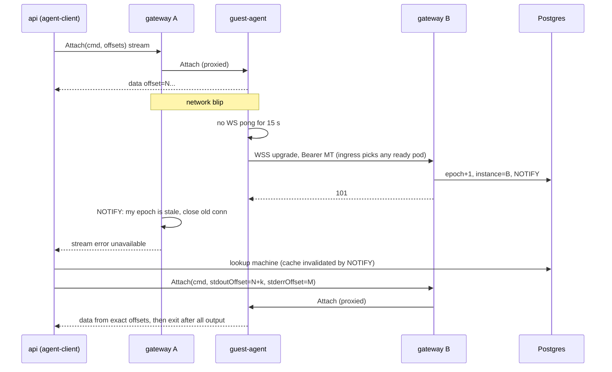
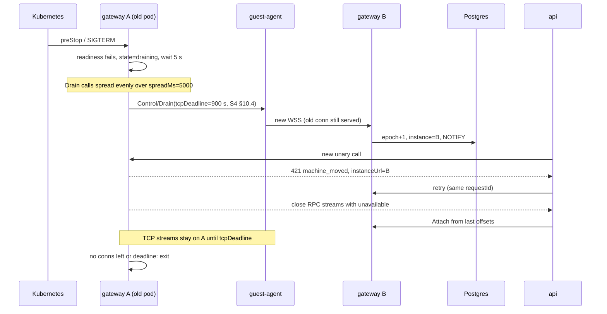
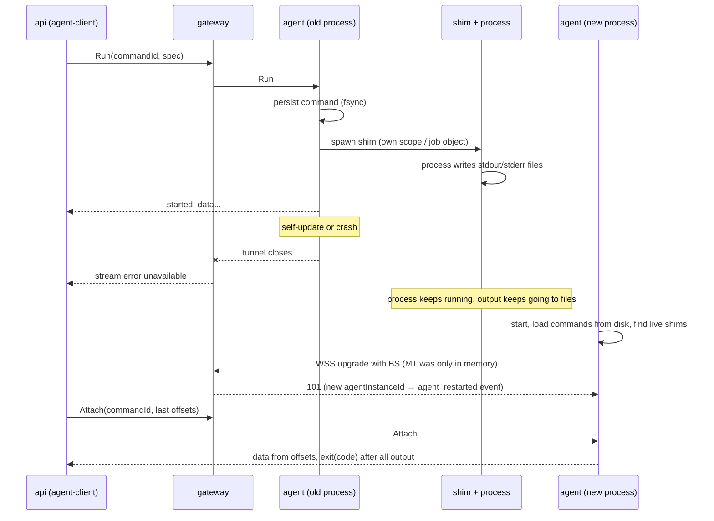

# S2. Agent ↔ gateway tunnel protocol

Status: agreed, 2026-10-29. Area S2 from `docs/roadmap.md`. Architecture: `docs/architecture.md` (§4, §10, §11).

The document defines the contract between the guest agent (Go, inside each VM), `gateway` (Go, in Kubernetes), and the control plane (`api`, `worker` in TS). What the agent can do (exec, files, ports, claim) is decided by S3; here are only the general rules by which it is invoked. HTTP routing of `*.umiak` and public TLS belong to S4.

The mark **[implementer]** means a decision taken by the author of the spec within the brief; it can be changed without new agreement if the reason for the change is recorded.

## 1. Why, and what counts as success

Principle: **state lives in the agent, not in the connection.** A tunnel drop is a normal situation.

Scenarios by priority:

1. **A long command.** An AI agent or CI runs through the API a command of 20–60 minutes (a build, tests, a coding agent). In the middle the tunnel drops or the gateway is redeployed. The process does not notice. The client reconnects by `commandId` + offset and gets the output byte for byte, without gaps and duplicates, and the correct exit code. The API caller sees a pause of no more than 30 s or a retryable `503` that the SDK retries itself.
2. **Rolling gateway deploy.** No command is lost or executed twice. Agents move to another instance within seconds, new calls go to the right instance, no human is needed.
3. **An interactive terminal.** A drop of up to ~10 s recovers automatically, the scrollback is in place. A PTY lives up to 10 minutes without a client.
4. **Agent restart or self-update.** Running processes and their output are preserved, attach works afterwards.

**Acceptable losses:** raw TCP streams (an SSH session, a user application's WebSocket through a public URL, an in-flight HTTP request) may break, the client reconnects. Transparent resumption is phase 2 (§11).

## 2. Goals, non-goals, anti-goals

**Goals:** one outbound channel per VM; multiplexing of RPC and TCP streams with flow control; machine authentication with no secrets on the guest disk; fast drop detection; lossless drain on deploy; output resumption by offset; idempotency of mutations; one proto for Go and TS; the same code working on Linux and Windows.

**Non-goals:** the set of agent features (S3); the public HTTP proxy, `*.umiak` TLS, SSH gateway (S4); Proxmox operations (S1); the data model and state machines (S6); the public API and its NDJSON (S7).

**Anti-goals** (a failure even if it formally works):
- a command ran twice after a retry;
- the output after reconnect differs from the real one by even a byte;
- the machine's secret ended up on the guest disk and went into a fork or saved snapshot;
- a gateway deploy requires manual actions or breaks commands;
- the gateway started parsing agent RPC, and its version became tightly coupled to the agent's version.

## 3. Overview

```
 VM (Linux / Windows)                         Kubernetes
 +---------------------------+                +----------------------------------+
 | guest-agent               |   WSS :443     | ingress tunnel.<domain>          |
 |  h2 SERVER on the WS conn |--------------->|   (no oauth2-proxy)              |
 |  Connect: umiak.agent.v1.*  |  agent dials   +----------------+-----------------+
 |           umiak.tunnel.v1.* |                                 |
 |  /files/* (plain HTTP)    |                +----------------v-----------------+
 |  CONNECT host:port        |                | gateway pod (Deployment)         |
 |  shim per command         |                |  h2 CLIENT on the WS conn        |
 +---------------------------+                |  internal listener (ClusterIP):  |
                                              |   /v1/machines/{id}/rpc/*        |
                                              |   /v1/machines/{id}/files/*      |
                                              |   /v1/machines/{id}/tcp/{port}   |
                                              +--+----------------+--------------+
                                                 | registry       ^ service token
                                                 v Postgres       |
                                              +--------------+  +-+--------------+
                                              | tunnel_*     |  | api / worker   |
                                              | tables       |  | agent-client   |
                                              +--------------+  +----------------+
```

The connection is opened by the agent (the VM has no inbound ports), but the roles on it are inverted: **the agent is the HTTP/2 server, the gateway is the HTTP/2 client.** This is how Cloudflare Tunnel works. HTTP/2 gives multiplexing, flow control per stream and per connection, a fair frame scheduler, PING, and CONNECT. We do not write our own mux.

For RPC the gateway is an authenticated reverse proxy: it does not parse the bodies of Connect requests. The control plane calls the agent with generated Connect clients through `/v1/machines/{id}/rpc/<service>/<method>`.

The scheme was verified by a one-off experiment (2026-10-29): the agent opens a WebSocket and serves `http2.Server.ServeConn` on it, the gateway does `http2.Transport.NewClientConn`. A streaming response with flush, CONNECT to a TCP server with half-close, and h2 PING work.

## 4. Transport

### 4.1 Connection

- `GET wss://tunnel.<domain>/v1/connect`, WS subprotocol `umiak-tunnel.v1`.
- WS messages are binary; on top of WS is a byte stream (`websocket.NetConn`), on it HTTP/2 with prior knowledge (h2c inside the already encrypted WSS).
- Headers of the upgrade request:

| Header | Value |
|---|---|
| `Authorization` | `Bearer <MT>` or `Umiak-Bootstrap <BS>` (§5.2) |
| `Umiak-Machine-Id` | machineId from smbios |
| `Umiak-Boot-Id` | OS boot id (Linux `/proc/sys/kernel/random/boot_id`, Windows — an equivalent, chosen by S3/S9) |
| `Umiak-Agent-Instance-Id` | a random id, new at every start of the agent process |
| `Umiak-Vmgenid` | VM Generation ID |
| `Umiak-Agent-Version` | agent semver |

- The `101` response contains `Umiak-Gateway-Instance` and `Umiak-Conn-Epoch`. Errors are in §5.3.
- After `101` the gateway calls `umiak.tunnel.v1.Control/Info` on the agent (capabilities, versions, §10), `Control/SetToken` if needed, and opens `Events/Subscribe` (§9.6).

### 4.2 What goes over HTTP/2

| What | How | Initiator |
|---|---|---|
| Agent RPC (`umiak.agent.v1.*`) | Connect, unary and server-streaming | control plane → gateway → agent |
| Service RPC (`umiak.tunnel.v1.*`) | Connect | only the gateway itself |
| Files | plain HTTP `/files/*` (§9.5) | control plane → gateway → agent |
| TCP streams (ports, SSH, desktop signaling) | `CONNECT <addr>:<port>`, full duplex, half-close via END_STREAM | gateway → agent |

All requests are initiated by the gateway: the agent is only a server. Agent messages outward go as responses in the long-lived `Events/Subscribe`.

The agent allows CONNECT only to the VM's own addresses: loopback and its interface addresses. Other hosts (LAN, neighboring VMs) — `403`. Port 0 and ports outside 1–65535 — `400`.

### 4.3 HTTP/2 parameters

| Parameter | Value |
|---|---|
| `MaxConcurrentStreams` on the agent | 1000 |
| Initial stream window | 1 MiB |
| Connection window | 16 MiB |
| Maximum frame | default (16 KiB) |
| Write scheduler | round-robin (the Go default) |
| Maximum Connect message | 16 MiB |

### 4.4 Head-of-line

HTTP/2 shares one TCP connection, so a large file stream can delay the terminal at the TCP level. Rule: **one connection per agent**. A separate bulk connection is added only if the perf test (§14.3) shows a terminal echo p99 above 50 ms during a 1 GB transfer. The protocol is ready for this: `Umiak-Lane` in the upgrade is reserved and unused in v1.

### 4.5 Transport behind an interface

The protocol code does not know that there is a WebSocket underneath. **[implementer]** The shape of the interfaces:

```go
// Agent side: produces connections on which the agent serves HTTP/2.
type Dialer interface {
	Dial(ctx context.Context, hello Hello) (net.Conn, ConnInfo, error)
}

// Gateway side: one live tunnel to one machine.
type MachineConn interface {
	RoundTrip(req *http.Request) (*http.Response, error) // RPC and /files
	DialTCP(ctx context.Context, port uint16) (net.Conn, error)
	Ping(ctx context.Context) error
	Drain(ctx context.Context, opts DrainOptions) error
	Close() error
}
```

Userspace WireGuard (wireguard-go + netstack) in phase 2 slots in under the same interface: the agent serves HTTP/2 on the netstack listener. The same interface is used in tests: an in-memory transport with failure injection.

### 4.6 Windows

The agent is the same code, as a Windows service (`golang.org/x/sys/windows/svc`). The whole stack is pure Go, no cgo needed: `coder/websocket`, `x/net/http2`, `connect-go`, `protobuf`. No obstacles. Differences: no `TCP_USER_TIMEOUT` (we rely on ping), smbios is read via `GetSystemFirmwareTable` or WMI.

## 5. Identity and authentication

### 5.1 Identifiers

| What changed | What happened | Consequences |
|---|---|---|
| only `connId` (a new connection) | a short drop | nothing, streams continue by offset |
| `agentInstanceId` | the agent restarted | processes and PTYs are alive |
| `bootId` | the VM rebooted | unfinished commands → `lost`, PTYs closed |
| `machineId` in smbios ≠ the one saved by the agent | fork or a VM from a saved snapshot | identity change (S3), the agent's journal and caches are reset |

`machineId` is a UUID (v7), issued by the control plane. **A machine is never reused between sandboxes:** after delete the VM is destroyed, a new sandbox gets a new machine. So the bootstrap secret does not outlive a single tenant.

### 5.2 Credentials

- **Bootstrap secret (BS).** 32 random bytes, separate for each VM. The worker puts it into the VM config at creation (`docs/specs/s1-proxmox-foundation.md` §6.4, assumptions — S2 §15). The DB stores a SHA-256. Reusable, valid until the machine is retired. **It does not reach the guest disk.**
- **Machine token (MT).** 32 random bytes, opaque, issued by the gateway. Lives **only in agent memory**: after an agent or VM restart the agent presents the BS again. The DB stores the SHA-256 of the current and the next token.
- **MT rotation.** Two-phase: the gateway writes `mt_next_hash`, calls `Control/SetToken`, and after the response moves `next` into `current`. If the link breaks in the middle, both tokens are valid; connecting with `next` completes the rotation. Triggers: claim (the control plane calls `POST /v1/machines/{id}/rotate-token` on the gateway), every 24 h, on an operator's request.
- **Consequence.** There are no secrets on disk, so forks, snapshots, and user templates do not carry away foreign credentials. A new VM gets its own `machineId` and BS in its own smbios.
- **One active connection per machine.** A new connection gets `epoch+1` and displaces the old one (§8.3). The exception is a short make-before-break window during drain. Two live connections of one machine outside drain give the alert metric `tunnel_duplicate_sessions_total`.
- **Retirement.** The worker sets `retired_at`. The gateway closes the connection (by `NOTIFY`) and answers `403` to new attempts.

The smbios format **[implementer]**: `smbios1: uuid=<machineId>,serial=<base64("umiak1:" + machineId + ":" + base64url(BS))>,base64=1`. The version `umiak1` allows changing the format later. Check the field length in S1.

### 5.3 Upgrade responses and agent behavior

| Response | Meaning | Agent |
|---|---|---|
| `101` | accepted | works |
| `401` with MT | the token is unknown or revoked | forgets the MT, immediately tries the BS |
| `401` with BS | the BS is wrong | re-reads smbios, backoff 60 s |
| `403` | the machine is retired | attempts every 5 min |
| `426` | the protocol version is unsupported or the agent is below the security minimum | backoff 5 min; recovery through the QEMU guest agent fallback channel (S3) |
| `503` + `Retry-After` | the instance is draining or overloaded | waits `Retry-After` with jitter, then the usual backoff |

### 5.4 TLS

- A separate private **tunnel CA**. The `tunnel.<domain>` certificate is issued by this CA. TLS is terminated by the ingress or the gateway (TLS passthrough), S12 decides. It only matters that the agent sees a certificate from the tunnel CA.
- The agent trusts only the CA bundle from its config (current and next CA, for rotation). System roots are not used. The bundle is updated together with the agent (S3).
- Public TLS for `*.umiak` and `api.<domain>` (S4, S12) is unrelated to this.

### 5.5 Control plane → gateway

- The internal gateway listener (a ClusterIP Service and pod IP), h2c, a NetworkPolicy lets in only `api`, `worker`, and other gateway pods.
- `Authorization: Bearer <service-token>`. A separate token for each caller (`api`, `worker`, `gateway`), stored in a Kubernetes Secret. Two tokens per caller are valid at the same time to rotate without downtime. mTLS later.
- The reverse direction — `POST /internal/v1/agent-events` to `api` — also goes over the cluster network, with the gateway's service token, bypassing oauth2-proxy.
- Through `/rpc/` the proxy passes only `umiak.agent.v1.*`, through `/files/` — only the agent's `/files/*`. `umiak.tunnel.v1.*` is called only by the gateway itself, from outside — `403`.

## 6. Liveness and reconnect

| What | Value | Why |
|---|---|---|
| WS ping from the agent | every 5 s; dead after 15 s without a pong | the agent decides quickly to reconnect |
| h2 PING from the gateway | `ReadIdleTimeout` 10 s, `PingTimeout` 5 s | the gateway cleans up dead connections |
| TCP keepalive | 15 s, both sides | |
| `TCP_USER_TIMEOUT` | 20 s, Linux | a stuck send |

Architecture §4 had 10/30 s. We tightened it because the pause budget is 30 s: detection up to 15 s + reconnect 1–3 s.

**Agent backoff:** the first attempt after a random 0–250 ms, then from 500 ms ×2 up to a ceiling of 10 s, full jitter. Reset after 30 s of stable operation. The responses of §5.3 set their own delays.

**Grace.** The registry entry goes to `disconnected` with `disconnected_at`. The control plane considers a sandbox `degraded` if the agent is unavailable for more than 60 s (S6). An individual API call waits for the agent up to 30 s (§8.4). During the grace the gateway holds nothing: the state is in the agent.

**Ingress for WSS** (the controller is not chosen, requirements):
- WebSocket upgrade, connections live for hours and days, no limit on duration;
- idle timeout of at least 60 s (ping every 5 s, a many-fold margin);
- no buffering of requests and responses;
- removing a pod from endpoints by the readiness probe;
- the `tunnel.<domain>` certificate from the tunnel CA (§5.4).

## 7. Drain on deploy and instance crash

The gateway is an HTTP/2 client, so a GOAWAY from it does not mean "reconnect". We use an explicit RPC `Control/Drain{reason, tcpDeadline}`.

The gateway runs as a Kubernetes Deployment, drain is part of pod termination:

1. `preStop` (or SIGTERM) moves the instance to `draining`: the readiness probe fails, `gateway_instances.state = draining`, new upgrades get `503`.
2. The instance waits for removal from the ingress endpoints (5 s by default).
3. It calls `Control/Drain` on its agents, spreading the calls evenly over `spreadMs` (5000 by default). The pace is set only by the gateway: it knows how many agents it has. The RPC answers immediately.
4. An agent that receives `Drain` immediately (jitter 0–250 ms) does **make-before-break**: opens a new connection while the old one keeps serving. The ingress sends it to a ready pod. If it landed on a draining pod and got `503`, the agent retries.
5. The new instance writes `epoch+1` into the registry and sends `NOTIFY`.
6. On the old instance:
   - in-flight unary calls complete on their own;
   - new calls for the moved machine get `421 machine_moved` with the `instanceUrl` of the new owner, `agent-client` retries there;
   - RPC streams (`/rpc/`: attach, events) are closed with Connect `unavailable` right after the move, `agent-client` continues them by offset on the new instance;
   - TCP streams (`/tcp/`) live until `tcpDeadline` (2 min by default), then are closed.
7. When no connections remain or the overall deadline has passed, the process exits. The agent itself closes the old connection after `tcpDeadline + 10 s`.

`terminationGracePeriodSeconds` must cover steps 2–7. With a `tcpDeadline` of 2 min alone this would be 5 s + 5 s + 120 s + margin → 180. **S4 overrides:** the gateway passes `tcpDeadline` = 15 min so that SSH streams survive, and closes the other TCP streams itself after 2 min (`docs/specs/s4-gateway.md` §10). The result is **960**.

**A crash without drain** (OOM, node died): agents notice by ping no later than 15 s and reconnect. The `tunnel_sessions` records point to an instance whose `heartbeat_at` is stale. After 15 s `agent-client` considers such machines disconnected and waits for a new record.

**Sweep of stale instances.** Every gateway every 5 s looks for instances with `heartbeat_at` older than 15 s (`FOR UPDATE SKIP LOCKED`, so that only one does the sweep). It moves their not-yet-moved sessions to `disconnected` (`disconnected_at` = the last heartbeat), sends `NOTIFY` and a `disconnected` event, then deletes the instance record. This way the `degraded` rule in S6 works after a pod crash too.

## 8. Registry and routing

### 8.1 Tables

Postgres, schema `tunnel`. Redis is not needed.

```
gateway_instances(
  id text pk,              -- pod name + start uuid
  internal_url text,       -- http://<podIP>:<port>, from the Downward API
  state text,              -- active | draining
  started_at, heartbeat_at -- heartbeat every 5 s, stale after 15 s
)

tunnel_sessions(
  machine_id uuid pk,
  instance_id text, epoch bigint, conn_id text,
  agent_instance_id text, boot_id text, vmgenid text,
  agent_version text, proto_version text, capabilities text[],
  state text,              -- connected | disconnected
  connected_at, disconnected_at
)

tunnel_credentials(
  machine_id uuid pk,
  bs_hash bytea,                    -- written by worker at machine creation
  mt_hash bytea, mt_next_hash bytea, mt_issued_at,
  retired_at                        -- written by worker at delete
)
```

Ownership: `gateway_instances` and `tunnel_sessions` are written by the gateway. In `tunnel_credentials` the worker writes `bs_hash` and `retired_at`, the gateway writes the MT fields. Everyone else reads.

`internal_url` is the address of a concrete pod (pod IP), not a Service: after `421` the API must reach exactly that instance.

### 8.2 Writes

The registry is written only on connect and disconnect, not on every ping. On connect, in one transaction:
1. verify the credentials;
2. `epoch = epoch + 1`;
3. write the instance;
4. `NOTIFY tunnel_sessions, '<machineId>'`.

### 8.3 Fencing

An instance whose local epoch for a machine is lower than that in the registry closes its connection on `NOTIFY`. The exception is the drain window, where it only closes RPC streams, while TCP is held until `tcpDeadline`. It does not serve calls to the stale connection but answers `421`.

### 8.4 How the control plane calls the agent

Package `packages/agent-client` (TS):
- the clients are generated by `protoc-gen-es` from `proto/umiak/agent/v1`, the transport is `@connectrpc/connect-node`, HTTP/2;
- `baseUrl = <internal_url>/v1/machines/{machineId}/rpc`, header `Authorization: Bearer <service-token>`;
- instance lookup: `tunnel_sessions` join `gateway_instances` where `state = connected` and the heartbeat is fresh. The result is cached, the cache is reset by `LISTEN tunnel_sessions`;
- **retry:** on `421`, a connection error, Connect `unavailable` — find the instance again and retry. If the machine is not connected, wait for `NOTIFY` (polling once per 1 s just in case) up to 30 s, then the error `agent_unavailable` with `retryable: true`, which the API returns as `503`;
- any call may be retried: mutating ones carry `requestId` or `commandId` (§9.2);
- `agent-client` itself continues a server stream (attach, PTY) from the last received offset (§9.1), the caller sees a pause;
- `invalid_argument`, `not_found`, `permission_denied`, `failed_precondition` are not retried.

The gateway as a proxy:
- verifies the service token and the path;
- strips `Authorization`, sets `Umiak-Caller: api|worker`;
- passes through Connect headers (`Connect-Timeout-Ms`, `Umiak-Request-Id`);
- streams bodies without buffering.

For S4 and SSH:
- `CONNECT /v1/machines/{id}/tcp/{port}` on the internal listener — for a call from another gateway instance when a public request landed not where the tunnel is. **S4 clarification (§7.2):** a plain HTTP/2 CONNECT carries no `:path`, and extended CONNECT in Go is enabled only by a global GODEBUG. So on the wire this is `CONNECT <machineId>:<port>` (the target in `:authority`) with a service token; the internal listener's `MaxConcurrentStreams` is 10 000;
- The Go interface `MachineConn.DialTCP` inside the process.

## 9. Resumability

### 9.1 Commands and output

- **`commandId`** (ULID) is generated by the control plane before the call, and the Command record is saved. `Process/Start(commandId, spec)` is idempotent by it: a retry with the same id and the same spec returns the existing command; with a different spec — `already_exists`.
- The agent writes the command to disk with fsync **before** starting the process. After the `Start` response the command is durable.
- The process runs under a **shim** — a separate process (the same agent binary in a different mode). The shim:
  - writes stdout and stderr straight into files;
  - holds the PTY master;
  - writes the exit code to a file;
  - lives outside the agent's lifetime: on Linux in a systemd scope, on Windows in a job object with breakaway.
  
  The mechanism is S3 and S9, the contract is here.
- **Offset** is a byte position in a stream file (`stdout`, `stderr`, or `pty`), `uint64`, monotonic.
- `Process/Attach(commandId, stdoutOffset, stderrOffset)` — a server stream with events:

| Event | Fields | When |
|---|---|---|
| `data` | `stream, offset, bytes` (≤ 64 KiB) | output |
| `heartbeat` | — | after 15 s of silence |
| `truncated` | `stream, availableFrom` | the requested offset was evicted by retention |
| `exit` | `status (exited/killed/lost), code, signal, stdoutEnd, stderrEnd` | **only after** all output up to `*End` has been delivered |

- `Process/Run` — `Start` + `Attach` in one stream, the first event `started{commandId}`.
- **End-to-end backpressure.** The agent reads the file at the speed at which the consumer takes it through HTTP/2 flow control, and accumulates nothing in memory. A slow client does not inflate memory in the agent or the gateway.
- **Stitching in `agent-client`** per stream:
  - `offset == expected` → accept;
  - overlap → trim;
  - gap → a repeated attach with `expected`.
- An external client can also reconnect to the API by `commandId` and offset (S7).
- How much output to keep on the VM disk is decided by S3. Contract: offsets do not shift on eviction, the evicted part is reported as `truncated`.

### 9.2 `requestId`

- The header `Umiak-Request-Id` (UUID or ULID) is **mandatory** on mutating unary calls. Without it the agent answers `invalid_argument`.
- Exempt are methods with `option idempotency_level = IDEMPOTENT` or `NO_SIDE_EFFECTS`, and also `Start` (the key is `commandId`).
- The agent middleware stores on disk `requestId → (request hash, code, response body)` with a TTL of 24 h and a size limit (S3).
  - A retry with the same body → the saved response.
  - The same id with a different body → `invalid_argument`.
  - A parallel duplicate waits for the result of the first call.
- `requestId` is generated by the control plane: from the public `Idempotency-Key` if present, otherwise a new one per logical operation. On retries the same one.

### 9.3 Input and PTY

- `Process/SendInput(commandId, inputSessionId, seq, bytes)`, unary. Duplicates with `seq ≤ last` for a given `inputSessionId` are dropped. A client may coalesce keystrokes over 5 ms.
- The PTY window size — `Process/Update(commandId, cols, rows)`.
- A PTY is a command with `pty: {cols, rows}` and a single stream `pty`. The scrollback is the tail of this log.
- The PTY master is held by the shim, so the session survives an agent restart.
- After 10 min without a connected client (a timer on the agent from the last detach) the PTY is closed with SIGHUP.

Bidi streams are not used: everything works over HTTP/1.1 and HTTP/2 and survives reconnects in the same way.

### 9.4 Kill and the rest

`Process/Signal(commandId, signal)` is idempotent by itself. The other mutations (move, delete, mkdir, claim, quiesce) carry a `requestId`.

### 9.5 Files

Plain HTTP endpoints of the agent `/files/*`, as in E2B `envd`. From outside they are available as `/v1/machines/{id}/files/*` on the gateway's internal listener.

- **Download:** `GET /files?path=` with `Range`, `ETag` (inode + size + mtime), and `If-Range`. Resuming with standard HTTP means.
- **Upload:**
  1. `PUT /files/uploads/{uploadId}?offset=` — chunks up to 8 MiB (4 MiB recommended) into a temporary file next to the target;
  2. `HEAD /files/uploads/{uploadId}` — the current size, to continue;
  3. `POST /files/uploads/{uploadId}/commit {path, sha256?, mode?}` — an atomic rename. Idempotent by `uploadId`.
  
  Unfinished uploads are deleted after 24 h.
- Small operations (stat, list, mkdir, move, delete) — Connect unary (S3).

### 9.6 Events agent → control plane

- The agent keeps a **durable event journal** with `seq` (`uint64`). The seq is monotonic across agent restarts and is reset only when machineId changes.
- Envelope: `{seq, time, bootId, type, payload (protobuf Any)}`.
- The event types are defined by S3 and S6: a command finished, a PTY closed, ports changed, the readiness phase, idle, etc.
- Delivery flow:
  1. After connecting, the gateway calls `Events/Subscribe(afterSeq)`, where `afterSeq` is the last acknowledged seq, kept by the agent itself.
  2. The gateway sends batches (up to 500 events or once per 1 s) to `POST /internal/v1/agent-events` in `api`.
  3. `api` writes them durably, deduplicates by `(machineId, seq)`, and answers `{ackedSeq}`.
  4. The gateway calls `Events/Ack(seq)`, the agent cleans the journal.
- Delivery is **at-least-once**. If `api` is unavailable, the gateway stops reading the stream, the journal accumulates on the agent (limit — S3).
- The synthetic events `connected`, `disconnected`, `agent_restarted`, `rebooted`, `identity_changed` are derived by the gateway from §5.1 and sent to the same endpoint. This is a separate class of events without `seq`: the key `(machineId, epoch, type)`, fields `time` and `instanceId`. There is no ordering relative to agent events and between instances. `api` deduplicates them by the key and takes the current connection state from `tunnel_sessions`, not from the order of events. `disconnected` after a pod crash is sent by the sweep (§7).

## 10. Schema and versioning

### 10.1 Proto

- `proto/umiak/tunnel/v1/` — owned by S2:
  - `Control`: `Info`, `SetToken`, `Drain`;
  - `Events`: `Subscribe`, `Ack`;
  - shared messages: `ErrorDetail`, the event envelope.
- `proto/umiak/agent/v1/` — filled in by S3: `Process` (`Start`, `Run`, `Attach`, `SendInput`, `Update`, `Signal`, `List`), `Filesystem`, `System` (claim, quiesce, identity) — following the conventions of this spec.
- Codec — protobuf binary. JSON Connect is always accepted, for debugging via curl.
- Errors: Connect codes + a detail `ErrorDetail{code string, retryable bool}`. `retryable` is true for `unavailable` and `deadline_exceeded`.

### 10.2 Three levels of versions

1. **Wire.** The WS subprotocol `umiak-tunnel.v1` and the headers of §4.1. The gateway supports the current and the previous major versions. A breaking change is `umiak-tunnel.v2`.
2. **RPC.** Packages `v1`, additions only (new fields, methods, services). `buf breaking` in CI compares with `main`. A breaking change is `v2` next to `v1`.
3. **Capabilities.** `Control/Info` returns `{agentVersion, os, arch, protoPackages[], capabilities[]}`, for example `process.pty`, `files.upload.v1`. This is saved in `tunnel_sessions.capabilities`. The API checks the needed capability before the call, otherwise it answers `409 agent_outdated`.

Old agents are **not rejected** on connect: they live in the warm pool and in stopped VMs. The only exception is the security minimum version in the gateway config (`426`). Agent updating is S3.

The gateway does not parse `umiak.agent.v1`, so its version is not tied to the agent's version. Only `umiak.tunnel.v1` and the wire level are tied.

## 11. What breaks and phase 2

**What breaks:**
- TCP streams (CONNECT): on any tunnel drop, at the expiry of `tcpDeadline` during drain, and on an agent restart (the sockets to `localhost:port` belong to the agent);
- on a VM reboot: unfinished commands get `exit{status: lost}`, PTYs disappear.

**Options for phase 2:**
- **(a) Resumable TCP streams at the tunnel level.** Each stream has an id, seq/ack, and a retransmit buffer of 1–4 MiB on both sides. On reconnect the stream continues. If the agent moved to another instance, the public instance builds a bridge via `/tcp/`. Protects against drops and deploys, does not protect against an agent restart.
- **(b) Userspace WireGuard** under the interface of §4.5. TCP goes end to end through netstack and survives short drops. The TCP state lives in the netstack of a particular gateway pod, so a deploy and an agent restart still break it.

Recommendation if it comes to this: **(a)**.

## 12. Sequence diagrams

### 12.1 First connection (BS → MT)

```mermaid
sequenceDiagram
  participant W as worker
  participant DB as Postgres
  participant A as guest-agent
  participant G as gateway
  W->>DB: tunnel_credentials(machineId, bs_hash)
  W->>W: create VM with smbios1 uuid=machineId, serial=umiak1:machineId:BS (S1)
  A->>A: boot, read smbios: machineId, BS
  A->>G: WSS upgrade, Authorization: Umiak-Bootstrap BS, Umiak-Machine-Id, Boot-Id, ...
  G->>DB: check bs_hash, retired_at; epoch+1; tunnel_sessions=connected; NOTIFY
  G-->>A: 101, Umiak-Conn-Epoch
  Note over A,G: HTTP/2 inside the WS: agent = server, gateway = client
  G->>A: Control/Info
  A-->>G: version, capabilities
  G->>DB: mt_next_hash = sha256(MT)
  G->>A: Control/SetToken(MT)
  A-->>G: ok (MT kept in memory only)
  G->>DB: mt_hash = mt_next_hash
  G->>A: Events/Subscribe(afterSeq)
```

### 12.2 Reconnect after a short drop



### 12.3 Gateway drain on deploy



### 12.4 Agent restart during a long command



## 13. Observability

Prometheus metrics in the gateway and the agent:
- connected agents per instance;
- connects and reconnects per minute by reason (blip, drain, agent restart, reboot);
- the duration of a gap (from `disconnected_at` to the new connection);
- `421` and retries in `agent-client`;
- `tunnel_duplicate_sessions_total`;
- upgrade rejections by code;
- RTT h2 PING;
- event journal lag (`seq − ackedSeq`);
- bytes through the tunnel by type (rpc, files, tcp);
- active streams.

The agent log records every connection change with `connId`, `epoch`, and the reason.

## 14. Acceptance

Where tests run **[implementer]**:
- **CI:** the in-memory transport behind the interface of §4.5 with failure injection, a real Postgres in a container.
- **A local cluster** (kind or k3s, any ingress with WebSocket): 2–3 gateway pods, agents are processes of the real agent binary in containers with fake machineIds, not VMs. This is how the drain test with 50 agents runs (`pve` has only 8 GB of RAM).
- **The `pve` stand:** 1–2 real VMs for chaos, perf, and terminal tests.

### 14.1 Chaos test (the main one)

A deterministic command of at least 20 min:
- writes numbered lines of known content to stdout and stderr (≥ 200 MiB in total);
- creates a marker file once per run;
- exits with code 42.

While it runs, the injector at random, every 10–60 s, does one of:
- a TCP tunnel drop;
- blocking traffic for 20 s;
- SIGKILL of a gateway pod;
- graceful rollout gateway;
- SIGKILL of the agent;
- a restart of the agent service.

The client reads the output through the API with transparent resume. A second client reconnects by offset itself.

**Passes if:**
- the sha256 of stdout and stderr matches the expected ones for both clients;
- exit code 42;
- the marker was created exactly once;
- the pause in output after each failure is no more than 30 s;
- no API call ended with an error other than a retryable `503` that the client retried.

### 14.2 Drain test

2–3 gateway pods, 50 agents, each with commands and attach streams running. A rolling update of the gateway is done.

**Passes if:**
- 0 lost and 0 doubled commands;
- all streams continued by offset;
- the p99 of the agent move time (from the agent receiving `Drain` to the new `101`) is no more than 5 s; all agents of the pod moved no later than `spreadMs + 5 s` from the start of step 3;
- new calls after `421` get through on the first retry;
- the pod terminated within `terminationGracePeriodSeconds`.

### 14.3 Head-of-line perf test

1 byte is sent into a PTY every 100 ms, and the echo is measured. In parallel through the same tunnel a 1 GB upload and download run.

**Threshold:** echo p99 no more than 50 ms. If the threshold is not met, we add a bulk connection (§4.4).

### 14.4 Terminal

- A drop of up to 10 s: the PTY reconnects itself, the scrollback matches.
- Without a client for 9 min: the PTY is alive. After 10 min it is closed.

### 14.5 Security

- A fork and a VM from a saved snapshot cannot connect as the original machine: there is no secret on disk, and the smbios has a new one.
- A retired machine gets `403`.
- A call to `umiak.tunnel.v1.*` through `/rpc/` → `403`.
- CONNECT to an address outside the VM → `403`.
- A call to the internal listener without a service token → `401`.

### 14.6 Scale

Design target **[implementer]**: up to 2000 agents per gateway pod and up to 10 000 machines in total. Under load we check 2000 agents per pod (agent processes, no VMs). What matters at this scale:
- `NOTIFY` on every connection: on a pod deploy this is up to 2000 notifications within `spreadMs`, with a handful of listeners (the api, worker, and gateway pods). If it does not fit, we batch.
- Memory per connection: HTTP/2 windows are limits, not allocated memory. We check the gateway RSS with 2000 idle agents.

### 14.7 Scope of the S2 implementation and acceptance

- **S2 at implementation delivers only the contract and shared parts:** the proto (`umiak.tunnel.v1` and the conventions), the Go tunnel library, the tunnel receiver, the registry, drain, and the proxy in the gateway, the client part of the tunnel in the agent, and the TS `agent-client`.
- **S2 verification:** an in-memory transport with failure injection and a test double of `Process` that follows the `commandId`/offset/`exit` contract. The double does not go into the product.
- **The full §14** (chaos, drain, perf, and terminal tests on real components) is a joint acceptance when S3 and S4 are implemented.
- **Windows:** in the S2 CI only cross-compilation (`GOOS=windows`, no cgo). The real check is in S9.

## 15. Interfaces to other areas (assumptions)

- **S1:**
  - `create`, `fork`, and creation from a saved snapshot accept from the caller `smbios1` (`uuid`, `serial` with the base64 machineId and BS);
  - a fork never inherits `smbios1` and `vmgenid` of the source VM;
  - every new VM has a new `vmgenid`;
  - the QEMU guest agent is available as a fallback channel.
- **S3:**
  - the shim and its scope or job object;
  - the durable state directory (commands, logs, the `requestId` cache, the event journal);
  - output retention;
  - reading smbios and identity change;
  - `Control/Info` and capabilities;
  - the client part of the tunnel per this spec;
  - updating the tunnel CA bundle together with the agent;
  - self-update and recovery through the QEMU guest agent.
- **S4:** the gateway process contains the tunnel receiver and the registry from this spec. The public HTTP proxy and SSH use `MachineConn.DialTCP` or `/v1/machines/{id}/tcp/{port}` on the owner instance. Public TLS is separate.
- **S6:**
  - the worker creates `machineId` and BS, writes `tunnel_credentials.bs_hash`, and passes the smbios to S1;
  - at claim it calls `rotate-token`;
  - at delete it sets `retired_at`;
  - consumes `/internal/v1/agent-events`;
  - the `degraded` rule after 60 s;
  - a machine is not reused between sandboxes.
- **S7:** public attach by `commandId` and offset on top of `agent-client`, heartbeat in NDJSON.
- **S9:** the same for Windows: a service, a job object, ConPTY, reading smbios.
- **S12:**
  - ingress for `tunnel.<domain>` per the requirements of §6;
  - the tunnel CA and its secrets;
  - the gateway Deployment with readiness, `preStop`, and `terminationGracePeriodSeconds: 960` (S4 §10);
  - the NetworkPolicy of the internal listener;
  - service tokens in Secrets.

## 16. Security assumptions (accepted by Ilia, 2026-10-29)

1. **Root inside a VM can read the BS and MT of its own VM.** This only allows impersonating the same VM. A machine is not reused between sandboxes, there are no secrets on disk, so other VMs are unreachable. Accepted.
2. **Operators with permission to read Proxmox configs see the BS.** They are administrators of the whole host anyway. Accepted.
3. **Between the control plane and the gateway in the PoC and MVP there are static rotatable service tokens in the cluster's private network** (NetworkPolicy), without mTLS. mTLS later. Accepted.

## 17. Libraries and tools

Project rule (`CLAUDE.md`): **the latest stable versions.** Before adding a dependency, check the current one (`go list -m -versions`, `npm view`, GitHub releases) and take it. Run tools through mise (`mise exec -- <cmd>`). Below are the versions checked on 2026-10-29; re-check during implementation.

| Purpose | Library | Checked |
|---|---|---|
| Go toolchain | `mise.toml` | go 1.27.3 |
| WebSocket (agent and gateway) | `github.com/coder/websocket` | v1.8.15 |
| HTTP/2 `ServeConn` / `NewClientConn` | `golang.org/x/net/http2` | v0.62.0 |
| Connect RPC (Go) | `connectrpc.com/connect` | v1.21.1 |
| Protobuf (Go) | `google.golang.org/protobuf` | v1.36.12 |
| Windows service, smbios | `golang.org/x/sys` | v0.49.0 |
| Postgres from the gateway | `github.com/jackc/pgx/v5` | v5.11.0 |
| Connect RPC (TS) | `@connectrpc/connect`, `@connectrpc/connect-node` | 2.3.0 |
| Protobuf (TS) and generator | `@bufbuild/protobuf`, `@bufbuild/protoc-gen-es` | 2.16.0 |
| buf CLI (generation, lint, breaking) | `@bufbuild/buf` or `buf` in mise | 1.75.0 |
| Phase 2: userspace WireGuard | `golang.zx2c4.com/wireguard` | no tags, the latest commit |

Rejected: `hashicorp/yamux` (v0.1.2, 2024; its own control channel and FIFO without a scheduler), our own mux in one gRPC bidi stream, grpc-go (does not fit `net/http` and a reverse proxy as simply as Connect).

## 18. Left to the implementer

- the layout of `proto/`, `buf.yaml`, `buf.gen.yaml`; whether to commit generated code;
- the structure of the Go packages (a shared tunnel module for the agent and the gateway);
- the failure injection tool (an in-process transport, toxiproxy, nftables on the stand);
- exact size limits of the `requestId` cache and the journal (with S3);
- whether to use the std `net/http` HTTP/2 instead of `x/net/http2`, if std provides `ServeConn` and a client connection on top of a ready `net.Conn`.

## 19. Open questions

- ~~`tcpDeadline` of 2 min on drain: is it enough for SSH sessions?~~ Decided in S4 §10: SSH streams 15 min, the others 2 min, grace 960 s.
- The list of journal event types and their payload (S3, S6).
- Retention of command output on the VM disk and limits (S3).
- The ingress controller and where the `tunnel.<domain>` TLS is terminated (S12).
