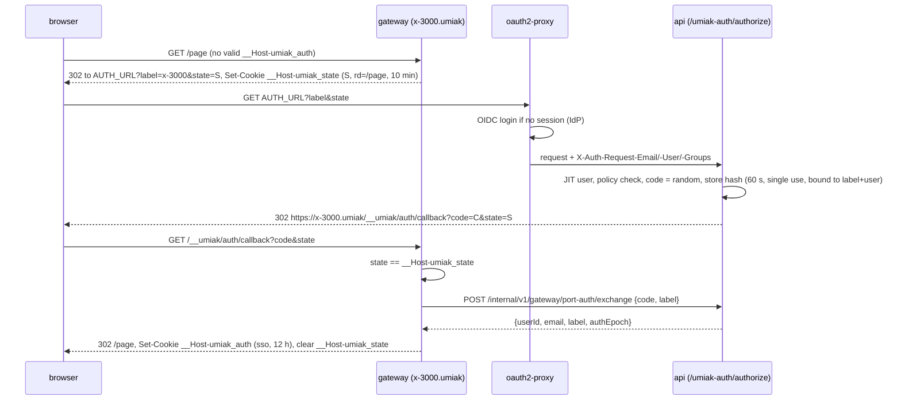

# S4. Gateway: public port URLs, SSH, edge

Status: draft for agreement, 2026-10-29. Supplemented by Ilia's decision of 2026-10-29 (Keycloak, offboarding option A): login by short-lived SSH certificates and session termination on deactivation (§9.2, §9.3, §9.5). Area S4 from `docs/roadmap.md`. Architecture: `docs/architecture.md` (§7, §10, §11). Basis: `docs/specs/s2-tunnel-protocol.md` (below "S2").

S2 has already defined in the gateway the tunnel intake, the `machine → gateway` registry, drain, and the internal listener for `api`/`worker`. This document adds everything that faces outward:
- an HTTP proxy of sandbox ports at `https://<slug>-<port>.umiak.<domain>`;
- the access modes `public`, `token`, `sso`;
- routing of a request that landed on the wrong pod;
- TLS-edge;
- SSH gateway;
- limits, observability, and a placeholder for TURN.

The tunnel protocol, registry, and drain of S2 do not change here, except for one override (§10.4).

The mark **[implementer]** means a decision of the spec author within the brief. It can be changed without new agreement if the reason for the change is recorded. The rest was agreed with the master session on 2026-10-29.

## 1. Why, and what counts as success

A sandbox has no public IP, all inbound traffic goes through the agent's outbound tunnel. The gateway is the single entry point for people and programs that want to reach what runs inside the VM.

Scenarios by priority:

1. **A dev server preview.** An AI agent runs `npm run dev` (Vite, Next.js) in the sandbox, publishes the port via the API, and gives a person the link `https://quiet-otter-lamp-5173.umiak.example.com?_token=…`. The person opens it in a browser: the page, HMR over WebSocket, and file loading work. The flags `--host 0.0.0.0` or `allowedHosts` in the Vite config are not needed.
2. **An internal tool for colleagues.** A port in `sso` mode. Any employee signed in through the corporate IdP opens the URL without a token, the application receives their e-mail in a header.
3. **A public link** (`public`): a webhook receiver, a demo for an outside person.
4. **SSH.** `ssh quiet-otter-lamp@ssh.example.com` with a key the user registered in the platform. scp, sftp, `-L`/`-R`, agent forwarding, and VS Code Remote-SSH work. After a fork or a resume onto a new machine `known_hosts` does not break.
5. **A gateway deploy** requires no manual actions. In-flight HTTP requests complete, WebSocket and SSH close predictably and with a warning, clients reconnect.

## 2. Goals, non-goals, anti-goals

**Goals:**
- one proxy code for any pod, regardless of where the machine's tunnel is;
- transparent HTTP/1.1, HTTP/2, WebSocket, SSE, large uploads without buffering;
- no platform account (cookie, token, IdP session) reaches code in the sandbox;
- TLS and L4 entry without dependence on a specific ingress controller;
- SSH with all OpenSSH capabilities;
- metrics and logs that show where a request broke: route, agent, application.

**Non-goals:**
- the tunnel protocol, registry, tunnel drain (S2);
- the guest agent (S3), but S4 states requirements for it (§16);
- the public REST API and HostedPort storage (S7);
- the dashboard and JIT users (S8);
- Kubernetes manifests (S12), only requirements here;
- TURN and the desktop (S10), only a placeholder here (§13);
- waking a stopped sandbox on an HTTP request (later, a product feature);
- users' own domains (CNAME), raw TCP/UDP ports outward, HTTPS to the application inside the VM (later).

**Anti-goals** (a failure even if it formally works):
- an IdP session cookie, an API key, or a port token reached a request to the application in the sandbox;
- code in one sandbox can read or forge the authorization of another sandbox or the dashboard;
- a request to sandbox A was delivered to sandbox B (for example, because of a stale cache after rename or fork);
- the gateway buffers the whole body, and a 5 GB upload eats the pod's memory;
- a gateway deploy silently breaks SSH sessions without warning;
- a gateway error cannot be distinguished from an application error.

## 3. Overview

```
                 DNS: *.umiak.<domain>, ssh.<domain>, tunnel.<domain>  ->  LB IP
                                         |
 browser / curl / ssh / guest-agent      v
 ---------------------------->  L4 LoadBalancer Service "gateway-edge"
                                 :443/tcp, :22/tcp, PROXY protocol v2
                                         |
            +----------------------------+----------------------------+
            v                                                         v
 +-----------------------------+                         +-----------------------------+
 | gateway pod P (front)       |   h2c, internal         | gateway pod O (owner)       |
 |  :8443 TLS, SNI:            |   listener (S2 §8.4)    |  tunnel to machine M        |
 |   *.umiak  -> HTTP proxy      |  CONNECT .../tcp/{port} |  MachineConn.DialTCP(port)  |
 |   tunnel -> S2 acceptor     |------------------------>|                             |
 |  :2222 SSH gateway          |                         +--------------+--------------+
 |  route cache <- api, NOTIFY |                                        | WSS tunnel
 |  registry   <- Postgres     |                                        v
 +-----------------------------+                              VM: guest-agent -> 127.0.0.1:port
                                                                            -> sshd 127.0.0.1:22
 web / api / oauth2-proxy live behind the regular ingress on <domain>, not on this LB.
```

Principles:

1. **The accepting pod does everything application-level.** HTTP parsing, authorization, limits, logs, and metrics are done by the pod that accepted the connection. From the tunnel owner it needs only a byte stream to `127.0.0.1:port` in the VM. It gets the stream locally (`MachineConn.DialTCP`) or from the owner pod via `CONNECT` on the internal listener (S2 §8.4). A redirect to the "right" pod is impossible: the hostname is one, and the L4 balancer would again pick a random pod.
2. **The gateway stores no route data.** The source of truth is `api`; the gateway caches responses and drops the cache on `NOTIFY`.
3. **Everything that belongs to the platform is stripped by the gateway** at the boundary with the application in both directions.

## 4. Names and DNS

### 4.1 Domains

| Name | Purpose | Where in DNS |
|---|---|---|
| `*.umiak.<domain>` | public port URLs | the `gateway-edge` IP |
| `tunnel.<domain>` | agent tunnels (S2) | the `gateway-edge` IP |
| `ssh.<domain>` | SSH gateway | IP `gateway-edge` |
| `<domain>`, `app.<domain>`, `api.<domain>` | web, API, oauth2-proxy | the regular ingress, not the gateway |

The suffix of public URLs is set by config (`UMIAK_GATEWAY_PREVIEW_DOMAIN`). By default it is `umiak.<domain>`. A separate registrable domain is also supported (for example `example-umiak.net`): in code this is only a config value and the cookie mode (§8.2). The risks of the choice are in §14.1.

### 4.2 Label grammar

Host = `<label>.<umiak-domain>`, where the label is **exactly one** DNS label (covered by a single wildcard certificate):

```
label = slug "-" port
slug  = [a-z0-9]+ ( "-" [a-z0-9]+ )*      ; 3..40 chars, no "--", no leading/trailing "-"
port  = [1-9][0-9]{0,4}                    ; 1..65535, no leading zeros
```

- The port is the last segment after `-`, the slug is everything before it. A slug cannot end with `-<digits>`: otherwise parsing is ambiguous. This is a slug validation rule in S7.
- Slug suffixes are reserved for service hosts. `<slug>-desktop` is the desktop (S10). The list of reserved suffixes is a constant in the gateway and in the S7 validation.
- The host is lowercased, `:443` is dropped. A host outside the grammar, the apex `umiak.<domain>`, and nested labels give `404 route_not_found`.
- The slug is a property of the sandbox, not of the machine: it survives stop/resume and a machine change. A fork gets a new sandbox and a new slug. Slug generation (by default three random words, like boat) and rename are S7.
- Port `22` and the ports from the platform-reserved list (S3/S10, a constant in the config) cannot be published: S7 rejects them, the gateway answers `404` just in case.

## 5. Edge: TLS and incoming connections

### 5.1 Main mode: the gateway terminates TLS behind an L4 LoadBalancer

- Service `gateway-edge` of type `LoadBalancer` (in a homelab — MetalLB, kube-vip, or similar; chosen by S12): `443/tcp → 8443`, `22/tcp → 2222`.
- **Client IP** — two equal modes (`UMIAK_GATEWAY_PROXY_PROTOCOL=off|v2`). S12 chooses by the LB's capabilities.
  - `v2` — **PROXY protocol v2** on both ports. For cloud and external L4 balancers that can send it. The gateway accepts the PROXY header only from addresses in `UMIAK_GATEWAY_PROXY_PROTOCOL_CIDRS`. From other addresses a connection with a header is rejected, without a header is accepted.
  - `off` + `externalTrafficPolicy: Local` — the IP is taken from the TCP connection. For a homelab: MetalLB and kube-vip only announce the IP, traffic goes through kube-proxy, which does not add a PROXY header. **This mode is used in the PoC and on the stand.**
  - Both modes are covered by tests (§15.6).
- The listener `:8443` picks a certificate by SNI:

| SNI | Certificate | Next |
|---|---|---|
| `tunnel.<domain>` | from the private tunnel CA (S2 §5.4) | the S2 tunnel receiver |
| `*.umiak.<domain>` | public wildcard | HTTP proxy (§7) |
| empty or foreign | the connection is closed (TLS alert `unrecognized_name`) | — |

- ALPN: `h2`, `http/1.1` for `*.umiak`. For `tunnel` — `http/1.1`: WebSocket upgrade (S2 §4.1).
- TLS 1.2 and 1.3, the default Go cipher set. Handshake timeout 10 s.
- **Certificates.** The wildcard `*.umiak.<domain>` is issued by cert-manager via ACME DNS-01 (Let's Encrypt; HTTP-01 is impossible for a wildcard) or via a corporate CA if S12 decides so. The `tunnel.<domain>` certificate is from the tunnel CA (a cert-manager `CA` Issuer or manual issuance, S12). Both live in a `kubernetes.io/tls` Secret and are mounted as files. The gateway re-reads them without a restart: an mtime check every 30 s and `fsnotify` **[implementer]**. The expiry metric is in §12.
- For the PoC without a public domain a cert-manager `SelfSigned`/`CA` Issuer for `*.umiak` is acceptable. Browsers then require trust in the CA. This is configuration, the code does not change.

### 5.2 Fallback mode: behind an ingress

The gateway can listen on plain HTTP (`UMIAK_GATEWAY_HTTP_LISTEN`, h2c and HTTP/1.1) for `*.umiak` and `tunnel`, and then TLS is terminated by the ingress. SSH in this mode still goes through a separate L4 Service on `:2222`: an HTTP ingress does not serve it.

Requirements for the ingress in this mode (any controller):
- the wildcard host `*.umiak.<domain>` with a wildcard certificate; `tunnel.<domain>` with a certificate from the tunnel CA (S2 §6);
- WebSocket upgrade; connections without a duration limit; idle timeout of at least 60 min for `*.umiak` (§7.7) and at least 60 s for `tunnel`;
- **no buffering** of requests and responses, no body size limit (otherwise large uploads and SSE break);
- passing `X-Forwarded-For`, `X-Forwarded-Proto`; the gateway trusts them only from addresses in `UMIAK_GATEWAY_TRUSTED_PROXY_CIDRS`;
- HTTP/2 to the backend is not required. Without it gRPC to applications (`appProtocol: h2c`, §7.5) does not work, the rest works;
- removing the pod from endpoints by readiness.

The main mode is §5.1. The fallback is supported by the code and covered by one integration test (§15).

### 5.3 The pod's other listeners

| Port | What | Who connects |
|---|---|---|
| 8443 | TLS edge (§5.1) | LB |
| 2222 | SSH (§9) | LB |
| 8080 | plain mode behind an ingress (§5.2), off by default | ingress |
| 7000 | the internal S2 listener (h2c, service token) | `api`, `worker`, other gateway pods |
| 9090 | `/metrics`, `/healthz`, `/readyz` | Prometheus, kubelet |

## 6. Route lookup

### 6.1 Contract with `api`

The gateway does not read the `api` schema. It calls an internal `api` endpoint over the cluster network with the gateway's service token (the same mechanism as `POST /internal/v1/agent-events` in S2 §5.5):

```
GET /internal/v1/gateway/routes/{label}
200 {
  "label": "quiet-otter-lamp-5173",
  "sandboxId": "umiak_...",
  "slug": "quiet-otter-lamp",
  "port": 5173,
  "machineId": "0192..." | null,      // null if the sandbox has no machine now
  "sandboxState": "running",          // S6 state, see 6.3
  "access": "public" | "token" | "sso",
  "tokenHash": "<hex sha256>" | null, // only for access=token
  "authEpoch": 7,                     // bumped on any access change, see 8.2
  "blocked": false,
  "blockReason": null | "operator" | "public_disabled" | "abuse",
  "hostRewrite": "preserve" | "localhost",
  "appProtocol": "http1" | "h2c",
  "teamId": "team_..."
}
404 {"code": "route_not_found"}   // unknown slug, port not hosted, reserved suffix
```

Here the gateway decides nothing about policy: whether a route is blocked, whether `public` is allowed in the organization, who the owner is — `api` computes all of this. The global switch of the `public` mode lives in `api`: with `public` turned off such routes come as `blocked: true, blockReason: "public_disabled"`.

### 6.2 Cache

- An in-memory cache of the pod, keyed by label. Positive TTL 30 s, negative (`404`) 5 s **[implementer]**.
- Simultaneous misses on one label are merged into one request (singleflight). The timeout of a request to `api` is 3 s.
- **Invalidation.** After any change that affects the response, `NOTIFY umiak_routes, '<slug>'` goes to Postgres. Triggers: hosted port, mode, token, block, sandbox state, `machineId`, rename. This data is written by both `api` and `worker` (state, machine), so the notification is sent by a **DB trigger** on the corresponding tables, not by application code: this way no writer forgets it. The triggers are part of the S6/S7 schema, the contract is set by S4. On rename two notifications go out, with the old and new slug. The gateway holds `LISTEN umiak_routes` (the same pgx connection as for `tunnel_sessions` in S2) and drops all entries with the slug from the payload. The payload `*` clears the whole cache: this is how the global `public` switch takes effect.
- If the `LISTEN` connection dropped, the gateway clears the whole cache on reconnect: notifications during the drop are lost.
- **`api` unavailable.** Entries whose TTL has expired keep being served for up to 10 min (stale-if-error), so that an `api` failure does not take down all previews. A miss without an old entry gives `503 route_lookup_unavailable`. Exception: a stale entry with `blocked: true` stays blocked.

### 6.3 Sandbox state

| `sandboxState` (S6) | Gateway action |
|---|---|
| `ready`, `running` | proxy |
| `creating`, `resuming` | `503 sandbox_starting`, `Retry-After: 5` |
| `stopping`, `stopped` | `503 sandbox_stopped` |
| `deleting`, `deleted` | `404 route_not_found` |
| `error` and any unknown | `503 sandbox_unavailable` |

If in `ready`/`running` the field `machineId` is `null`, this is an inconsistency; the answer is `503 sandbox_unavailable`. There is no wake-up on request.

### 6.4 Tunnel owner

1. The gateway looks for the machine among its local tunnels. If found with the current epoch — a local dial.
2. Otherwise it looks at the S2 registry: `tunnel_sessions` join `gateway_instances`, `state = connected`, the heartbeat is fresh. This is the same logic and the same cache with `LISTEN tunnel_sessions` that S2 §8.4 describes for `agent-client`, but in Go. The implementation lives in `libs/tunnel` next to the registry.
3. The machine is not connected: the gateway waits for `NOTIFY` up to **10 s** (covers the usual agent reconnect, S2 §6), then answers `503 agent_unavailable` with `Retry-After: 5`.

## 7. HTTP proxy

### 7.1 Request pipeline

1. Accept TLS (or plain from §5.2), determine the client IP (§5.1).
2. Per-IP limits (§11).
3. Parse the host (§4.2). The path `/__umiak/*` is handled by the gateway itself and never proxied (§8.4).
4. Route (§6), block, state.
5. Authorization by mode (§8).
6. Per-route and per-machine limits (§11).
7. Prepare the headers (§7.4).
8. Get the stream to the application (§7.2) and proxy the request.
9. Prepare the response headers (§7.4), write the access log and metrics (§12).

The implementation is `net/http/httputil.ReverseProxy` with a `Rewrite` hook and its own `Transport` **[implementer]**.

### 7.2 Stream to the application

`Transport.DialContext` receives an address of the form `m-<machineId>-<port>.umiak.internal:80` and turns it into a stream:
- **locally:** `MachineConn.DialTCP(ctx, port)` (S2 §4.5);
- **via the owner:** `CONNECT` to the `internal_url` of the owner pod, h2c, the gateway's service token (S2 §5.5, §8.4). One HTTP/2 connection to each neighboring pod, streams are multiplexed. The client function for this is in `libs/tunnel`.
- If the owner answered `421 machine_moved`, the gateway looks for the owner again and repeats the dial once. This is safe: the request bytes have not been sent yet.

**The wire form of the peer CONNECT (a clarification of S2 §8.4).** A plain HTTP/2 CONNECT carries no `:path` (RFC 9113 §8.5): the Go client does not send it, the Go server rejects it. A path is possible only in extended CONNECT, which Go enables only with the global `GODEBUG=http2xconnect=1`, forbidden by §7.3. Therefore the target is encoded in `:authority`, as in the CONNECT to the agent (S2 §4.2):
- request: `CONNECT <machineId>:<port>`, where `machineId` is a UUID, a valid reg-name;
- headers: `Authorization: Bearer <service-token>`;
- the handler is chosen by the `CONNECT` method before path routing.

The form `/v1/machines/{id}/tcp/{port}` in the S2 text means this request. The correction was made in S2 §8.4.

**Stream budget.**
- On the internal listener `MaxConcurrentStreams` is raised to 10 000 per connection (the Go default is 250). Otherwise long WebSocket and SSH between two pods would hit the limit.
- The agent holds up to 1000 streams per tunnel (S2 §4.3), shared by RPC, attach, files, and TCP. Therefore the limit of TCP streams to applications (including SSH) — **800 per machine** — is counted by the **owner pod**: only it sees all the tunnel's streams, local and from neighbors. Beyond the limit the owner answers the CONNECT with `503`, and the front returns `503 overloaded`. 200 streams stay for RPC and files.

A synthetic host in the URL is needed so that the standard `http.Transport` connection pool keeps keep-alive separately for each pair `(machine, epoch, port)`: `m-<machineId>-e<epoch>-<port>.umiak.internal`. The epoch is in the key because `http.Transport` cannot close idle connections of one host. After a machine moves, new requests go into a new pool and the old connections die by idle timeout. The pool: up to 8 idle connections per key, idle 30 s **[implementer]**. Each idle connection holds a tunnel stream, so the pool is small.

**Where the agent dials inside the VM** (a requirement for S3; agreed by the master session): the order `127.0.0.1:port`, then `[::1]:port`, then the VM interface addresses. This way applications on `localhost` and on `0.0.0.0` work the same, and the `--localhost` flag, as in boat, is not needed.

**Dial errors** (a requirement for S2/S3, within the `CONNECT` response):

| Agent or owner response | Gateway response |
|---|---|
| nothing listens on the port (`ECONNREFUSED` on all addresses) | `502 app_not_listening` |
| dial timeout inside the VM | `504 app_timeout` |
| the tunnel dropped during the dial | `503 agent_unavailable` |
| `403`/`400` from the agent (S2 §4.2) | `502 upstream_error`, logged as a platform error |

It is enough for the agent to answer `CONNECT` with the status `502` and the header `Umiak-Dial-Error: refused|timeout` **[implementer]**. The exact form is fixed by the S2/S3 implementation; the gateway maps it to the table above.

### 7.3 Protocols

- **Client → gateway:** HTTP/1.1 and HTTP/2 (ALPN).
- **WebSocket:** only HTTP/1.1 `Upgrade`, `ReverseProxy` supports it. **We do not advertise WebSocket over HTTP/2 (RFC 8441):** `ReverseProxy` does not translate extended CONNECT into an HTTP/1.1 upgrade. Verified by an experiment on 2026-10-29: Go 1.27.3 by default does not send `SETTINGS_ENABLE_CONNECT_PROTOCOL`, only `GODEBUG=http2xconnect=1` enables it. Do not enable this setting; the acceptance test checks SETTINGS (§15). The browser then opens the WebSocket as a separate HTTP/1.1 connection.
- **Gateway → application:** HTTP/1.1 by default (`appProtocol: http1`). For gRPC and h2c-only servers — `appProtocol: h2c`: HTTP/2 prior knowledge with full duplex and trailers. The client must arrive over HTTP/2. HTTPS to the application inside the VM is not supported in S4.
- **SSE and streaming:** `FlushInterval: -1`, responses are flushed immediately.
- **Bodies without buffering.** The request and response are streamed. Backpressure is end to end, through the tunnel's HTTP/2 flow control (S2 §4.3). There is no body size limit (`UMIAK_GATEWAY_MAX_BODY_BYTES`, 0 = no limit).

### 7.4 Headers

**Into the request to the application:**

| Header | Value |
|---|---|
| `Host` | the original `<label>.<umiak-domain>`; with `hostRewrite: localhost` — `localhost:<port>` |
| `X-Forwarded-For` | the client IP. An incoming XFF from the client is **replaced**: the gateway is the edge. In the §5.2 mode the chain from trusted proxies is kept, the client is the rightmost untrusted address |
| `X-Forwarded-Proto` | `https` |
| `X-Forwarded-Host` | the original host |
| `X-Forwarded-Port` | `443` |
| `Forwarded` | `for=…;proto=https;host=…` (RFC 7239) |
| `X-Request-Id` | from the client if it is 1–128 printable characters, otherwise a new ULID; the same id in the access log and on error pages |
| `X-Umiak-User-Email` | only in `sso` mode, the e-mail of the signed-in user (§8.4) |

**Stripped from the request:**
- the gateway cookies `__Host-umiak_auth` and `__Host-umiak_state` (removed from `Cookie`, other cookies stay);
- cookies from `UMIAK_GATEWAY_STRIP_COOKIE_PREFIXES` (by default `_oauth2_proxy`, `__Host-oauth2_proxy`, `__Secure-oauth2_proxy`). This is the second line of defense: with correct configuration (§14.1) these cookies do not arrive on `*.umiak` at all;
- the `_token` query parameter;
- the header `Umiak-Port-Token`;
- all incoming `Umiak-*` and `X-Umiak-*` (the gateway sets its own anew);
- identity headers a client could forge: `X-Auth-Request-*`, `X-Forwarded-Email`, `X-Forwarded-User`, `X-Forwarded-Groups`, `X-Forwarded-Preferred-Username`, `X-Forwarded-Access-Token`;
- hop-by-hop (done by `ReverseProxy`).

`Authorization` and the application's other headers are not touched: they belong to the application.

**In the response:**
- `Set-Cookie` with the gateway cookie names is stripped: an application on the same host could set them;
- `Umiak-*` is stripped so that the application cannot forge a gateway error, and `Alt-Svc` (the application does not know through what it was published);
- `X-Robots-Tag: noindex, nofollow` is set on all responses, including application responses and gateway pages.

### 7.5 Vite, "host not allowed", and other dev servers

The Host is kept by default: the application's absolute URLs, redirects, and OAuth callbacks depend on it.

- **Vite** since version 6.1.0 reads `__VITE_ADDITIONAL_SERVER_ALLOWED_HOSTS` and adds the value to `server.allowedHosts` if it is an array (that is the default). In 6.1–7.x the value is a single host, since 8.x — a comma-separated list. A leading dot means subdomains. `vite preview` inherits `server.allowedHosts` if `preview.allowedHosts` is not set. Verified against the npm packages 6.0.8, 6.1.0, 7.1.0, and 8.3.5, 2026-10-29.
- S3/S5 put **one value** `__VITE_ADDITIONAL_SERVER_ALLOWED_HOSTS=.<umiak-domain>` into the sandbox environment (agreed by the master session). It works in all versions since 6.1.
- For other cases (Vite below 6.1, webpack-dev-server `allowedHosts`, Angular, a server with strict Host checking) the port has the option `hostRewrite: localhost`. The gateway then sends `Host: localhost:<port>`, the original host stays in `X-Forwarded-Host`.
- The user documentation (S7) lists these options, like boat in `hosting/how-it-works`.

### 7.6 Gateway responses

Every response generated by the gateway itself carries `Umiak-Error: <code>`. This is how the client and the application tell a gateway error from an application response. If `Accept` contains `text/html`, the response is a minimal HTML page without external resources; otherwise JSON `{"error": {"code", "message", "retryable", "requestId"}}`. There are no internal details (machineId, pod name, addresses) in the response.

| HTTP | `Umiak-Error` | When |
|---|---|---|
| 404 | `route_not_found` | host outside the grammar, port not published, sandbox deleted |
| 403 | `route_blocked` | `blocked: true`; the page shows the reason: "blocked by an operator" or "public links are disabled" |
| 401 | `auth_required` | `token`/`sso` without a valid session (for `sso` a redirect for the browser, §8.4) |
| 401 | `token_invalid` | a wrong `_token` or `Umiak-Port-Token` |
| 429 | `rate_limited` | §11, with `Retry-After` |
| 502 | `app_not_listening` | nobody listens on the port in the VM |
| 502 | `upstream_error` | the application dropped the connection or returned invalid HTTP |
| 503 | `sandbox_starting`, `sandbox_stopped`, `sandbox_unavailable` | §6.3 |
| 503 | `agent_unavailable` | §6.4, with `Retry-After: 5` |
| 503 | `route_lookup_unavailable` | §6.2 |
| 503 | `overloaded` | per-machine stream limit (§11) |
| 504 | `app_timeout` | §7.7 |

The pages `sandbox_starting` and `agent_unavailable` refresh themselves every 5 s (`<meta http-equiv="refresh">`). All gateway responses carry `Cache-Control: no-store`.

### 7.7 Timeouts

| What | Value | Response |
|---|---|---|
| TLS handshake | 10 s | close |
| Reading request headers (`ReadHeaderTimeout`) | 10 s; `MaxHeaderBytes` 64 KiB | close / `431` |
| Client keep-alive idle (HTTP/1.1 and HTTP/2) | 120 s | close |
| Route lookup in `api` | 3 s | stale or `503` |
| Waiting for the agent to connect | 10 s | `503 agent_unavailable` |
| Dial to the application (with CONNECT via the owner) | 10 s | `504 app_timeout` |
| Application response headers (`ResponseHeaderTimeout`) | 5 min (the first Next.js compile can be long) | `504 app_timeout` |
| Stream idle: not a byte in either direction for a request body, response, WebSocket, SSE | 60 min | close |
| Overall duration of a request or connection | unlimited | — |

Values are **[implementer]**, all configurable.

## 8. Access modes

### 8.1 `public`

No authorization. Allowed to everyone by default. An operator turns it off globally or for a particular sandbox or route in `api` (§6.1), effective immediately via `NOTIFY`. The default mode for a newly published port is `token`, like boat (S7 decision, S4 recommendation).

### 8.2 The gateway session cookie

One cookie for `token` and `sso`:

```
name:  __Host-umiak_auth
value: v1.<kid>.<base64url(payload)>.<base64url(HMAC-SHA256(key[kid], "v1.<kid>.<payload>"))>
payload (JSON): {
  "l": "quiet-otter-lamp-5173",   // label, must equal the request label
  "m": "t" | "s",                 // token | sso, must match route access
  "e": 7,                         // authEpoch, must equal route authEpoch
  "u": "usr_...", "em": "a@b.c",  // sso only
  "x": 1767225600                 // expiry, unix seconds
}
attributes: Secure; HttpOnly; Path=/; SameSite=Lax; Max-Age=<ttl>   (no Domain)
```

- The `__Host-` prefix forbids the `Domain` attribute. So a neighboring sandbox cannot plant or overwrite this cookie through a shared parent domain (§14.1).
- Checked on every request: signature, `l`, `m`, `e`, `x`. Any change of a port's access (mode change, token rotation, block, rename) raises `authEpoch` in `api`, and all cookies already issued for this port stop working at once.
- TTL: `token` — 7 days, `sso` — 12 h **[implementer for token; sso agreed]**.
- Keys: `UMIAK_GATEWAY_COOKIE_KEYS` from a Secret, a list `kid:base64(32 bytes)`. The first key signs, all verify. Rotation: add a new one first, delete the old one after 7 days.
- **Cookie mode for a separate registrable domain** (`UMIAK_GATEWAY_COOKIE_CROSS_SITE=true`): `SameSite=None; Partitioned`, so that the preview works in a dashboard iframe on another site. Works in browsers with CHIPS; Safari support is unreliable. In the main variant (`umiak.<domain>`) umiak and the dashboard are one site, the iframe works with `SameSite=Lax` everywhere.

### 8.3 `token`

The port token is generated by `api` at publication: `umiakp_` + 32 random bytes in base64url. Only the SHA-256 is stored in the route. High entropy, so a slow hash is not needed; the comparison is constant-time.

Order of checks:
1. **`_token` in the query.** A correct one:
   - a browser navigation (`GET`/`HEAD`, `Accept` contains `text/html`, no `Upgrade`) → `302` to the same URL without `_token` (other parameters in the original order), `Set-Cookie: __Host-umiak_auth`, `Referrer-Policy: no-referrer`;
   - everything else (curl without a cookie jar, `fetch`, WebSocket, non-GET) → the request is proxied without `_token`, the cookie is set in the response.
   
   A wrong one → `401 token_invalid`, counted toward the authorization error limit (§11).
2. **`Umiak-Port-Token: <token>`** — for API clients and scripts. A correct one → proxy, do not set a cookie. A wrong one → `401 token_invalid`.
3. **A valid cookie** → proxy.
4. Otherwise `401 auth_required`: the page "this link needs a token".

Rotation and revocation are in `api` (S7): a new token and `authEpoch+1`. Old links and cookies stop working at once, without the "open without a token" gap that boat has.

### 8.4 `sso`

Goal: let in any signed-in platform user without giving the sandbox's domain either the IdP cookie or the oauth2-proxy cookie. The scheme is a redirect to an endpoint behind oauth2-proxy and a one-time code, like subdomain apps in Coder.



- **Who triggers it.** A browser without a valid cookie (`GET`/`HEAD` and `Accept` contains `text/html`) gets a redirect. Other requests get `401 auth_required`. Programmatic access to `sso` ports (by API key) is later (§17).
- **`AUTH_URL`** (`UMIAK_GATEWAY_AUTH_URL`, for example `https://app.<domain>/umiak-auth/authorize`) is implemented by `api` behind oauth2-proxy (S7/S8), the contract is set by S4:
  - input: `label`, `state`;
  - checks: the label passes the grammar of §4.2, the route exists and `access = sso`, the user is a signed-in platform user (the `api` policy; currently — any);
  - output: `302` to `https://<label>.<umiak-domain>/__umiak/auth/callback?code=…&state=…`. The redirect host is built by `api` itself from the label, it does not accept an arbitrary URL (no open redirect);
  - code: 32 random bytes, the hash is stored in the DB, TTL 60 s, one-time, bound to `(label, userId)`.
- **Code exchange.** `POST /internal/v1/gateway/port-auth/exchange {code, label}` with the gateway's service token. `api` atomically consumes the code and answers `{userId, email, label, authEpoch}` or `400 {"code": "invalid_code"}`. One-timeness is ensured by the `api` DB, not by pod memory.
- **`__Host-umiak_state`** is a cookie signed with the same key, 10 min, containing `state` (16 random bytes) and `rd`. `rd` is only a path with a query: it starts with `/` but not with `//` and not with `/\`. The `state` check protects against login CSRF.
- **`/__umiak/`** is a reserved path prefix on every `*.umiak` host, the gateway does not proxy it. In S4: `/__umiak/auth/callback` and `/__umiak/auth/logout` (erases the cookie, `302` to `/`).
- **Into the application** goes `X-Umiak-User-Email: <email>` (agreed). This header is always stripped from the client request (§7.4), so it cannot be forged. For `public` and `token` it is absent.
- A deactivated user loses access no later than 12 h. Immediately — via `authEpoch+1` on the routes (an operation in `api`, S8).

### 8.5 Multiple ports and CORS

Access and the cookie apply to one label, i.e. one port: the cookie is host-only. A frontend on `slug-5173` doing a `fetch` to a backend on `slug-8000` in `token`/`sso` mode gets `401` until the user opens the backend URL.

- **A CORS preflight is let through without authorization** **[implementer]**. This is an `OPTIONS` with the headers `Origin` and `Access-Control-Request-Method`: the browser never sends a cookie in it, and without the pass-through it would always get `401`. The application answers. The risk is the application's open `OPTIONS` handler; it is considered acceptable, Cloudflare Access and similar do the same.
- Recommendation to users (S7 documentation): reach the backend through the dev server proxy (Vite `server.proxy`) from the same origin or make the API port `public`.
- Access to the whole sandbox at once (one authorization for all ports) is later (§17).

## 9. SSH gateway

### 9.1 Scheme

```
ssh client --(SSH, user key or short-lived cert from api)--> gateway :2222 (x/crypto/ssh server, one host key)
                                   | api: ssh/authorize(sandbox, public key | cert identity)
                                   | owner: DialTCP(22) local or CONNECT via owner pod
                                   v
                    VM sshd 127.0.0.1:22 <--(SSH, short-lived user cert from gateway SSH CA)
```

The gateway terminates SSH because that is the only way to read the sandbox name from the user name. Then it opens its own SSH connection to the **system OpenSSH in the VM** through the tunnel and forwards the channels.

A shell built into the agent was rejected: sftp, port forwarding, agent forwarding, and the login environment would have to be rewritten. OpenSSH exists on Linux and is enabled on Windows (S9).

### 9.2 Connecting

- `ssh <sandbox>@ssh.<domain>`, where `<sandbox>` is a slug or sandboxId. The syntax `<sandbox>+<osuser>` is reserved for the future. The OS user in the VM comes from `api` (`loginUser`, by default the template's user, S5/S9).
- **The gateway host key** — ed25519 and ecdsa-p256 from a Secret, shared by all pods. The public keys are given to clients by `api` (S7: the CLI writes a `known_hosts` entry for `ssh.<domain>` and avoids TOFU). A fork and a resume do not change the host key the client sees.
- **Authentication** is `publickey` only. Password and keyboard-interactive are off. `MaxAuthTries` 6, handshake and authentication 20 s.
- **Two kinds of `publickey`** [Ilia's decision 2026-10-29]:
  - **a short-lived certificate** — the main path of the CLI and the only one for team keys. It is issued by `api` (S7 §11.3) from a person's Keycloak JWT or a team key, signed by the **SSH login CA** (separate from the SSH user CA of §9.3). The gateway verifies it itself via `ssh.CertChecker`: `CertType = UserCert`, the signer is one of the keys `UMIAK_GATEWAY_SSH_LOGIN_CA_KEYS` (public, current and next), exactly one principal (the sandbox ID `sb_…`; the user name in SSH is the slug, so `CheckCert(cert.ValidPrincipals[0], cert)` is called, not `Authenticate` by name), the signature, `ValidAfter`/`ValidBefore` (60 s tolerance), `KeyId` of the form `umiak:user:<id>` or `umiak:key:<id>`. Only then `ssh/authorize` with the certificate fields; `api` checks that the principal equals the sandbox ID, and the identity (§9.2 below);
  - **a user's registered key** (dashboard, `umiak ssh-keys`) — for people with a regular `ssh` without the CLI.
- **Verification.** `PublicKeyCallback` calls `api`:

```
POST /internal/v1/gateway/ssh/authorize
{ "sandbox": "quiet-otter-lamp", "publicKey": "ssh-ed25519 AAAA...", "fingerprint": "SHA256:..." }
{ "sandbox": "quiet-otter-lamp", "certificate": { "keyId": "umiak:key:key_...", "serial": "...", "principal": "sb_...", "validBefore": "..." } }
200 { "allowed": true, "actor": { "kind": "user", "userId", "email" } | { "kind": "team_key", "apiKeyId" }, "userId", "email", "sandboxId", "machineId", "sandboxState", "loginUser" }
200 { "allowed": false }
```

Who may log into a sandbox is decided by `api` (S7 §12.1): a person — an active member of the sandbox's team; a team key — not revoked, not expired, from the sandbox's team, with the scope `ssh:connect`. The check runs on every connection, so deactivation and revocation take effect at once, not when the certificate expires (10 min). Users register keys in the dashboard or through the CLI (S7/S8). The result is cached per connection. The identity is taken only from the `ssh.Permissions` returned by the callback for the key that passed the signature check, not from "the last key passed to the callback" (the lesson of CVE-2024-45337). An up-to-date `golang.org/x/crypto` is needed.

### 9.3 Connection to the VM

- After authentication the gateway finds the owner (§6.4, waiting for the agent up to 10 s) and dials port 22 (§7.2).
- Key: an ephemeral ed25519 per session and a user certificate from the gateway's **SSH user CA**:
  - `ValidPrincipals: [loginUser]`;
  - `ValidAfter` = now − 60 s, `ValidBefore` = now + 5 min (sshd checks the certificate only at login, the session lives longer);
  - `KeyId: umiak:user:<userId>:<sessionId>` or `umiak:key:<apiKeyId>:<sessionId>` (from the `actor` of the `ssh/authorize` response), so that the sshd journal in the VM shows who logged in — the same identity as in the incoming certificate or key;
  - extensions `permit-pty`, `permit-port-forwarding`, `permit-agent-forwarding`, `permit-X11-forwarding`, `permit-user-rc`.
- The CA private key lies in a Secret. The CA public key (current and next, for rotation) is baked into the template by S5 and updated by S3 at claim.
- The gateway does not verify the VM's sshd host key **[implementer]**. The stream goes through the tunnel authenticated as exactly this machine (S2 §5), and the VM's host key changes on fork. The fingerprint is written to the log.
- **Requirements for the VM** (S3/S5/S9; agreed by the master session for S3):
  - sshd listens only on `127.0.0.1:22` and `[::1]:22`;
  - `TrustedUserCAKeys` with the gateway CA keys;
  - `PasswordAuthentication no`;
  - `AuthorizedPrincipalsFile` is not needed: the principal equals the user name.
- **The sandbox is not running or the agent is unavailable.** The gateway accepts the first `session` channel, writes a clear message to stderr (`umiak: sandbox quiet-otter-lamp is stopped; run: umiak resume quiet-otter-lamp`), returns `exit-status 255`, and closes the connection. A plain authentication refusal would be shown by the client as an unclear `Permission denied`.

### 9.4 Forwarding

The gateway is a transparent intermediary at the level of SSH channels:
- the client's channels (`session`, `direct-tcpip`, `direct-streamlocal@openssh.com`) are opened on the backend with the same type and extra data. A backend refusal is passed to the client with the reason;
- data flows both ways in a channel, extended data (stderr), requests with `want-reply` and replies (`pty-req`, `shell`, `exec`, `subsystem`, `env`, `window-change`, `signal`, `exit-status`, `exit-signal`, `auth-agent-req@openssh.com`, `eow@openssh.com`, and any unknown ones), EOF and close;
- the backend's channels (`forwarded-tcpip`, `forwarded-streamlocal@openssh.com`, `auth-agent@openssh.com`, `x11`) are opened at the client.

Global requests (connection level) are forwarded by an explicit list, because the two SSH connections have different session ids:

| Direction | Request | What the gateway does |
|---|---|---|
| client → VM | `tcpip-forward`, `cancel-tcpip-forward`, `streamlocal-forward@openssh.com`, `cancel-streamlocal-forward@openssh.com`, `no-more-sessions@openssh.com` | proxies, passes the reply to the client |
| client → gateway | `keepalive@openssh.com` | answers itself |
| client → gateway | `hostkeys-prove-00@openssh.com` | answers with a refusal: the host key is shown to the client by the gateway |
| VM → gateway | `hostkeys-00@openssh.com` | **drops it**. Otherwise the client would get the VM sshd's keys and the `hostkeys-prove` check would break |
| VM → gateway | `keepalive@openssh.com` | answers itself |
| any | unknown request | refusal (`want-reply` → false) |

The implementation is on `golang.org/x/crypto/ssh` **[implementer]**. An alternative to compare before implementation is `tg123/sshpiper` (MIT, v1.6.1): it proxies at the packet level after authentication, but on its own fork of `crypto/ssh`. The implementer decides, the criterion is the tests of §15.4.

Keepalive: the gateway sends `keepalive@openssh.com` to the client and the backend every 30 s, the connection is dead after 3 misses. A session being idle does not close the connection by itself.

### 9.5 Terminating sessions on access revocation

Deactivating a user (by an operator or by Keycloak sync, S8 §20.1), removing a member from a team, and revoking a team key close already open SSH sessions at once [Ilia's decision 2026-10-29]:
- `NOTIFY umiak_ssh_revoke` is sent by the Payload hooks in `@umiak/payload` in the same transaction as the change (S8 §8), so it does not matter who made it — `web` (an operator, a server action), `api`, or `worker` (sync): `users` became inactive → `user:<userId>`; a membership deleted (`afterDelete`, the record still exists) → `member:<teamId>:<userId>`; a key got `revokedAt` → `key:<apiKeyId>`; a team deleted → `team:<teamId>` (the public ID format). This is the same trigger by which `api` closes streams and PTYs (S8 C9).
- Each gateway pod holds `LISTEN umiak_ssh_revoke` (the same pgx connection as `umiak_routes`) and an index of open sessions by `actor` and the sandbox's team. To matching sessions it writes a message (`umiak: access revoked`) to the stderr of the `session` channels and closes the connection.
- If `LISTEN` dropped, on reconnect the gateway re-checks all open sessions via `ssh/authorize` and closes the rejected ones.

## 10. Deploy and drain

### 10.1 Pod roles

Every pod at once is:
- **front** — holds the clients' public HTTP and SSH connections;
- **owner** — holds the agent tunnels (S2).

The drain of both roles starts at a single `preStop`/SIGTERM.

### 10.2 Front: HTTP

1. Readiness fails (S2 §7, step 1). The pod accepts new connections for another 5 s while the LB removes it from endpoints.
2. Then the listeners close. Idle keep-alive connections are closed (HTTP/1.1 — `Connection: close` on the next response, HTTP/2 — GOAWAY). In-flight requests run to the end.
3. Long streams (WebSocket, SSE, long responses and uploads) live up to **2 min** from the start of drain, then close. Browsers and Vite HMR reconnect on their own.

### 10.3 Front: SSH

The front and owner of an SSH session are usually different pods, and the session closes when either of them starts draining. The front must warn the user: only it speaks SSH with the client.

- **The session closing deadline** = min(its own drain deadline, the owner pod's drain deadline). A pod's deadline is `drain_started_at + UMIAK_GATEWAY_SSH_DRAIN_DEADLINE` (the same config on all pods).
- **How the front learns about the owner's drain.** On starting drain, a pod writes `gateway_instances.drain_started_at` together with `state = draining` and sends `NOTIFY gateway_instances, '<instanceId>'`. This is an additive extension of the S2 registry, done in `libs/tunnel`. The front listens on this channel and recomputes the deadline for its SSH sessions whose backend streams go through this pod. A machine move (`NOTIFY tunnel_sessions`) serves as a fallback signal: if a backend stream is alive but the machine is already with another owner, the old owner is draining.
- **Actions:**
  1. Its own drain: new connections are not accepted (the same as in HTTP).
  2. When the deadline becomes known, and once more 1 min before it, the gateway writes to the stderr of every interactive `session` channel with a PTY: `umiak: gateway restarting, this SSH session will close in N min; reconnect to continue`. If less than 1 min remains to the deadline, the second message is not written.
  3. At the deadline the front closes the connection itself. The owner closes the stream on its side at the same moment.

### 10.4 Owner: tunnels, the S2 override

- The gateway calls `Control/Drain` with `tcpDeadline` = **15 min** instead of the 2 min of S2 §7, so that SSH streams through the old tunnel survive until their deadline. The protocol does not change: S2 passes the deadline as an argument.
- The gateway itself closes streams through the old tunnel earlier by stream kind:
  - port 22 (SSH gateway only, it cannot be published, §4.2) — 15 min;
  - everything else — 2 min.
  
  This applies to local streams and to streams that arrived via `CONNECT` from a neighboring pod. The stream kind is determined by the port, no new headers are needed.
- RPC streams and `421` — unchanged (S2 §7).
- The old tunnel connection is closed as soon as no TCP streams are left through it. A pod exits when neither tunnels nor client connections remain (S2 §7, step 7). So 15 min is lived only by a pod through which SSH sessions really go; the others finish in 2 min or faster.

### 10.5 `terminationGracePeriodSeconds`

5 s (removal from endpoints) + 5 s (`spreadMs`) + 900 s (SSH) + 30 s margin ≈ 940 → **960**. This value replaces the 180 of S2 §7 (the correction was made in S2). The rollout is not slowed by this: new pods take traffic at once, old ones live out in the background. The price is the memory of the old pods for up to 16 min after a deploy.

Resumable TCP streams, with which SSH survives a deploy, are phase 2 (S2 §11, option (a)). We recommend tmux to users.

## 11. Limits and abuse protection

A token bucket in pod memory, without Redis **[implementer]**. The limit applies per pod, so the effective limit with N pods is roughly N times higher; this is enough for protection. IPv6 is counted by /64. Addresses from `UMIAK_GATEWAY_RATELIMIT_EXEMPT_CIDRS` (for example, an office NAT) are not limited by IP.

**Tunnels and the sandboxes themselves.**
- The per-IP limits apply only after the destination is chosen: to `*.umiak` by SNI and to SSH. `tunnel.<domain>` connections are **not subject** to them: all VMs of a node come from one SNAT address, and on drain hundreds of agents reconnect at once (S2 §7). Tunnel protection is set by S2 (authentication, `503` on overload).
- Sandboxes may open `*.umiak`, including their own previews: AI agents verify their work this way. The IPSet `umiak-gateway` lets TCP 443 through to `gateway-edge`. SSH (22) from a sandbox to the gateway is closed.
- The egress addresses of Proxmox nodes (SNAT) are by default part of `UMIAK_GATEWAY_RATELIMIT_EXEMPT_CIDRS` (an S12 setting). They are protected by the per-label limit.

| What | Key | Default | Response |
|---|---|---|---|
| HTTP requests | client IP | 300 rps, burst 2000 (a Vite page in dev mode is hundreds of modules) | `429 rate_limited` |
| HTTP requests | label | 1000 rps, burst 3000 | `429` |
| Authorization errors (`token_invalid`, a wrong callback) | IP | 20/min | `429` for 5 min |
| Concurrent connections | IP | 512 | close |
| Concurrent TCP streams to applications and SSH, counted by the owner pod (§7.2) | machine | 800 | `503 overloaded` |
| New SSH connections | IP | 10/min, burst 20 | close before the handshake |
| SSH authentication errors | IP | 10/min | close |
| Concurrent SSH sessions | user | 20 | channel refusal with a message |

Values are configurable.

Other:
- Slowloris: `ReadHeaderTimeout` and the handshake timeout (§7.7).
- Operator block: on a route, a sandbox, or the `public` mode as a whole — via `api` (§6.1), effective at once.
- `X-Robots-Tag: noindex, nofollow` everywhere (§7.4).
- Routes cannot be enumerated. An unknown label and an unpublished label give the same `404`.
- Abuse (phishing, serving malicious code from public URLs) is tracked by the access log (§12). An automatic scanner is not in S4.

## 12. Observability

### 12.1 Prometheus metrics (`:9090/metrics`)

Labels by sandbox and machine are not used: up to 10 000 machines would cause a cardinality explosion. Data on a specific sandbox comes from the access log.

| Metric | Labels |
|---|---|
| `umiak_gateway_http_requests_total` | `access`, `code_class`, `umiak_error`, `via` (`local`/`peer`) |
| `umiak_gateway_http_request_duration_seconds` (histogram, up to the response headers) | `access`, `via` |
| `umiak_gateway_http_bytes_total` | `direction` |
| `umiak_gateway_http_active_streams` (WebSocket, SSE, upgrade) | — |
| `umiak_gateway_upstream_dial_duration_seconds` | `via` |
| `umiak_gateway_upstream_dial_errors_total` | `reason` (`refused`, `timeout`, `agent_unavailable`, `moved`, `peer_error`) |
| `umiak_gateway_route_lookups_total` | `result` (`hit`, `miss`, `stale`, `error`) |
| `umiak_gateway_route_invalidations_total` | — |
| `umiak_gateway_auth_total` | `access`, `result` (`ok`, `missing`, `invalid`, `redirect`) |
| `umiak_gateway_ratelimited_total` | `limit` |
| `umiak_gateway_peer_streams_active` | — |
| `umiak_gateway_ssh_connections_active`, `umiak_gateway_ssh_sessions_total` | `result` |
| `umiak_gateway_ssh_auth_total` | `result` |
| `umiak_gateway_ssh_channels_total` | `type` |
| `umiak_gateway_tls_handshake_errors_total` | `sni_kind` |
| `umiak_gateway_cert_expiry_timestamp_seconds` | `cert` (`umiak`, `tunnel`) |
| `umiak_gateway_drain_open_streams` | `kind` (`http`, `ssh`) |

Plus the tunnel metrics from S2 §13.

### 12.2 Access log

JSON, one line per request on stdout:
- `time`, `requestId`, `clientIp`, `host`, `label`, `sandboxId`, `machineId`, `port`;
- `method`, `path` **without the query** (the query sometimes holds `_token` and application secrets);
- `status`, `umiakError`, `bytesIn`, `bytesOut`, `durationMs`, `ttfbMs`;
- `access`, `authResult`, `userId` (sso), `upgrade` (`websocket`);
- `via` (`local`/`peer`), `ownerInstance`, `userAgent`.

Long streams write a line on close.

SSH log: `sessionId`, `clientIp`, `actor` (`userId` or `apiKeyId`), the certificate `fingerprint` or serial, `sandboxId`, start, end, bytes, the types of opened channels, and the close reason. Session contents are not written.

### 12.3 Health

- `/healthz` — the process is alive.
- `/readyz` — certificates loaded and the pod is not in drain. Postgres and `api` are **not part** of readiness: on their failure all pods would become unready at once, the LB would be left with no endpoints, and previews, SSH, and tunnels would fail. This contradicts stale-if-error (§6.2). The state of Postgres `LISTEN` and `api` is visible in the metrics `umiak_gateway_dependency_up{dep}`.

Tracing (OTel) is phase 2 (architecture §12).

## 13. TURN: a placeholder for S10

- TURN is a separate coturn (a Deployment with a UDP LoadBalancer or hostNetwork), **not a gateway process**. A correction to architecture §2 and §10.
- TURN credentials are temporary, per the TURN REST API scheme (`use-auth-secret`). ~~The secret is shared with `api`, the credentials are issued by `api` together with the desktop URL.~~ **Overridden by S10 §9.3:** the secret is held only by `worker` and coturn, the credentials are delivered to the agent through `Desktop/Configure`. The gateway does not take part in the media path. The desktop as a whole is `docs/specs/s10-desktop.md` (the gateway — S10 §10).
- From S4 only this is needed:
  - the reserved suffix `<slug>-desktop` (§4.2) for moonlight-web signaling through the same HTTP proxy and the same access modes;
  - permission in the sandbox firewall (the S1 IPSet) for outbound UDP to the TURN addresses. Ports and form are defined by S10.

## 14. Security

### 14.1 Shared parent domain and cookie tossing

Applications in a sandbox are untrusted code, and all of them live under `*.umiak.<domain>`. If the umiak suffix is not in the Public Suffix List, the browser considers all `*.umiak.<domain>` and `<domain>` one site. Hence the risks:
- **Cookie tossing.** The page `evil-80.umiak.<domain>` sets a cookie with `Domain=umiak.<domain>` or `Domain=<domain>`, and the browser will send it to other sandboxes, the dashboard, and `api`. This can overwrite or shadow a platform cookie (session fixation, breaking oauth2-proxy's CSRF protection).
- **Leak of a platform cookie.** If the cookie of oauth2-proxy or the dashboard is set on `Domain=<domain>`, the browser sends it to every sandbox.
- **Same-site requests between sandboxes.** A page of one sandbox makes credentialed requests to another; `SameSite` does not protect, because the site is the same.

**Mandatory measures** (agreed; some are requirements for S8/S12):
1. All gateway cookies are `__Host-`, without `Domain` (§8.2).
2. **All platform cookies on the main domain** (oauth2-proxy, Payload, web) are host-only and with the prefix `__Host-` if the component allows it. oauth2-proxy: `--cookie-name=__Host-oauth2_proxy`, without `--cookie-domain`, `--cookie-secure`. The `__Host-` prefix also protects against planting: the browser will not accept a cookie with such a name if it has a `Domain`. A requirement for S8/S12.
3. The gateway strips the gateway cookies and cookies with oauth2-proxy prefixes from requests to applications, and its own `Set-Cookie` from application responses (§7.4).
4. IdP and oauth2-proxy sessions are never set on the umiak domain: the `sso` mode uses a one-time code (§8.4).
5. The state of access to a port is bound to `authEpoch` and the label, not only to the presence of a cookie.

**Residual risk, accepted:** CSRF between sandboxes of one parent site. An application in sandbox A can make a visitor's browser send requests with their cookie to sandbox B. CSRF protection inside an application is the application's concern, as in any hosting. The risk is removed entirely by a separate registrable domain (`UMIAK_GATEWAY_PREVIEW_DOMAIN`, §4.1) and, if the domain is public, adding it to the Public Suffix List. The price: buying a domain and unreliable cookies in an iframe in Safari (§8.2). Ilia has been informed and may choose a separate domain later; the code does not change because of this.

### 14.2 Other

- **Header trust boundary.** The gateway overwrites `X-Forwarded-*` and strips identity headers. `X-Umiak-User-Email` is set only by it (§7.4).
- **Open redirect.** There is none: `rd` is a path only (§8.4), and the callback host is built by `api` from the label.
- **Token leak.** `_token` disappears from the URL after the first request (`302`), the logs have no query, `Referrer-Policy: no-referrer` on the redirect.
- **SSH.**
  - The CA private keys and host keys are in a Secret.
  - The certificate for the VM lives 5 min and is issued only for the `loginUser` named by `api`.
  - The agent's CONNECT is limited to the VM's own addresses (S2 §4.2), so the gateway cannot become a proxy into the LAN.
- **Service tokens** — per S2 §5.5 and §16: static rotatable tokens in the cluster's private network.

## 15. Acceptance

Where tests run — as in S2 §14:
- the `libs/tunnel` in-memory transport in CI;
- kind/k3s with 2–3 gateway pods and agent processes;
- the `pve` stand with a real VM.

In the gateway tests `api` is replaced by a fake that implements the contracts of §6.1, §8.4, and §9.2.

### 15.1 HTTP

- Vite (the latest stable at implementation time; on 2026-10-29 this is 8.3.5) on `localhost:5173` without flags, with `__VITE_ADDITIONAL_SERVER_ALLOWED_HOSTS` in the environment: the page loads, HMR over WebSocket updates a module after a file edit. The same for `vite preview`.
- An application on `0.0.0.0` and an application on `[::1]` only — both answer.
- `hostRewrite: localhost` — the application sees `Host: localhost:<port>` and the original `X-Forwarded-Host`.
- SSE: an event reaches the client in under 100 ms after being written.
- A 5 GB upload via `PUT` and a 5 GB download: the gateway pod's RSS grows by no more than 64 MiB, the sha256 matches.
- gRPC unary and a bidi stream to a server with `appProtocol: h2c`.
- `curl --http2` to the gateway: there is no `ENABLE_CONNECT_PROTOCOL` in SETTINGS; Chrome opens a WebSocket to the application.
- Every row of the §7.6 table is reproduced, and the response has the right `Umiak-Error`.

### 15.2 Routing

- A request to pod P, the tunnel on pod O — the response is correct, `via=peer` in the log; the peer CONNECT goes over one HTTP/2 connection (§7.2).
- 1000 simultaneous WebSockets through one neighbor: all open (the stream limit of the internal listener is not 250). The 801st TCP stream to one machine gets `503 overloaded`, while exec through the API keeps working.
- A rolling update of the gateway during 100 parallel long HTTP requests (30 s each): no request shorter than 2 min was dropped; WebSockets closed no earlier than 2 min after the start of drain.
- Slug rename: the old URL gives `404`, the new one works no later than 1 s (via `NOTIFY`).
- `api` unavailable: cached routes work for 10 min, new labels give `503 route_lookup_unavailable`.

### 15.3 Access

- `token`:
  - a browser navigation with `?_token=` → `302` without the token, the cookie is set; `curl` without a cookie jar and a WebSocket with `?_token=` are proxied right away;
  - a wrong token → `401`;
  - rotation (`authEpoch+1`) → the old cookie gives `401` at once.
- `sso`:
  - the full cycle through a real oauth2-proxy and a test IdP (Dex or similar);
  - a forged `state` → refusal;
  - code reuse → refusal;
  - `rd=//evil.com` → ignored;
  - the application sees `X-Umiak-User-Email`, and the client's `X-Umiak-User-Email` is stripped.
- Stripping: an echo application sees none of the cookies and headers of §7.4. `Set-Cookie: __Host-umiak_auth` from the application does not reach the browser.
- `blocked` and a disabled `public` → `403 route_blocked` no later than 1 s after the change in `api`.
- A CORS preflight to a `token`/`sso` port reaches the application without authorization; a `fetch` with credentials without a cookie gets `401`.

### 15.4 SSH

Through the gateway on the stand with a real VM:
- `ssh`, `ssh -t … tmux`, `scp`, `sftp`, `rsync`, `ssh -L`, `ssh -R`, `ssh -A` (the agent is visible in the VM);
- VS Code Remote-SSH connects and installs its server;
- in the sshd journal in the VM — a `KeyId` with `umiak:user:<id>` or `umiak:key:<id>`;
- login by a certificate from `api` (a person and a team key); a certificate from a foreign CA, expired, with the principal of another sandbox → refusal; deactivating a user and revoking a key close an open session within seconds (§9.5);
- a wrong key → refusal; a stopped sandbox → a clear message on stderr;
- after a fork the `known_hosts` entry for `ssh.<domain>` is valid;
- `hostkeys-00@openssh.com` from the VM's sshd does not reach the client; there are no `hostkeys` errors in the `ssh -v` output;
- front drain: messages at once and 1 min before, closing after 15 min; the pod terminates within 960 s;
- drain of the owner only (the front is another and not draining): the front gets the deadline from `NOTIFY gateway_instances`, writes the same messages, and closes the session at the owner's deadline.

### 15.5 Limits

Each row of the §11 table triggers on a load script; an `exempt` address is not limited.

### 15.6 Edge modes

- `UMIAK_GATEWAY_PROXY_PROTOCOL=v2`: a test client sends PROXY v2 — the client IP in the log is right; a PROXY header from an address outside `PROXY_PROTOCOL_CIDRS` is rejected.
- `off` + `externalTrafficPolicy: Local` in kind (MetalLB) — the client IP is right.
- Behind-ingress mode: one run of §15.1 (without gRPC) through ingress-nginx or Traefik in kind.
- A pod with an unavailable Postgres stays ready, cached routes are served.

## 16. Code layout and interfaces to other areas

### 16.1 Code

The binary is `services/gateway` (the Go module `github.com/belov38/umiak/services/gateway`, in `go.work`). It embeds the S2 tunnel library `libs/tunnel`: the receiver, registry, drain, `MachineConn`, the `CONNECT` client to a neighboring pod, owner lookup with a `LISTEN` cache.

The package layout inside `services/gateway/internal/` **[implementer]**:

| Package | What |
|---|---|
| `edge` | listeners, SNI, PROXY protocol, certificate re-reading |
| `routes` | the `api` client, cache, `LISTEN umiak_routes` |
| `upstream` | dial: local or via the owner, pool |
| `httpproxy` | `ReverseProxy`, headers, timeouts, error pages |
| `portauth` | cookie, `token`, `sso`, `/__umiak/*` |
| `sshgw` | SSH server, CA, channel forwarding |
| `ratelimit` | limits |
| `obs` | metrics, logs |

If `libs/tunnel` in the S2 implementation does not yet provide owner lookup, the peer `CONNECT` client (§7.2), `drain_started_at` with `NOTIFY gateway_instances` (§10.3), or the per-machine TCP stream counter (§7.2), S4 adds them there, not in `services/gateway`: others need these parts too.

Implementation order **[implementer]**, by the architecture phases (§12):
- **PoC** — edge, routes, proxy, `public` and `token`, basic metrics and logs;
- **MVP** — `sso`, SSH, limits, front drain.

### 16.2 Config (env)

| Variable | Purpose |
|---|---|
| `UMIAK_GATEWAY_PREVIEW_DOMAIN`, `UMIAK_GATEWAY_TUNNEL_HOST`, `UMIAK_GATEWAY_SSH_HOST` | names (§4.1) |
| `UMIAK_GATEWAY_TLS_PREVIEW_CERT_FILE`/`_KEY_FILE`, `UMIAK_GATEWAY_TLS_TUNNEL_CERT_FILE`/`_KEY_FILE` | certificates |
| `UMIAK_GATEWAY_PROXY_PROTOCOL` (`off`/`v2`), `UMIAK_GATEWAY_PROXY_PROTOCOL_CIDRS`, `UMIAK_GATEWAY_TRUSTED_PROXY_CIDRS` | client IP |
| `UMIAK_GATEWAY_HTTP_LISTEN` | plain mode (§5.2), empty — off |
| `UMIAK_GATEWAY_API_URL`, `UMIAK_GATEWAY_API_TOKEN_FILE` | the internal `api` |
| `UMIAK_GATEWAY_AUTH_URL` | authorize endpoint (§8.4) |
| `UMIAK_GATEWAY_COOKIE_KEYS_FILE`, `UMIAK_GATEWAY_COOKIE_CROSS_SITE` | §8.2 |
| `UMIAK_GATEWAY_INGRESS_DESKTOP_KEY_FILE` | 32 raw bytes; HMAC key of the `Umiak-Ingress-Desktop` header (owner ingress, path-addressed desktop). Unset: header always 403 |
| `UMIAK_GATEWAY_STRIP_COOKIE_PREFIXES` | §7.4 |
| `UMIAK_GATEWAY_SSH_HOST_KEY_FILES`, `UMIAK_GATEWAY_SSH_USER_CA_KEY_FILE`, `UMIAK_GATEWAY_SSH_LOGIN_CA_KEYS` (the public keys of the SSH login CA) | §9 |
| `UMIAK_GATEWAY_RESERVED_PORTS`, `UMIAK_GATEWAY_RESERVED_SUFFIXES` | §4.2 |
| `UMIAK_GATEWAY_RATELIMIT_*`, `UMIAK_GATEWAY_RATELIMIT_EXEMPT_CIDRS` | §11 |
| `UMIAK_GATEWAY_HTTP_DRAIN_DEADLINE` (2m), `UMIAK_GATEWAY_SSH_DRAIN_DEADLINE` (15m) | §10 |
| timeouts of §7.7 | `UMIAK_GATEWAY_TIMEOUT_*` |

Plus the S2 config (Postgres, the internal listener, service tokens).

### 16.3 What S4 expects from other areas

- **S2 / `libs/tunnel`** (to be agreed with the `s2-impl` track):
  - `MachineConn.DialTCP`;
  - peer CONNECT in the form `CONNECT <machineId>:<port>` via `:authority` (§7.2) with a `421` response; `MaxConcurrentStreams` 10 000 on the internal listener;
  - owner lookup in Go;
  - `Control/Drain` with an arbitrary `tcpDeadline`;
  - distinguishable dial errors (§7.2);
  - a counter and limit of TCP streams per machine at the owner (§7.2);
  - `gateway_instances.drain_started_at` and `NOTIFY gateway_instances` (§10.3).
- **S3:**
  - the dial order `127.0.0.1` → `[::1]` → interface addresses;
  - a `CONNECT` response with the dial error reason;
  - `__VITE_ADDITIONAL_SERVER_ALLOWED_HOSTS` in the environment of processes and login shells;
  - sshd on loopback only;
  - `TrustedUserCAKeys` and updating the CA keys at claim.
  
  Agreed by the master session.
- **S5/S9:** OpenSSH in the template (Windows: OpenSSH Server enabled, the default shell PowerShell), the gateway CA keys, the template's `loginUser`.
- **S6:**
  - sandbox states (§6.3);
  - `machineId` sandbox;
  - DB triggers that send `NOTIFY umiak_routes` on changes (§6.2);
  - the "exec" right as the basis of SSH access.
- **S7:**
  - HostedPort: `port`, `access`, token (hash), `authEpoch`, `hostRewrite`, `appProtocol`, `blocked`;
  - slug and port validation (§4.2), rename;
  - a limit of 50 ports per sandbox;
  - the endpoints of §6.1, §8.4 (`authorize`, `exchange`), §9.2 (including login by certificate), issuing SSH certificates (S7 §11.3);
  - serving SSH host keys;
  - user documentation (§7.5).
- **S8:**
  - SSH key registration;
  - operator switches (block, `public`);
  - platform cookies per §14.1;
  - revoking a user's access via `authEpoch`;
  - deactivating users by Keycloak (S8 §20.1); `NOTIFY umiak_ssh_revoke` from the Payload hooks on deactivation, member removal, key revocation, and team deletion (§9.5).
- **S10:** the `-desktop` suffix, TURN (§13).
- **S12:**
  - the Service `gateway-edge` (L4, PROXY protocol v2, 443 and 22);
  - DNS (§4.1);
  - cert-manager (DNS-01 wildcard, tunnel CA);
  - Secrets: cookie keys, SSH host keys, SSH user CA, the public keys of the SSH login CA, service tokens;
  - `terminationGracePeriodSeconds: 960`;
  - IPSet `umiak-gateway` = the `gateway-edge` IP (TCP 443 only);
  - the egress addresses of Proxmox nodes in `UMIAK_GATEWAY_RATELIMIT_EXEMPT_CIDRS`;
  - client IP mode: `v2` or `off` + `externalTrafficPolicy: Local` (§5.1);
  - oauth2-proxy with `__Host-` cookies.

## 17. Later

- Waking a stopped sandbox by HTTP or SSH.
- Programmatic access to `sso` ports by API key (a header that the gateway verifies through `api`).
- One authorization for all ports of a sandbox (§8.5).
- HTTPS to the application inside the VM; raw TCP/UDP ports outward; custom domains.
- Resumable TCP streams so that SSH and WebSocket survive a deploy (S2 §11).
- Per-sandbox traffic counters in the dashboard (from the access log or gateway aggregates).
- Adding a separate umiak domain to the Public Suffix List.
- Cluster-wide limits (via Postgres or Redis) if per-pod limits turn out to be insufficient.

## 18. Libraries

Project rule: the latest stable versions, to be checked before adding. Checked 2026-10-29.

| Purpose | Library | Version |
|---|---|---|
| Go toolchain | `mise.toml` | go 1.27.3 |
| HTTP, reverse proxy, TLS | standard library | — |
| HTTP/2 (h2c to the application, if std is not enough) | `golang.org/x/net/http2` | v0.62.0 |
| SSH server and client | `golang.org/x/crypto/ssh` | v0.58.0 |
| PROXY protocol | `github.com/pires/go-proxyproto` | v0.16.0 |
| Postgres `LISTEN` | `github.com/jackc/pgx/v5` | v5.11.0 |
| Token bucket | `golang.org/x/time/rate` | v0.16.0 |
| Metrics | `github.com/prometheus/client_golang` | v1.25.0 |
| Re-reading certificates | `github.com/fsnotify/fsnotify` | v1.10.1 |
| Alternative for the SSH proxy | `github.com/tg123/sshpiper` | v1.6.1 |
| Certificates in the cluster (S12) | cert-manager | v1.21.3 |
| TURN (S10) | coturn | 4.18.0 |

## 19. Left to the implementer

- The package structure (§16.1) and how to split code between `services/gateway` and `libs/tunnel`.
- The form of the agent's response to a failed dial (§7.2), agreed with the S2/S3 implementation.
- Our own SSH channel forwarding or sshpiper (§9.4).
- Timeout and limit values (§7.7, §11) based on test results.
- The design of the HTML error pages (minimal, no external resources).
- The certificate re-reading mechanism.

## 20. Open questions

- A separate registrable domain for umiak instead of `umiak.<domain>`: Ilia's choice, can be made later (§14.1).
- Which L4 LoadBalancer is in the cluster and whether it supports PROXY protocol v2 (S12). On the PoC — `off` + `externalTrafficPolicy: Local`.
- Who exactly may log in via SSH and open `sso` ports: now SSH is by the exec right, `sso` — any signed-in user; refining the policy is for S6/S8.
