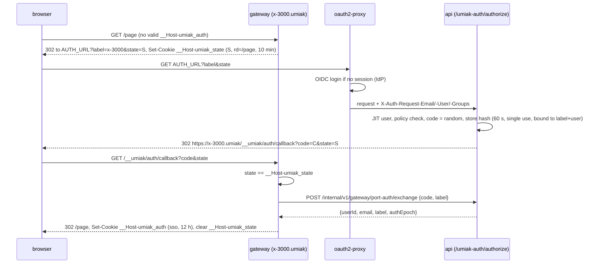

# S4. Gateway: публичные URL портов, SSH, edge

Статус: черновик на согласование, 2026-10-29. Дополнено решением Ильи 2026-10-29 (Keycloak, offboarding вариант A): вход по коротким SSH-сертификатам и разрыв сессий при деактивации (§9.2, §9.3, §9.5). Область S4 из `docs/roadmap.md`. Архитектура: `docs/architecture.md` (§7, §10, §11). Основа: `docs/specs/s2-tunnel-protocol.md` (дальше «S2»).

S2 уже задал в gateway приём туннелей, реестр `machine → gateway`, drain и внутренний listener для `api`/`worker`. Этот документ добавляет всё, что смотрит наружу:
- HTTP-прокси портов sandbox на `https://<slug>-<port>.umiak.<domain>`;
- режимы доступа `public`, `token`, `sso`;
- маршрутизацию запроса, попавшего не на тот под;
- TLS-edge;
- SSH gateway;
- лимиты, наблюдаемость и заглушку под TURN.

Протокол туннеля, реестр и drain S2 здесь не меняются, кроме одного переопределения (§10.4).

Пометка **[исполнитель]** означает решение автора спеки в рамках брифа. Его можно менять без нового согласования, если причина изменения записана. Остальное согласовано master-сессией 2026-10-29.

## 1. Зачем и что считается успехом

Sandbox не имеет публичного IP, весь входящий трафик идёт через исходящий туннель агента. Gateway — единственная входная точка для людей и программ, которые хотят достучаться до того, что работает внутри VM.

Сценарии по приоритету:

1. **Превью dev-сервера.** AI-агент запускает в sandbox `npm run dev` (Vite, Next.js), публикует порт через API и отдаёт человеку ссылку `https://quiet-otter-lamp-5173.umiak.example.com?_token=…`. Человек открывает её в браузере: страница, HMR через WebSocket и загрузка файлов работают. Флаги `--host 0.0.0.0` или `allowedHosts` в конфиге Vite не нужны.
2. **Внутренний инструмент для коллег.** Порт в режиме `sso`. Любой сотрудник, вошедший через корпоративный IdP, открывает URL без токена, приложение получает его e-mail в заголовке.
3. **Публичная ссылка** (`public`): webhook-приёмник, демо для внешнего человека.
4. **SSH.** `ssh quiet-otter-lamp@ssh.example.com` с ключом, который пользователь зарегистрировал в платформе. Работают scp, sftp, `-L`/`-R`, agent forwarding и VS Code Remote-SSH. После fork или resume на новую machine `known_hosts` не ломается.
5. **Деплой gateway** не требует ручных действий. HTTP-запросы в полёте завершаются, WebSocket и SSH закрываются предсказуемо и с предупреждением, клиенты переподключаются.

## 2. Цели, не-цели, анти-цели

**Цели:**
- один код прокси для любого пода, независимо от того, где туннель machine;
- прозрачные HTTP/1.1, HTTP/2, WebSocket, SSE, большие загрузки без буферизации;
- никакая учётная запись платформы (cookie, токен, сессия IdP) не доходит до кода в sandbox;
- TLS и L4-вход без зависимости от конкретного ingress-контроллера;
- SSH со всеми возможностями OpenSSH;
- метрики и логи, по которым видно, где запрос сломался: маршрут, агент, приложение.

**Не-цели:**
- протокол туннеля, реестр, drain туннелей (S2);
- гостевой агент (S3), но S4 формулирует к нему требования (§16);
- публичный REST API и хранение HostedPort (S7);
- дашборд и JIT-пользователи (S8);
- манифесты Kubernetes (S12), здесь только требования;
- TURN и рабочий стол (S10), здесь только заглушка (§13);
- пробуждение остановленного sandbox по HTTP-запросу (позже, продуктовая функция);
- свои домены пользователей (CNAME), сырые TCP/UDP-порты наружу, HTTPS к приложению внутри VM (позже).

**Анти-цели** (провал, даже если формально работает):
- cookie сессии IdP, API-ключ или токен порта попали в запрос к приложению в sandbox;
- код в одном sandbox может читать или подменять авторизацию другого sandbox или дашборда;
- запрос к sandbox A доставлен в sandbox B (например, из-за устаревшего кэша после rename или fork);
- gateway буферизует тело целиком, и загрузка 5 GB съедает память пода;
- деплой gateway молча рвёт SSH-сессии без предупреждения;
- ошибку gateway невозможно отличить от ошибки приложения.

## 3. Обзор

```
                 DNS: *.umiak.<domain>, ssh.<domain>, tunnel.<domain>  ->  LB IP
                                         |
 browser / curl / ssh / guest-agent      v
 ---------------------------->  L4 LoadBalancer Service "gateway-edge"
                                 :443/tcp, :22/tcp, PROXY protocol v2
                                         |
            +----------------------------+----------------------------+
            v                                                         v
 +-----------------------------+                         +-----------------------------+
 | gateway pod P (front)       |   h2c, internal         | gateway pod O (owner)       |
 |  :8443 TLS, SNI:            |   listener (S2 §8.4)    |  tunnel to machine M        |
 |   *.umiak  -> HTTP proxy      |  CONNECT .../tcp/{port} |  MachineConn.DialTCP(port)  |
 |   tunnel -> S2 acceptor     |------------------------>|                             |
 |  :2222 SSH gateway          |                         +--------------+--------------+
 |  route cache <- api, NOTIFY |                                        | WSS tunnel
 |  registry   <- Postgres     |                                        v
 +-----------------------------+                              VM: guest-agent -> 127.0.0.1:port
                                                                            -> sshd 127.0.0.1:22
 web / api / oauth2-proxy live behind the regular ingress on <domain>, not on this LB.
```

Принципы:

1. **Принявший под делает всё прикладное.** HTTP-разбор, авторизацию, лимиты, логи и метрики делает под, который принял соединение. От владельца туннеля ему нужен только байтовый поток до `127.0.0.1:port` в VM. Поток он получает локально (`MachineConn.DialTCP`) или от пода-владельца через `CONNECT` на внутреннем listener-е (S2 §8.4). Редирект на «правильный» под невозможен: hostname один, и L4-балансировщик снова выберет случайный под.
2. **Gateway не хранит данных о маршрутах.** Источник истины — `api`; gateway кэширует ответы и сбрасывает кэш по `NOTIFY`.
3. **Всё, что принадлежит платформе, gateway вырезает** на границе с приложением в обе стороны.

## 4. Имена и DNS

### 4.1 Домены

| Имя | Назначение | Куда в DNS |
|---|---|---|
| `*.umiak.<domain>` | публичные URL портов | IP `gateway-edge` |
| `tunnel.<domain>` | туннели агентов (S2) | IP `gateway-edge` |
| `ssh.<domain>` | SSH gateway | IP `gateway-edge` |
| `<domain>`, `app.<domain>`, `api.<domain>` | web, API, oauth2-proxy | обычный ingress, не gateway |

Суффикс публичных URL задаётся конфигом (`UMIAK_GATEWAY_PREVIEW_DOMAIN`). По умолчанию это `umiak.<domain>`. Поддерживается и отдельный регистрируемый домен (например, `example-umiak.net`): в коде это только значение конфига и режим cookie (§8.2). Риски выбора — §14.1.

### 4.2 Грамматика метки

Хост = `<label>.<umiak-domain>`, где label — **ровно одна** DNS-метка (её покрывает один wildcard-сертификат):

```
label = slug "-" port
slug  = [a-z0-9]+ ( "-" [a-z0-9]+ )*      ; 3..40 chars, no "--", no leading/trailing "-"
port  = [1-9][0-9]{0,4}                    ; 1..65535, no leading zeros
```

- Порт — последний сегмент после `-`, slug — всё до него. Slug не может заканчиваться на `-<цифры>`: иначе разбор неоднозначен. Это правило валидации slug в S7.
- Зарезервированы суффиксы slug для служебных хостов. `<slug>-desktop` — рабочий стол (S10). Список зарезервированных суффиксов — константа в gateway и в валидации S7.
- Host приводится к нижнему регистру, `:443` отбрасывается. Хост вне грамматики, apex `umiak.<domain>` и вложенные метки дают `404 route_not_found`.
- Slug — свойство sandbox, а не machine: он переживает stop/resume и смену machine. Fork получает новый sandbox и новый slug. Генерация slug (по умолчанию случайные три слова, как у boat) и rename — S7.
- Порт `22` и порты из списка зарезервированных платформой (S3/S10, константа в конфиге) публиковать нельзя: S7 их отклоняет, gateway на всякий случай отвечает `404`.

## 5. Edge: TLS и входящие соединения

### 5.1 Основной режим: gateway терминирует TLS за L4 LoadBalancer

- Service `gateway-edge` типа `LoadBalancer` (в homelab — MetalLB, kube-vip или аналог; выбирает S12): `443/tcp → 8443`, `22/tcp → 2222`.
- **IP клиента** — два равноправных режима (`UMIAK_GATEWAY_PROXY_PROTOCOL=off|v2`). Выбирает S12 по возможностям LB.
  - `v2` — **PROXY protocol v2** на обоих портах. Для облачных и внешних L4-балансировщиков, которые умеют его слать. Gateway принимает заголовок PROXY только от адресов из `UMIAK_GATEWAY_PROXY_PROTOCOL_CIDRS`. С других адресов соединение с заголовком отклоняется, без заголовка — принимается.
  - `off` + `externalTrafficPolicy: Local` — IP берётся из TCP-соединения. Для homelab: MetalLB и kube-vip только анонсируют IP, трафик идёт через kube-proxy, а он PROXY-заголовок не добавляет. **Этот режим используется в PoC и на стенде.**
  - Оба режима покрыты тестами (§15.6).
- Listener `:8443` выбирает сертификат по SNI:

| SNI | Сертификат | Дальше |
|---|---|---|
| `tunnel.<domain>` | от приватного tunnel CA (S2 §5.4) | приёмник туннелей S2 |
| `*.umiak.<domain>` | публичный wildcard | HTTP-прокси (§7) |
| пусто или чужое | соединение закрывается (TLS alert `unrecognized_name`) | — |

- ALPN: `h2`, `http/1.1` для `*.umiak`. Для `tunnel` — `http/1.1`: WebSocket upgrade (S2 §4.1).
- TLS 1.2 и 1.3, набор шифров Go по умолчанию. Handshake timeout 10 s.
- **Сертификаты.** Wildcard `*.umiak.<domain>` выпускает cert-manager через ACME DNS-01 (Let's Encrypt; HTTP-01 для wildcard невозможен) или через корпоративный CA, если это решит S12. Сертификат `tunnel.<domain>` — от tunnel CA (cert-manager `CA` Issuer или выпуск вручную, S12). Оба лежат в Secret `kubernetes.io/tls` и смонтированы файлами. Gateway перечитывает их без рестарта: проверка mtime раз в 30 s и `fsnotify` **[исполнитель]**. Метрика срока действия — §12.
- Для PoC без публичного домена допустим cert-manager `SelfSigned`/`CA` Issuer для `*.umiak`. Браузеры тогда требуют доверия к CA. Это настройка, код не меняется.

### 5.2 Запасной режим: за ingress

Gateway умеет слушать plain HTTP (`UMIAK_GATEWAY_HTTP_LISTEN`, h2c и HTTP/1.1) для `*.umiak` и `tunnel`, а TLS тогда терминирует ingress. SSH в этом режиме всё равно идёт через отдельный L4 Service на `:2222`: HTTP-ingress его не обслуживает.

Требования к ingress в этом режиме (контроллер любой):
- wildcard-хост `*.umiak.<domain>` с wildcard-сертификатом; `tunnel.<domain>` с сертификатом от tunnel CA (S2 §6);
- WebSocket upgrade; соединения без ограничения длительности; idle timeout не меньше 60 min для `*.umiak` (§7.7) и не меньше 60 s для `tunnel`;
- **без буферизации** запросов и ответов, без лимита размера тела (иначе ломаются большие загрузки и SSE);
- передача `X-Forwarded-For`, `X-Forwarded-Proto`; gateway доверяет им только от адресов `UMIAK_GATEWAY_TRUSTED_PROXY_CIDRS`;
- HTTP/2 до backend не обязателен. Без него gRPC к приложениям (`appProtocol: h2c`, §7.5) не работает, остальное работает;
- снятие пода из endpoints по readiness.

Основной режим — §5.1. Запасной поддерживается кодом и покрывается одним интеграционным тестом (§15).

### 5.3 Остальные listener-ы пода

| Порт | Что | Кто ходит |
|---|---|---|
| 8443 | TLS edge (§5.1) | LB |
| 2222 | SSH (§9) | LB |
| 8080 | plain-режим за ingress (§5.2), по умолчанию выключен | ingress |
| 7000 | внутренний listener S2 (h2c, service token) | `api`, `worker`, другие поды gateway |
| 9090 | `/metrics`, `/healthz`, `/readyz` | Prometheus, kubelet |

## 6. Поиск маршрута

### 6.1 Контракт с `api`

Gateway не читает схему `api`. Он вызывает внутренний endpoint `api` по сети кластера с service token gateway (тот же механизм, что `POST /internal/v1/agent-events` в S2 §5.5):

```
GET /internal/v1/gateway/routes/{label}
200 {
  "label": "quiet-otter-lamp-5173",
  "sandboxId": "umiak_...",
  "slug": "quiet-otter-lamp",
  "port": 5173,
  "machineId": "0192..." | null,      // null if the sandbox has no machine now
  "sandboxState": "running",          // S6 state, see 6.3
  "access": "public" | "token" | "sso",
  "tokenHash": "<hex sha256>" | null, // only for access=token
  "authEpoch": 7,                     // bumped on any access change, see 8.2
  "blocked": false,
  "blockReason": null | "operator" | "public_disabled" | "abuse",
  "hostRewrite": "preserve" | "localhost",
  "appProtocol": "http1" | "h2c",
  "teamId": "team_..."
}
404 {"code": "route_not_found"}   // unknown slug, port not hosted, reserved suffix
```

Здесь gateway ничего не решает о политике: заблокирован ли маршрут, разрешён ли `public` в организации, кто владелец — всё это вычисляет `api`. Глобальный выключатель режима `public` живёт в `api`: при выключенном `public` такие маршруты приходят как `blocked: true, blockReason: "public_disabled"`.

### 6.2 Кэш

- Кэш в памяти пода, ключ — label. Положительный TTL 30 s, отрицательный (`404`) 5 s **[исполнитель]**.
- Одновременные промахи по одной метке сливаются в один запрос (singleflight). Таймаут запроса к `api` 3 s.
- **Инвалидация.** После любого изменения, влияющего на ответ, в Postgres уходит `NOTIFY umiak_routes, '<slug>'`. Поводы: hosted port, режим, токен, блокировка, состояние sandbox, `machineId`, rename. Эти данные пишут и `api`, и `worker` (состояние, machine), поэтому уведомление шлёт **триггер БД** на соответствующих таблицах, а не код приложения: так ни один писатель его не забудет. Триггеры — часть схемы S6/S7, контракт задаёт S4. При rename уходят два уведомления, со старым и новым slug. Gateway держит `LISTEN umiak_routes` (то же соединение pgx, что для `tunnel_sessions` в S2) и выкидывает все записи со slug из payload. Payload `*` очищает весь кэш: так срабатывает глобальный выключатель `public`.
- Если соединение `LISTEN` оборвалось, gateway очищает весь кэш при переподключении: уведомления за время обрыва потеряны.
- **`api` недоступен.** Записи, у которых истёк TTL, продолжают обслуживаться до 10 min (stale-if-error), чтобы падение `api` не валило все превью. Промах без старой записи даёт `503 route_lookup_unavailable`. Исключение: устаревшая запись с `blocked: true` остаётся заблокированной.

### 6.3 Состояние sandbox

| `sandboxState` (S6) | Действие gateway |
|---|---|
| `ready`, `running` | проксировать |
| `creating`, `resuming` | `503 sandbox_starting`, `Retry-After: 5` |
| `stopping`, `stopped` | `503 sandbox_stopped` |
| `deleting`, `deleted` | `404 route_not_found` |
| `error` и любое неизвестное | `503 sandbox_unavailable` |

Если в `ready`/`running` поле `machineId` равно `null`, это несогласованность; ответ — `503 sandbox_unavailable`. Пробуждения по запросу нет.

### 6.4 Владелец туннеля

1. Gateway ищет machine в своих локальных туннелях. Нашёл с актуальным epoch — это локальный dial.
2. Иначе смотрит реестр S2: `tunnel_sessions` join `gateway_instances`, `state = connected`, heartbeat свежий. Это та же логика и тот же кэш с `LISTEN tunnel_sessions`, что S2 §8.4 описывает для `agent-client`, но на Go. Реализация живёт в `libs/tunnel` рядом с реестром.
3. Machine не подключена: gateway ждёт `NOTIFY` до **10 s** (покрывает обычное переподключение агента, S2 §6), затем отвечает `503 agent_unavailable` с `Retry-After: 5`.

## 7. HTTP-прокси

### 7.1 Конвейер запроса

1. Принять TLS (или plain из §5.2), определить IP клиента (§5.1).
2. Лимиты по IP (§11).
3. Разобрать host (§4.2). Путь `/__umiak/*` gateway обрабатывает сам и никогда не проксирует (§8.4).
4. Маршрут (§6), блокировка, состояние.
5. Авторизация по режиму (§8).
6. Лимиты по маршруту и machine (§11).
7. Подготовить заголовки (§7.4).
8. Получить поток до приложения (§7.2) и проксировать запрос.
9. Подготовить заголовки ответа (§7.4), записать access log и метрики (§12).

Реализация — `net/http/httputil.ReverseProxy` с хуком `Rewrite` и своим `Transport` **[исполнитель]**.

### 7.2 Поток до приложения

`Transport.DialContext` получает адрес вида `m-<machineId>-<port>.umiak.internal:80` и превращает его в поток:
- **локально:** `MachineConn.DialTCP(ctx, port)` (S2 §4.5);
- **через владельца:** `CONNECT` на `internal_url` пода-владельца, h2c, service token gateway (S2 §5.5, §8.4). К каждому соседнему поду одно HTTP/2-соединение, потоки мультиплексируются. Клиентская функция для этого — в `libs/tunnel`.
- Если владелец ответил `421 machine_moved`, gateway ищет владельца заново и повторяет dial один раз. Это безопасно: байты запроса ещё не отправлены.

**Форма peer CONNECT на проводе (уточнение S2 §8.4).** Обычный HTTP/2 CONNECT не несёт `:path` (RFC 9113 §8.5): Go-клиент его не шлёт, Go-сервер отвергает. Путь возможен только в extended CONNECT, а его Go включает лишь глобальным `GODEBUG=http2xconnect=1`, который запрещён §7.3. Поэтому цель кодируется в `:authority`, как в CONNECT к агенту (S2 §4.2):
- запрос: `CONNECT <machineId>:<port>`, где `machineId` — UUID, допустимое reg-name;
- заголовки: `Authorization: Bearer <service-token>`;
- обработчик выбирается по методу `CONNECT` до маршрутизации по пути.

Форма `/v1/machines/{id}/tcp/{port}` в тексте S2 означает этот запрос. Поправка внесена в S2 §8.4.

**Бюджет потоков.**
- На внутреннем listener-е `MaxConcurrentStreams` поднимается до 10 000 на соединение (по умолчанию в Go 250). Иначе долгие WebSocket и SSH между двумя подами упрутся в лимит.
- Агент держит до 1000 потоков на туннель (S2 §4.3), и делят их RPC, attach, файлы и TCP. Поэтому лимит TCP-потоков к приложениям (включая SSH) — **800 на machine** — считает **под-владелец**: только он видит все потоки туннеля, локальные и от соседей. Сверх лимита владелец отвечает на CONNECT `503`, а front отдаёт `503 overloaded`. 200 потоков остаются RPC и файлам.

Синтетический host в URL нужен, чтобы стандартный пул соединений `http.Transport` держал keep-alive отдельно для каждой пары `(machine, epoch, port)`: `m-<machineId>-e<epoch>-<port>.umiak.internal`. Epoch в ключе нужен потому, что `http.Transport` не умеет закрывать простаивающие соединения одного хоста. После переезда machine новые запросы идут в новый пул, а старые соединения умирают по таймауту простоя. Пул: до 8 простаивающих соединений на ключ, простой 30 s **[исполнитель]**. Каждое простаивающее соединение держит поток туннеля, поэтому пул маленький.

**Куда агент дозванивается внутри VM** (требование к S3; согласовано master-сессией): порядок `127.0.0.1:port`, затем `[::1]:port`, затем адреса интерфейсов VM. Так одинаково работают приложения на `localhost` и на `0.0.0.0`, и флаг `--localhost`, как у boat, не нужен.

**Ошибки dial** (требование к S2/S3, в рамках ответа на `CONNECT`):

| Ответ агента или владельца | Ответ gateway |
|---|---|
| ничего не слушает порт (`ECONNREFUSED` на всех адресах) | `502 app_not_listening` |
| таймаут dial внутри VM | `504 app_timeout` |
| туннель оборвался во время dial | `503 agent_unavailable` |
| `403`/`400` от агента (S2 §4.2) | `502 upstream_error`, в лог как ошибка платформы |

Агенту достаточно отвечать на `CONNECT` статусом `502` с заголовком `Umiak-Dial-Error: refused|timeout` **[исполнитель]**. Точную форму фиксирует реализация S2/S3; gateway сопоставляет её с таблицей выше.

### 7.3 Протоколы

- **Клиент → gateway:** HTTP/1.1 и HTTP/2 (ALPN).
- **WebSocket:** только HTTP/1.1 `Upgrade`, `ReverseProxy` его поддерживает. **WebSocket поверх HTTP/2 (RFC 8441) не объявляем:** `ReverseProxy` не транслирует extended CONNECT в HTTP/1.1 upgrade. Проверено экспериментом 2026-10-29: Go 1.27.3 по умолчанию не шлёт `SETTINGS_ENABLE_CONNECT_PROTOCOL`, его включает только `GODEBUG=http2xconnect=1`. Эту настройку не включать; приёмочный тест проверяет SETTINGS (§15). Браузер в этом случае открывает WebSocket отдельным HTTP/1.1-соединением.
- **Gateway → приложение:** HTTP/1.1 по умолчанию (`appProtocol: http1`). Для gRPC и серверов только с h2c — `appProtocol: h2c`: HTTP/2 prior knowledge с полным дуплексом и trailers. Клиент должен прийти по HTTP/2. HTTPS к приложению внутри VM не поддерживается в S4.
- **SSE и стриминг:** `FlushInterval: -1`, ответы сбрасываются сразу.
- **Тела без буферизации.** Запрос и ответ идут потоком. Backpressure сквозная, через flow control HTTP/2 туннеля (S2 §4.3). Лимита размера тела нет (`UMIAK_GATEWAY_MAX_BODY_BYTES`, 0 = без лимита).

### 7.4 Заголовки

**В запрос к приложению:**

| Заголовок | Значение |
|---|---|
| `Host` | исходный `<label>.<umiak-domain>`; при `hostRewrite: localhost` — `localhost:<port>` |
| `X-Forwarded-For` | IP клиента. От клиента пришедший XFF **заменяется**: gateway — край. В режиме §5.2 цепочка от доверенных прокси сохраняется, клиентом считается правый недоверенный адрес |
| `X-Forwarded-Proto` | `https` |
| `X-Forwarded-Host` | исходный host |
| `X-Forwarded-Port` | `443` |
| `Forwarded` | `for=…;proto=https;host=…` (RFC 7239) |
| `X-Request-Id` | от клиента, если это 1–128 печатных символов, иначе новый ULID; тот же id в access log и на страницах ошибок |
| `X-Umiak-User-Email` | только в режиме `sso`, e-mail вошедшего пользователя (§8.4) |

**Вырезается из запроса:**
- cookie gateway `__Host-umiak_auth` и `__Host-umiak_state` (удаляются из `Cookie`, остальные cookie остаются);
- cookie из `UMIAK_GATEWAY_STRIP_COOKIE_PREFIXES` (по умолчанию `_oauth2_proxy`, `__Host-oauth2_proxy`, `__Secure-oauth2_proxy`). Это вторая линия защиты: при правильной настройке (§14.1) эти cookie на `*.umiak` вообще не приходят;
- параметр `_token` в query;
- заголовок `Umiak-Port-Token`;
- все входящие `Umiak-*` и `X-Umiak-*` (gateway ставит свои заново);
- заголовки идентичности, которые мог бы подделать клиент: `X-Auth-Request-*`, `X-Forwarded-Email`, `X-Forwarded-User`, `X-Forwarded-Groups`, `X-Forwarded-Preferred-Username`, `X-Forwarded-Access-Token`;
- hop-by-hop (делает `ReverseProxy`).

`Authorization` и прочие заголовки приложения не трогаются: они принадлежат приложению.

**В ответе:**
- вырезаются `Set-Cookie` с именами cookie gateway: приложение на том же хосте может их поставить;
- вырезаются `Umiak-*`, чтобы приложение не подделало ошибку gateway, и `Alt-Svc` (приложение не знает, через что его опубликовали);
- ставится `X-Robots-Tag: noindex, nofollow` на всех ответах, включая ответы приложения и страницы gateway.

### 7.5 Vite, «host not allowed» и другие dev-серверы

Host сохраняется по умолчанию: от него зависят абсолютные URL, редиректы и OAuth-колбэки приложений.

- **Vite** с версии 6.1.0 читает `__VITE_ADDITIONAL_SERVER_ALLOWED_HOSTS` и добавляет значение к `server.allowedHosts`, если это массив (по умолчанию так и есть). В 6.1–7.x значение — один хост, с 8.x — список через запятую. Ведущая точка означает поддомены. `vite preview` наследует `server.allowedHosts`, если `preview.allowedHosts` не задан. Проверено по пакетам npm 6.0.8, 6.1.0, 7.1.0 и 8.3.5, 2026-10-29.
- S3/S5 ставят в окружение sandbox **одно значение** `__VITE_ADDITIONAL_SERVER_ALLOWED_HOSTS=.<umiak-domain>` (согласовано master-сессией). Оно работает во всех версиях с 6.1.
- Для остальных случаев (Vite ниже 6.1, webpack-dev-server `allowedHosts`, Angular, сервер со строгой проверкой Host) у порта есть опция `hostRewrite: localhost`. Gateway тогда шлёт `Host: localhost:<port>`, исходный host остаётся в `X-Forwarded-Host`.
- Документация для пользователей (S7) перечисляет эти варианты, как boat в `hosting/how-it-works`.

### 7.6 Ответы gateway

Каждый ответ, который сгенерировал сам gateway, несёт `Umiak-Error: <code>`. Так клиент и приложение отличают ошибку gateway от ответа приложения. Если `Accept` содержит `text/html`, ответ — минимальная HTML-страница без внешних ресурсов; иначе JSON `{"error": {"code", "message", "retryable", "requestId"}}`. Внутренних подробностей (machineId, имя пода, адреса) в ответе нет.

| HTTP | `Umiak-Error` | Когда |
|---|---|---|
| 404 | `route_not_found` | host вне грамматики, порт не опубликован, sandbox удалён |
| 403 | `route_blocked` | `blocked: true`; на странице причина: «заблокировано оператором» или «публичные ссылки отключены» |
| 401 | `auth_required` | `token`/`sso` без валидной сессии (для `sso` браузеру — редирект, §8.4) |
| 401 | `token_invalid` | неверный `_token` или `Umiak-Port-Token` |
| 429 | `rate_limited` | §11, с `Retry-After` |
| 502 | `app_not_listening` | в VM никто не слушает порт |
| 502 | `upstream_error` | приложение оборвало соединение или вернуло невалидный HTTP |
| 503 | `sandbox_starting`, `sandbox_stopped`, `sandbox_unavailable` | §6.3 |
| 503 | `agent_unavailable` | §6.4, с `Retry-After: 5` |
| 503 | `route_lookup_unavailable` | §6.2 |
| 503 | `overloaded` | лимит потоков на machine (§11) |
| 504 | `app_timeout` | §7.7 |

Страницы `sandbox_starting` и `agent_unavailable` обновляются сами через 5 s (`<meta http-equiv="refresh">`). Все ответы gateway идут с `Cache-Control: no-store`.

### 7.7 Таймауты

| Что | Значение | Ответ |
|---|---|---|
| TLS handshake | 10 s | закрыть |
| Чтение заголовков запроса (`ReadHeaderTimeout`) | 10 s; `MaxHeaderBytes` 64 KiB | закрыть / `431` |
| Простой keep-alive клиента (HTTP/1.1 и HTTP/2) | 120 s | закрыть |
| Поиск маршрута в `api` | 3 s | stale или `503` |
| Ожидание подключения агента | 10 s | `503 agent_unavailable` |
| Dial до приложения (с CONNECT через владельца) | 10 s | `504 app_timeout` |
| Заголовки ответа приложения (`ResponseHeaderTimeout`) | 5 min (первая компиляция Next.js бывает долгой) | `504 app_timeout` |
| Простой потока: ни байта ни в одну сторону для тела запроса, ответа, WebSocket, SSE | 60 min | закрыть |
| Общая длительность запроса или соединения | без ограничения | — |

Значения **[исполнитель]**, все настраиваются конфигом.

## 8. Режимы доступа

### 8.1 `public`

Без авторизации. Разрешён всем по умолчанию. Оператор выключает его глобально или для отдельного sandbox или маршрута в `api` (§6.1), действует сразу через `NOTIFY`. Режим по умолчанию для нового опубликованного порта — `token`, как у boat (решение S7, рекомендация S4).

### 8.2 Сессионная cookie gateway

Одна cookie для `token` и `sso`:

```
name:  __Host-umiak_auth
value: v1.<kid>.<base64url(payload)>.<base64url(HMAC-SHA256(key[kid], "v1.<kid>.<payload>"))>
payload (JSON): {
  "l": "quiet-otter-lamp-5173",   // label, must equal the request label
  "m": "t" | "s",                 // token | sso, must match route access
  "e": 7,                         // authEpoch, must equal route authEpoch
  "u": "usr_...", "em": "a@b.c",  // sso only
  "x": 1767225600                 // expiry, unix seconds
}
attributes: Secure; HttpOnly; Path=/; SameSite=Lax; Max-Age=<ttl>   (no Domain)
```

- Префикс `__Host-` запрещает атрибут `Domain`. Поэтому соседний sandbox не может подбросить или перезаписать эту cookie через общий родительский домен (§14.1).
- Проверка на каждом запросе: подпись, `l`, `m`, `e`, `x`. Любое изменение доступа к порту (смена режима, ротация токена, блокировка, rename) поднимает `authEpoch` в `api`, и все выданные cookie этого порта сразу перестают действовать.
- TTL: `token` — 7 дней, `sso` — 12 h **[исполнитель для token; sso согласовано]**.
- Ключи: `UMIAK_GATEWAY_COOKIE_KEYS` из Secret, список `kid:base64(32 bytes)`. Первый ключ подписывает, все проверяют. Ротация: добавить новый первым, через 7 дней удалить старый.
- **Режим cookie для отдельного регистрируемого домена** (`UMIAK_GATEWAY_COOKIE_CROSS_SITE=true`): `SameSite=None; Partitioned`, чтобы превью работало в iframe дашборда на другом сайте. Работает в браузерах с CHIPS; в Safari поддержка ненадёжна. В основном варианте (`umiak.<domain>`) umiak и дашборд — один сайт, iframe работает с `SameSite=Lax` везде.

### 8.3 `token`

Токен порта генерирует `api` при публикации: `umiakp_` + 32 случайных байта в base64url. В маршруте хранится только SHA-256. Высокая энтропия, поэтому медленный хеш не нужен; сравнение — constant-time.

Порядок проверки:
1. **`_token` в query.** Верный:
   - переход браузера (`GET`/`HEAD`, `Accept` содержит `text/html`, нет `Upgrade`) → `302` на тот же URL без `_token` (остальные параметры в исходном порядке), `Set-Cookie: __Host-umiak_auth`, `Referrer-Policy: no-referrer`;
   - всё остальное (curl без cookie jar, `fetch`, WebSocket, не-GET) → запрос проксируется без `_token`, cookie ставится в ответе.
   
   Неверный → `401 token_invalid`, засчитывается в лимит ошибок авторизации (§11).
2. **`Umiak-Port-Token: <token>`** — для API-клиентов и скриптов. Верный → проксировать, cookie не ставить. Неверный → `401 token_invalid`.
3. **Валидная cookie** → проксировать.
4. Иначе `401 auth_required`: страница «для этой ссылки нужен токен».

Ротация и отзыв — в `api` (S7): новый токен и `authEpoch+1`. Старые ссылки и cookie перестают работать сразу, без промежутка «открыто без токена», который есть у boat.

### 8.4 `sso`

Цель: пустить любого вошедшего пользователя платформы, не отдавая домену sandbox ни cookie IdP, ни cookie oauth2-proxy. Схема — редирект на endpoint за oauth2-proxy и одноразовый код, как subdomain apps в Coder.



- **Кто запускает.** Браузер без валидной cookie (`GET`/`HEAD` и `Accept` содержит `text/html`) получает редирект. Остальные запросы получают `401 auth_required`. Программный доступ к `sso`-портам (по API-ключу) — позже (§17).
- **`AUTH_URL`** (`UMIAK_GATEWAY_AUTH_URL`, например `https://app.<domain>/umiak-auth/authorize`) реализует `api` за oauth2-proxy (S7/S8), контракт задаёт S4:
  - вход: `label`, `state`;
  - проверки: label проходит грамматику §4.2, маршрут существует и `access = sso`, пользователь — вошедший пользователь платформы (политика `api`; сейчас — любой);
  - выход: `302` на `https://<label>.<umiak-domain>/__umiak/auth/callback?code=…&state=…`. Хост редиректа `api` строит сам из label, произвольный URL не принимает (нет open redirect);
  - код: 32 случайных байта, в БД хранится хеш, TTL 60 s, одноразовый, привязан к `(label, userId)`.
- **Обмен кода.** `POST /internal/v1/gateway/port-auth/exchange {code, label}` с service token gateway. `api` атомарно гасит код и отвечает `{userId, email, label, authEpoch}` или `400 {"code": "invalid_code"}`. Одноразовость обеспечивает БД `api`, а не память пода.
- **`__Host-umiak_state`** — подписанная тем же ключом cookie, 10 min, содержит `state` (16 случайных байт) и `rd`. `rd` — только путь с query: начинается с `/`, но не с `//` и не с `/\`. Проверка `state` защищает от login CSRF.
- **`/__umiak/`** — зарезервированный префикс пути на каждом хосте `*.umiak`, gateway его не проксирует. В S4: `/__umiak/auth/callback` и `/__umiak/auth/logout` (стирает cookie, `302` на `/`).
- **В приложение** идёт `X-Umiak-User-Email: <email>` (согласовано). Из запроса клиента этот заголовок всегда вырезается (§7.4), поэтому подделать его нельзя. Для `public` и `token` его нет.
- Деактивированный пользователь теряет доступ не позже чем через 12 h. Немедленно — через `authEpoch+1` на маршрутах (операция в `api`, S8).

### 8.5 Несколько портов и CORS

Доступ и cookie действуют на один label, то есть на один порт: cookie host-only. Фронтенд на `slug-5173`, который делает `fetch` к бэкенду на `slug-8000` в режиме `token`/`sso`, получит `401`, пока пользователь не откроет URL бэкенда.

- **CORS preflight пропускается без авторизации** **[исполнитель]**. Это `OPTIONS` с заголовками `Origin` и `Access-Control-Request-Method`: браузер никогда не шлёт в нём cookie, и без пропуска он всегда получал бы `401`. Отвечает приложение. Риск — открытый обработчик `OPTIONS` приложения; он считается приемлемым, так же делают Cloudflare Access и аналоги.
- Рекомендация пользователям (документация S7): ходить к бэкенду через proxy dev-сервера (Vite `server.proxy`) с того же origin или сделать порт API `public`.
- Доступ на весь sandbox сразу (одна авторизация на все порты) — позже (§17).

## 9. SSH gateway

### 9.1 Схема

```
ssh client --(SSH, user key or short-lived cert from api)--> gateway :2222 (x/crypto/ssh server, one host key)
                                   | api: ssh/authorize(sandbox, public key | cert identity)
                                   | owner: DialTCP(22) local or CONNECT via owner pod
                                   v
                    VM sshd 127.0.0.1:22 <--(SSH, short-lived user cert from gateway SSH CA)
```

Gateway терминирует SSH, потому что только так можно прочитать имя sandbox из имени пользователя. Дальше он открывает собственное SSH-соединение к **системному OpenSSH в VM** через туннель и пробрасывает каналы.

Встроенный в агента shell отвергнут: пришлось бы заново писать sftp, проброс портов, agent forwarding и окружение логина. OpenSSH есть в Linux и включается в Windows (S9).

### 9.2 Подключение

- `ssh <sandbox>@ssh.<domain>`, где `<sandbox>` — slug или sandboxId. Синтаксис `<sandbox>+<osuser>` зарезервирован на будущее. Пользователь ОС в VM приходит от `api` (`loginUser`, по умолчанию пользователь шаблона, S5/S9).
- **Host key gateway** — ed25519 и ecdsa-p256 из Secret, общие для всех подов. Публичные ключи `api` отдаёт клиентам (S7: CLI пишет запись `known_hosts` для `ssh.<domain>` и обходится без TOFU). Fork и resume не меняют host key, который видит клиент.
- **Аутентификация** только `publickey`. Пароль и keyboard-interactive выключены. `MaxAuthTries` 6, handshake и аутентификация — 20 s.
- **Два вида `publickey`** [решение Ильи 2026-10-29]:
  - **короткий сертификат** — основной путь CLI и единственный для командных ключей. Его выпускает `api` (S7 §11.3) по Keycloak JWT человека или по командному ключу, подписывая **SSH login CA** (отдельный от SSH user CA §9.3). Gateway проверяет его сам через `ssh.CertChecker`: `CertType = UserCert`, подписант — один из ключей `UMIAK_GATEWAY_SSH_LOGIN_CA_KEYS` (публичные, текущий и следующий), ровно один principal (ID sandbox `sb_…`; имя пользователя в SSH — slug, поэтому вызывается `CheckCert(cert.ValidPrincipals[0], cert)`, а не `Authenticate` по имени), подпись, `ValidAfter`/`ValidBefore` (допуск 60 s), `KeyId` вида `umiak:user:<id>` или `umiak:key:<id>`. Только затем — `ssh/authorize` с полями сертификата; `api` проверяет, что principal равен ID sandbox, и личность (§9.2 ниже);
  - **зарегистрированный ключ пользователя** (дашборд, `umiak ssh-keys`) — для людей с обычным `ssh` без CLI.
- **Проверка.** `PublicKeyCallback` вызывает `api`:

```
POST /internal/v1/gateway/ssh/authorize
{ "sandbox": "quiet-otter-lamp", "publicKey": "ssh-ed25519 AAAA...", "fingerprint": "SHA256:..." }
{ "sandbox": "quiet-otter-lamp", "certificate": { "keyId": "umiak:key:key_...", "serial": "...", "principal": "sb_...", "validBefore": "..." } }
200 { "allowed": true, "actor": { "kind": "user", "userId", "email" } | { "kind": "team_key", "apiKeyId" }, "userId", "email", "sandboxId", "machineId", "sandboxState", "loginUser" }
200 { "allowed": false }
```

Кто может входить в sandbox, решает `api` (S7 §12.1): человек — активный участник команды sandbox; командный ключ — не отозван, не истёк, из команды sandbox, со scope `ssh:connect`. Проверка идёт на каждом подключении, поэтому деактивация и отзыв действуют сразу, а не по истечении сертификата (10 min). Ключи пользователи регистрируют в дашборде или через CLI (S7/S8). Результат кэшируется на соединение. Идентичность берётся только из `ssh.Permissions`, возвращённых callback-ом для ключа, который прошёл проверку подписи, а не из «последнего ключа, переданного в callback» (урок CVE-2024-45337). Нужен актуальный `golang.org/x/crypto`.

### 9.3 Соединение с VM

- После аутентификации gateway находит владельца (§6.4, ожидание агента до 10 s) и делает dial порта 22 (§7.2).
- Ключ: эфемерный ed25519 на каждую сессию и сертификат пользователя от **SSH user CA** gateway:
  - `ValidPrincipals: [loginUser]`;
  - `ValidAfter` = сейчас − 60 s, `ValidBefore` = сейчас + 5 min (sshd проверяет сертификат только при входе, сессия живёт дольше);
  - `KeyId: umiak:user:<userId>:<sessionId>` или `umiak:key:<apiKeyId>:<sessionId>` (из `actor` ответа `ssh/authorize`), чтобы журнал sshd в VM показывал, кто вошёл — та же личность, что во входящем сертификате или ключе;
  - расширения `permit-pty`, `permit-port-forwarding`, `permit-agent-forwarding`, `permit-X11-forwarding`, `permit-user-rc`.
- Закрытый ключ CA лежит в Secret. Публичный ключ CA (текущий и следующий, для ротации) S5 запекает в шаблон, а S3 обновляет при claim.
- Host key sshd в VM gateway не проверяет **[исполнитель]**. Поток идёт через туннель, аутентифицированный как именно эта machine (S2 §5), а host key VM меняется при fork. Отпечаток пишется в лог.
- **Требования к VM** (S3/S5/S9; согласовано master-сессией для S3):
  - sshd слушает только `127.0.0.1:22` и `[::1]:22`;
  - `TrustedUserCAKeys` с ключами CA gateway;
  - `PasswordAuthentication no`;
  - `AuthorizedPrincipalsFile` не нужен: принципал равен имени пользователя.
- **Sandbox не запущен или агент недоступен.** Gateway принимает первый канал `session`, пишет в stderr понятное сообщение (`umiak: sandbox quiet-otter-lamp is stopped; run: umiak resume quiet-otter-lamp`), отдаёт `exit-status 255` и закрывает соединение. Обычный отказ аутентификации клиент показал бы как непонятный `Permission denied`.

### 9.4 Проброс

Gateway — прозрачный посредник на уровне SSH-каналов:
- каналы от клиента (`session`, `direct-tcpip`, `direct-streamlocal@openssh.com`) открываются на backend с тем же типом и extra data. Отказ backend передаётся клиенту с причиной;
- в канале в обе стороны идут данные, extended data (stderr), запросы с `want-reply` и ответами (`pty-req`, `shell`, `exec`, `subsystem`, `env`, `window-change`, `signal`, `exit-status`, `exit-signal`, `auth-agent-req@openssh.com`, `eow@openssh.com` и любые неизвестные), EOF и close;
- каналы от backend (`forwarded-tcpip`, `forwarded-streamlocal@openssh.com`, `auth-agent@openssh.com`, `x11`) открываются у клиента.

Глобальные запросы (уровень соединения) пробрасываются по явному списку, потому что у двух SSH-соединений разные session id:

| Направление | Запрос | Что делает gateway |
|---|---|---|
| клиент → VM | `tcpip-forward`, `cancel-tcpip-forward`, `streamlocal-forward@openssh.com`, `cancel-streamlocal-forward@openssh.com`, `no-more-sessions@openssh.com` | проксирует, ответ передаёт клиенту |
| клиент → gateway | `keepalive@openssh.com` | отвечает сам |
| клиент → gateway | `hostkeys-prove-00@openssh.com` | отвечает отказом: host key клиенту показывает gateway |
| VM → gateway | `hostkeys-00@openssh.com` | **отбрасывает**. Иначе клиент получил бы ключи sshd VM и проверка `hostkeys-prove` сломалась бы |
| VM → gateway | `keepalive@openssh.com` | отвечает сам |
| любое | неизвестный запрос | отказ (`want-reply` → false) |

Реализация — на `golang.org/x/crypto/ssh` **[исполнитель]**. Альтернатива для сравнения перед реализацией — `tg123/sshpiper` (MIT, v1.6.1): он проксирует на уровне пакетов после аутентификации, но на своём форке `crypto/ssh`. Решает исполнитель, критерий — тесты §15.4.

Keepalive: gateway шлёт `keepalive@openssh.com` клиенту и backend раз в 30 s, соединение мёртво после 3 пропусков. Простой сессии сам по себе соединение не закрывает.

### 9.5 Разрыв сессий при отзыве доступа

Деактивация пользователя (оператором или синхронизацией с Keycloak, S8 §20.1), удаление участника из команды и отзыв командного ключа закрывают уже открытые SSH-сессии сразу [решение Ильи 2026-10-29]:
- `NOTIFY umiak_ssh_revoke` шлют хуки Payload в `@umiak/payload` в той же транзакции, что и изменение (S8 §8), поэтому неважно, кто его сделал — `web` (оператор, server action), `api` или `worker` (синхронизация): `users` стал неактивным → `user:<userId>`; удалено членство (`afterDelete`, запись ещё есть) → `member:<teamId>:<userId>`; ключу поставлен `revokedAt` → `key:<apiKeyId>`; удалена команда → `team:<teamId>` (публичный формат ID). Это тот же повод, по которому `api` закрывает стримы и PTY (S8 C9).
- Каждый под gateway держит `LISTEN umiak_ssh_revoke` (то же соединение pgx, что `umiak_routes`) и индекс открытых сессий по `actor` и команде sandbox. Подходящим сессиям он пишет в stderr каналов `session` сообщение (`umiak: access revoked`) и закрывает соединение.
- Если `LISTEN` оборвался, при переподключении gateway заново проверяет все открытые сессии через `ssh/authorize` и закрывает отклонённые.

## 10. Деплой и drain

### 10.1 Роли пода

Каждый под одновременно:
- **front** — держит публичные HTTP- и SSH-соединения клиентов;
- **owner** — держит туннели агентов (S2).

Drain обеих ролей начинается по одному `preStop`/SIGTERM.

### 10.2 Front: HTTP

1. Readiness падает (S2 §7, шаг 1). Под ещё 5 s принимает новые соединения, пока LB снимает его из endpoints.
2. Затем listener-ы закрываются. Простаивающие keep-alive соединения закрываются (HTTP/1.1 — `Connection: close` на следующем ответе, HTTP/2 — GOAWAY). Запросы в полёте идут до конца.
3. Длинные потоки (WebSocket, SSE, долгие ответы и загрузки) живут до **2 min** от начала drain, затем закрываются. Браузеры и Vite HMR переподключаются сами.

### 10.3 Front: SSH

Front и owner SSH-сессии обычно разные поды, и сессия закроется, когда начнёт drain любой из них. Предупреждать пользователя должен front: только он говорит по SSH с клиентом.

- **Срок закрытия сессии** = min(срок своего drain, срок drain пода-владельца). Срок пода — `drain_started_at + UMIAK_GATEWAY_SSH_DRAIN_DEADLINE` (одинаковый конфиг на всех подах).
- **Как front узнаёт о drain владельца.** Начиная drain, под пишет `gateway_instances.drain_started_at` вместе с `state = draining` и шлёт `NOTIFY gateway_instances, '<instanceId>'`. Это аддитивное расширение реестра S2, оно делается в `libs/tunnel`. Front слушает этот канал и пересчитывает срок для своих SSH-сессий, чьи backend-потоки идут через этот под. Переезд machine (`NOTIFY tunnel_sessions`) служит запасным сигналом: если backend-поток жив, а machine уже у другого владельца, старый владелец в drain.
- **Действия:**
  1. Свой drain: новые соединения не принимаются (так же, как в HTTP).
  2. Когда срок стал известен, и ещё раз за 1 min до него, gateway пишет в stderr каждого интерактивного канала `session` с PTY: `umiak: gateway restarting, this SSH session will close in N min; reconnect to continue`. Если до срока меньше 1 min, второе сообщение не пишется.
  3. В срок front закрывает соединение сам. Владелец закрывает поток со своей стороны в тот же момент.

### 10.4 Owner: туннели, переопределение S2

- Gateway вызывает `Control/Drain` с `tcpDeadline` = **15 min** вместо 2 min из S2 §7, чтобы SSH-потоки через старый туннель дожили до своего срока. Протокол не меняется: S2 передаёт срок в аргументе.
- Сам gateway закрывает потоки через старый туннель раньше по виду потока:
  - порт 22 (только SSH gateway, публиковать его нельзя, §4.2) — 15 min;
  - всё остальное — 2 min.
  
  Это касается и локальных потоков, и потоков, пришедших через `CONNECT` от соседнего пода. Вид потока определяется по порту, новых заголовков не нужно.
- RPC-стримы и `421` — без изменений (S2 §7).
- Старое соединение туннеля закрывается, как только через него не осталось TCP-потоков. Под выходит, когда не осталось ни туннелей, ни клиентских соединений (S2 §7, шаг 7). Поэтому 15 min живёт только под, через который действительно идут SSH-сессии; остальные завершаются за 2 min или быстрее.

### 10.5 `terminationGracePeriodSeconds`

5 s (снятие из endpoints) + 5 s (`spreadMs`) + 900 s (SSH) + 30 s запаса ≈ 940 → **960**. Это значение заменяет 180 из S2 §7 (поправка внесена в S2). Rollout это не тормозит: новые поды принимают трафик сразу, старые доживают в фоне. Цена — память старых подов до 16 min после деплоя.

Возобновляемые TCP-потоки, при которых SSH переживает деплой, — фаза 2 (S2 §11, вариант (a)). Пользователям рекомендуем tmux.

## 11. Лимиты и защита от злоупотреблений

Token bucket в памяти пода, без Redis **[исполнитель]**. Лимит действует на под, поэтому эффективный лимит при N подах примерно в N раз выше; для защиты этого достаточно. IPv6 считается по /64. Адреса из `UMIAK_GATEWAY_RATELIMIT_EXEMPT_CIDRS` (например, NAT офиса) не ограничиваются по IP.

**Туннели и сами sandbox.**
- Лимиты по IP применяются только после выбора назначения: к `*.umiak` по SNI и к SSH. Соединения `tunnel.<domain>` им **не подчиняются**: все VM ноды приходят с одного SNAT-адреса, и при drain переподключаются сотни агентов разом (S2 §7). Защиту туннелей задаёт S2 (аутентификация, `503` при перегрузке).
- Sandbox могут открывать `*.umiak`, в том числе свои превью: AI-агенты так проверяют свою работу. IPSet `umiak-gateway` пускает TCP 443 к `gateway-edge`. SSH (22) из sandbox к gateway закрыт.
- Egress-адреса нод Proxmox (SNAT) по умолчанию входят в `UMIAK_GATEWAY_RATELIMIT_EXEMPT_CIDRS` (настройка S12). Их защищает лимит по label.

| Что | Ключ | По умолчанию | Ответ |
|---|---|---|---|
| HTTP-запросы | IP клиента | 300 rps, burst 2000 (страница Vite в dev-режиме — сотни модулей) | `429 rate_limited` |
| HTTP-запросы | label | 1000 rps, burst 3000 | `429` |
| Ошибки авторизации (`token_invalid`, неверный callback) | IP | 20/min | `429` на 5 min |
| Одновременные соединения | IP | 512 | закрыть |
| Одновременные TCP-потоки к приложениям и SSH, считает под-владелец (§7.2) | machine | 800 | `503 overloaded` |
| Новые SSH-соединения | IP | 10/min, burst 20 | закрыть до handshake |
| Ошибки SSH-аутентификации | IP | 10/min | закрыть |
| Одновременные SSH-сессии | пользователь | 20 | отказ канала с сообщением |

Значения настраиваются конфигом.

Прочее:
- Slowloris: `ReadHeaderTimeout` и handshake timeout (§7.7).
- Блокировка оператором: на маршрут, sandbox или режим `public` целиком — через `api` (§6.1), действует сразу.
- `X-Robots-Tag: noindex, nofollow` везде (§7.4).
- Перечислить маршруты нельзя. Неизвестная и неопубликованная метка дают одинаковый `404`.
- Злоупотребления (фишинг, раздача вредоносного кода с публичных URL) отслеживаются по access log (§12). Автоматический сканер — не в S4.

## 12. Наблюдаемость

### 12.1 Метрики Prometheus (`:9090/metrics`)

Метки по sandbox и machine не используются: до 10 000 machine дали бы взрыв кардинальности. Данные по конкретному sandbox берутся из access log.

| Метрика | Метки |
|---|---|
| `umiak_gateway_http_requests_total` | `access`, `code_class`, `umiak_error`, `via` (`local`/`peer`) |
| `umiak_gateway_http_request_duration_seconds` (histogram, до заголовков ответа) | `access`, `via` |
| `umiak_gateway_http_bytes_total` | `direction` |
| `umiak_gateway_http_active_streams` (WebSocket, SSE, upgrade) | — |
| `umiak_gateway_upstream_dial_duration_seconds` | `via` |
| `umiak_gateway_upstream_dial_errors_total` | `reason` (`refused`, `timeout`, `agent_unavailable`, `moved`, `peer_error`) |
| `umiak_gateway_route_lookups_total` | `result` (`hit`, `miss`, `stale`, `error`) |
| `umiak_gateway_route_invalidations_total` | — |
| `umiak_gateway_auth_total` | `access`, `result` (`ok`, `missing`, `invalid`, `redirect`) |
| `umiak_gateway_ratelimited_total` | `limit` |
| `umiak_gateway_peer_streams_active` | — |
| `umiak_gateway_ssh_connections_active`, `umiak_gateway_ssh_sessions_total` | `result` |
| `umiak_gateway_ssh_auth_total` | `result` |
| `umiak_gateway_ssh_channels_total` | `type` |
| `umiak_gateway_tls_handshake_errors_total` | `sni_kind` |
| `umiak_gateway_cert_expiry_timestamp_seconds` | `cert` (`umiak`, `tunnel`) |
| `umiak_gateway_drain_open_streams` | `kind` (`http`, `ssh`) |

Плюс метрики туннелей из S2 §13.

### 12.2 Access log

JSON, одна строка на запрос в stdout:
- `time`, `requestId`, `clientIp`, `host`, `label`, `sandboxId`, `machineId`, `port`;
- `method`, `path` **без query** (в query бывают `_token` и секреты приложений);
- `status`, `umiakError`, `bytesIn`, `bytesOut`, `durationMs`, `ttfbMs`;
- `access`, `authResult`, `userId` (sso), `upgrade` (`websocket`);
- `via` (`local`/`peer`), `ownerInstance`, `userAgent`.

Долгие потоки пишут строку при закрытии.

SSH-лог: `sessionId`, `clientIp`, `actor` (`userId` или `apiKeyId`), `fingerprint` или serial сертификата, `sandboxId`, начало, конец, байты, типы открытых каналов и причина закрытия. Содержимое сессий не пишется.

### 12.3 Health

- `/healthz` — процесс жив.
- `/readyz` — сертификаты загружены и под не в drain. Postgres и `api` **не входят** в readiness: при их сбое все поды разом стали бы неготовыми, LB остался бы без endpoints, и упали бы превью, SSH и туннели. Это противоречит stale-if-error (§6.2). Состояние Postgres `LISTEN` и `api` видно в метриках `umiak_gateway_dependency_up{dep}`.

Трейсинг (OTel) — фаза 2 (architecture §12).

## 13. TURN: заглушка для S10

- TURN — отдельный coturn (Deployment с UDP LoadBalancer или hostNetwork), **не процесс gateway**. Поправка к architecture §2 и §10.
- Креды TURN — временные, по схеме TURN REST API (`use-auth-secret`). ~~Секрет общий с `api`, креды выдаёт `api` вместе с URL рабочего стола.~~ **Переопределено S10 §9.3:** секрет есть только у `worker` и coturn, креды доставляются агенту через `Desktop/Configure`. Gateway в медиапути не участвует. Рабочий стол целиком — `docs/specs/s10-desktop.md` (gateway — S10 §10).
- От S4 нужно только:
  - зарезервированный суффикс `<slug>-desktop` (§4.2) для сигналинга moonlight-web через тот же HTTP-прокси и те же режимы доступа;
  - разрешение в firewall sandbox (S1 IPSet) на исходящий UDP к адресам TURN. Порты и форму определяет S10.

## 14. Безопасность

### 14.1 Общий родительский домен и cookie tossing

Приложения в sandbox — недоверенный код, и все они живут под `*.umiak.<domain>`. Если суффикс umiak не в Public Suffix List, браузер считает все `*.umiak.<domain>` и `<domain>` одним сайтом. Отсюда риски:
- **Cookie tossing.** Страница `evil-80.umiak.<domain>` ставит cookie с `Domain=umiak.<domain>` или `Domain=<domain>`, и браузер отправит её другим sandbox, дашборду и `api`. Так можно перезаписать или затенить cookie платформы (фиксация сессии, сбой CSRF-защиты oauth2-proxy).
- **Утечка cookie платформы.** Если cookie oauth2-proxy или дашборда выставлена на `Domain=<domain>`, браузер шлёт её в каждый sandbox.
- **Same-site запросы между sandbox.** Страница одного sandbox делает credentialed-запросы к другому; `SameSite` не защищает, потому что сайт один.

**Обязательные меры** (согласовано; часть — требования к S8/S12):
1. Все cookie gateway — `__Host-`, без `Domain` (§8.2).
2. **Все cookie платформы на основном домене** (oauth2-proxy, Payload, web) host-only и с префиксом `__Host-`, если компонент это позволяет. oauth2-proxy: `--cookie-name=__Host-oauth2_proxy`, без `--cookie-domain`, `--cookie-secure`. Префикс `__Host-` защищает и от подбрасывания: браузер не примет cookie с таким именем, если у неё есть `Domain`. Требование к S8/S12.
3. Gateway вырезает cookie gateway и cookie с префиксами oauth2-proxy из запросов к приложениям, а также свои `Set-Cookie` из ответов приложений (§7.4).
4. Сессии IdP и oauth2-proxy никогда не выставляются на домене umiak: режим `sso` использует одноразовый код (§8.4).
5. Состояние доступа к порту привязано к `authEpoch` и label, а не только к наличию cookie.

**Остаточный риск, принят:** CSRF между sandbox одного родительского сайта. Приложение в sandbox A может заставить браузер посетителя слать запросы с его cookie в sandbox B. Защита от CSRF внутри приложения — забота приложения, как и в любом хостинге. Полностью риск снимает отдельный регистрируемый домен (`UMIAK_GATEWAY_PREVIEW_DOMAIN`, §4.1) и, если домен публичный, внесение его в Public Suffix List. Цена: покупка домена и ненадёжная работа cookie в iframe в Safari (§8.2). Илья проинформирован и может выбрать отдельный домен позже; код от этого не меняется.

### 14.2 Прочее

- **Граница доверия к заголовкам.** Gateway перезаписывает `X-Forwarded-*` и вырезает заголовки идентичности. `X-Umiak-User-Email` ставит только он (§7.4).
- **Open redirect.** Его нет: `rd` — только путь (§8.4), а хост колбэка `api` строит из label.
- **Утечка токена.** `_token` пропадает из URL после первого запроса (`302`), в логах нет query, `Referrer-Policy: no-referrer` на редиректе.
- **SSH.**
  - Закрытые ключи CA и host keys — в Secret.
  - Сертификат для VM живёт 5 min и выдаётся только на `loginUser`, которого назвал `api`.
  - CONNECT агента ограничен адресами самой VM (S2 §4.2), поэтому gateway не может стать прокси в LAN.
- **Service tokens** — по S2 §5.5 и §16: статические ротируемые токены в приватной сети кластера.

## 15. Приёмка

Где идут тесты — как в S2 §14:
- in-memory транспорт `libs/tunnel` в CI;
- kind/k3s с 2–3 подами gateway и агентами-процессами;
- стенд `pve` с реальной VM.

`api` в тестах gateway заменён фейком, который реализует контракты §6.1, §8.4 и §9.2.

### 15.1 HTTP

- Vite (последняя стабильная на момент реализации; 2026-10-29 это 8.3.5) на `localhost:5173` без флагов, с `__VITE_ADDITIONAL_SERVER_ALLOWED_HOSTS` в окружении: страница грузится, HMR через WebSocket обновляет модуль после правки файла. То же для `vite preview`.
- Приложение на `0.0.0.0` и приложение только на `[::1]` — оба отвечают.
- `hostRewrite: localhost` — приложение видит `Host: localhost:<port>` и исходный `X-Forwarded-Host`.
- SSE: событие доходит до клиента меньше чем за 100 ms после записи.
- Загрузка 5 GB через `PUT` и скачивание 5 GB: RSS пода gateway растёт не больше чем на 64 MiB, sha256 совпадает.
- gRPC unary и bidi-stream к серверу с `appProtocol: h2c`.
- `curl --http2` к gateway: в SETTINGS нет `ENABLE_CONNECT_PROTOCOL`; Chrome открывает WebSocket к приложению.
- Каждая строка таблицы §7.6 воспроизводится, и у ответа правильный `Umiak-Error`.

### 15.2 Маршрутизация

- Запрос на под P, туннель на поде O — ответ корректный, в логе `via=peer`; peer CONNECT идёт по одному HTTP/2-соединению (§7.2).
- 1000 одновременных WebSocket через одного соседа: все открываются (лимит потоков внутреннего listener-а не 250). 801-й TCP-поток к одной machine получает `503 overloaded`, а exec через API при этом работает.
- Rolling update gateway во время 100 параллельных долгих HTTP-запросов (по 30 s): ни один запрос короче 2 min не оборвался; WebSocket закрылись не раньше чем через 2 min после начала drain.
- Rename slug: старый URL даёт `404`, новый работает не позже чем через 1 s (по `NOTIFY`).
- `api` недоступен: закэшированные маршруты работают 10 min, новые метки дают `503 route_lookup_unavailable`.

### 15.3 Доступ

- `token`:
  - браузерный переход с `?_token=` → `302` без токена, cookie выставлена; `curl` без cookie jar и WebSocket с `?_token=` проксируются сразу;
  - неверный токен → `401`;
  - ротация (`authEpoch+1`) → старая cookie сразу даёт `401`.
- `sso`:
  - полный цикл через настоящий oauth2-proxy и тестовый IdP (Dex или аналог);
  - подмена `state` → отказ;
  - повторное использование кода → отказ;
  - `rd=//evil.com` → игнорируется;
  - приложение видит `X-Umiak-User-Email`, а клиентский `X-Umiak-User-Email` вырезан.
- Вырезание: приложение-эхо не видит ни одного cookie и заголовка из §7.4. `Set-Cookie: __Host-umiak_auth` от приложения до браузера не доходит.
- `blocked` и выключенный `public` → `403 route_blocked` не позже чем через 1 s после изменения в `api`.
- CORS preflight к `token`/`sso`-порту доходит до приложения без авторизации; `fetch` с credentials без cookie получает `401`.

### 15.4 SSH

Через gateway на стенде с реальной VM:
- `ssh`, `ssh -t … tmux`, `scp`, `sftp`, `rsync`, `ssh -L`, `ssh -R`, `ssh -A` (агент виден в VM);
- VS Code Remote-SSH подключается и ставит свой сервер;
- в журнале sshd в VM — `KeyId` с `umiak:user:<id>` или `umiak:key:<id>`;
- вход по сертификату от `api` (человек и командный ключ); сертификат чужого CA, истёкший, с principal другой sandbox → отказ; деактивация пользователя и отзыв ключа закрывают открытую сессию за секунды (§9.5);
- неверный ключ → отказ; остановленный sandbox → понятное сообщение в stderr;
- после fork запись `known_hosts` для `ssh.<domain>` действует;
- `hostkeys-00@openssh.com` от sshd VM до клиента не доходит; в выводе `ssh -v` нет ошибок `hostkeys`;
- drain front-а: сообщения сразу и за 1 min, закрытие через 15 min; под завершается в пределах 960 s;
- drain только владельца (front другой и не в drain): front получает срок по `NOTIFY gateway_instances`, пишет те же сообщения и закрывает сессию в срок владельца.

### 15.5 Лимиты

Каждая строка таблицы §11 срабатывает на нагрузочном скрипте; `exempt`-адрес не ограничивается.

### 15.6 Режимы edge

- `UMIAK_GATEWAY_PROXY_PROTOCOL=v2`: тестовый клиент шлёт PROXY v2 — IP клиента в логе верный; заголовок PROXY с адреса вне `PROXY_PROTOCOL_CIDRS` отклоняется.
- `off` + `externalTrafficPolicy: Local` в kind (MetalLB) — IP клиента верный.
- Режим за ingress: один прогон §15.1 (без gRPC) через ingress-nginx или Traefik в kind.
- Под с недоступным Postgres остаётся ready, закэшированные маршруты обслуживаются.

## 16. Раскладка кода и интерфейсы к другим областям

### 16.1 Код

Бинарник — `services/gateway` (Go-модуль `github.com/belov38/umiak/services/gateway`, в `go.work`). Он встраивает библиотеку туннеля S2 `libs/tunnel`: приёмник, реестр, drain, `MachineConn`, клиент `CONNECT` к соседнему поду, поиск владельца с кэшем по `LISTEN`.

Раскладка пакетов внутри `services/gateway/internal/` **[исполнитель]**:

| Пакет | Что |
|---|---|
| `edge` | listener-ы, SNI, PROXY protocol, перечитывание сертификатов |
| `routes` | клиент `api`, кэш, `LISTEN umiak_routes` |
| `upstream` | dial: локальный или через владельца, пул |
| `httpproxy` | `ReverseProxy`, заголовки, таймауты, страницы ошибок |
| `portauth` | cookie, `token`, `sso`, `/__umiak/*` |
| `sshgw` | SSH-сервер, CA, проброс каналов |
| `ratelimit` | лимиты |
| `obs` | метрики, логи |

Если `libs/tunnel` в реализации S2 ещё не даёт поиска владельца, клиента peer `CONNECT` (§7.2), `drain_started_at` с `NOTIFY gateway_instances` (§10.3) или счётчика TCP-потоков на machine (§7.2), S4 добавляет их туда, а не в `services/gateway`: эти части нужны и другим.

Порядок реализации **[исполнитель]**, по фазам архитектуры (§12):
- **PoC** — edge, маршруты, прокси, `public` и `token`, базовые метрики и логи;
- **MVP** — `sso`, SSH, лимиты, drain front-а.

### 16.2 Конфиг (env)

| Переменная | Назначение |
|---|---|
| `UMIAK_GATEWAY_PREVIEW_DOMAIN`, `UMIAK_GATEWAY_TUNNEL_HOST`, `UMIAK_GATEWAY_SSH_HOST` | имена (§4.1) |
| `UMIAK_GATEWAY_TLS_PREVIEW_CERT_FILE`/`_KEY_FILE`, `UMIAK_GATEWAY_TLS_TUNNEL_CERT_FILE`/`_KEY_FILE` | сертификаты |
| `UMIAK_GATEWAY_PROXY_PROTOCOL` (`off`/`v2`), `UMIAK_GATEWAY_PROXY_PROTOCOL_CIDRS`, `UMIAK_GATEWAY_TRUSTED_PROXY_CIDRS` | IP клиента |
| `UMIAK_GATEWAY_HTTP_LISTEN` | plain-режим (§5.2), пусто — выключен |
| `UMIAK_GATEWAY_API_URL`, `UMIAK_GATEWAY_API_TOKEN_FILE` | внутренний `api` |
| `UMIAK_GATEWAY_AUTH_URL` | authorize endpoint (§8.4) |
| `UMIAK_GATEWAY_COOKIE_KEYS_FILE`, `UMIAK_GATEWAY_COOKIE_CROSS_SITE` | §8.2 |
| `UMIAK_GATEWAY_INGRESS_DESKTOP_KEY_FILE` | 32 raw bytes; HMAC key of the `Umiak-Ingress-Desktop` header (owner ingress, path-addressed desktop). Unset: header always 403 |
| `UMIAK_GATEWAY_STRIP_COOKIE_PREFIXES` | §7.4 |
| `UMIAK_GATEWAY_SSH_HOST_KEY_FILES`, `UMIAK_GATEWAY_SSH_USER_CA_KEY_FILE`, `UMIAK_GATEWAY_SSH_LOGIN_CA_KEYS` (публичные ключи SSH login CA) | §9 |
| `UMIAK_GATEWAY_RESERVED_PORTS`, `UMIAK_GATEWAY_RESERVED_SUFFIXES` | §4.2 |
| `UMIAK_GATEWAY_RATELIMIT_*`, `UMIAK_GATEWAY_RATELIMIT_EXEMPT_CIDRS` | §11 |
| `UMIAK_GATEWAY_HTTP_DRAIN_DEADLINE` (2m), `UMIAK_GATEWAY_SSH_DRAIN_DEADLINE` (15m) | §10 |
| таймауты §7.7 | `UMIAK_GATEWAY_TIMEOUT_*` |

Плюс конфиг S2 (Postgres, внутренний listener, service tokens).

### 16.3 Что S4 ожидает от других областей

- **S2 / `libs/tunnel`** (нужно согласовать с треком `s2-impl`):
  - `MachineConn.DialTCP`;
  - peer CONNECT в форме `CONNECT <machineId>:<port>` по `:authority` (§7.2) с ответом `421`; `MaxConcurrentStreams` 10 000 на внутреннем listener-е;
  - поиск владельца на Go;
  - `Control/Drain` с произвольным `tcpDeadline`;
  - отличимые ошибки dial (§7.2);
  - счётчик и лимит TCP-потоков на machine у владельца (§7.2);
  - `gateway_instances.drain_started_at` и `NOTIFY gateway_instances` (§10.3).
- **S3:**
  - порядок dial `127.0.0.1` → `[::1]` → адреса интерфейсов;
  - ответ на `CONNECT` с причиной ошибки dial;
  - `__VITE_ADDITIONAL_SERVER_ALLOWED_HOSTS` в окружении процессов и логин-шеллов;
  - sshd только на loopback;
  - `TrustedUserCAKeys` и обновление ключей CA при claim.
  
  Согласовано master-сессией.
- **S5/S9:** OpenSSH в шаблоне (Windows: OpenSSH Server включён, shell по умолчанию PowerShell), ключи CA gateway, `loginUser` шаблона.
- **S6:**
  - состояния sandbox (§6.3);
  - `machineId` sandbox;
  - триггеры БД, которые шлют `NOTIFY umiak_routes` при изменениях (§6.2);
  - право «exec» как основа SSH-доступа.
- **S7:**
  - HostedPort: `port`, `access`, токен (хеш), `authEpoch`, `hostRewrite`, `appProtocol`, `blocked`;
  - валидация slug и портов (§4.2), rename;
  - лимит 50 портов на sandbox;
  - эндпоинты §6.1, §8.4 (`authorize`, `exchange`), §9.2 (включая вход по сертификату), выпуск SSH-сертификатов (S7 §11.3);
  - отдача host keys SSH;
  - документация пользователей (§7.5).
- **S8:**
  - регистрация SSH-ключей;
  - выключатели оператора (блокировка, `public`);
  - cookie платформы по §14.1;
  - отзыв доступа пользователя через `authEpoch`;
  - деактивация пользователей по Keycloak (S8 §20.1); `NOTIFY umiak_ssh_revoke` из хуков Payload при деактивации, удалении участника, отзыве ключа и удалении команды (§9.5).
- **S10:** суффикс `-desktop`, TURN (§13).
- **S12:**
  - Service `gateway-edge` (L4, PROXY protocol v2, 443 и 22);
  - DNS (§4.1);
  - cert-manager (DNS-01 wildcard, tunnel CA);
  - Secrets: ключи cookie, SSH host keys, SSH user CA, публичные ключи SSH login CA, service tokens;
  - `terminationGracePeriodSeconds: 960`;
  - IPSet `umiak-gateway` = IP `gateway-edge` (только TCP 443);
  - egress-адреса нод Proxmox в `UMIAK_GATEWAY_RATELIMIT_EXEMPT_CIDRS`;
  - режим IP клиента: `v2` или `off` + `externalTrafficPolicy: Local` (§5.1);
  - oauth2-proxy с `__Host-` cookie.

## 17. Позже

- Пробуждение остановленного sandbox по HTTP или SSH.
- Программный доступ к `sso`-портам по API-ключу (заголовок, который gateway проверяет через `api`).
- Одна авторизация на все порты sandbox (§8.5).
- HTTPS к приложению внутри VM; сырые TCP/UDP-порты наружу; свои домены.
- Возобновляемые TCP-потоки, чтобы SSH и WebSocket переживали деплой (S2 §11).
- Счётчики трафика по sandbox в дашборде (из access log или агрегатов gateway).
- Внесение отдельного домена umiak в Public Suffix List.
- Общие лимиты на кластер (через Postgres или Redis), если лимитов на под окажется мало.

## 18. Библиотеки

Правило проекта: последние стабильные версии, проверить перед добавлением. Проверено 2026-10-29.

| Назначение | Библиотека | Версия |
|---|---|---|
| Go toolchain | `mise.toml` | go 1.27.3 |
| HTTP, reverse proxy, TLS | стандартная библиотека | — |
| HTTP/2 (h2c к приложению, если std не хватит) | `golang.org/x/net/http2` | v0.62.0 |
| SSH-сервер и клиент | `golang.org/x/crypto/ssh` | v0.58.0 |
| PROXY protocol | `github.com/pires/go-proxyproto` | v0.16.0 |
| Postgres `LISTEN` | `github.com/jackc/pgx/v5` | v5.11.0 |
| Token bucket | `golang.org/x/time/rate` | v0.16.0 |
| Метрики | `github.com/prometheus/client_golang` | v1.25.0 |
| Перечитывание сертификатов | `github.com/fsnotify/fsnotify` | v1.10.1 |
| Альтернатива для SSH-прокси | `github.com/tg123/sshpiper` | v1.6.1 |
| Сертификаты в кластере (S12) | cert-manager | v1.21.3 |
| TURN (S10) | coturn | 4.18.0 |

## 19. Оставлено исполнителю

- Структура пакетов (§16.1) и как разделить код между `services/gateway` и `libs/tunnel`.
- Форма ответа агента на неудачный dial (§7.2), согласованно с реализацией S2/S3.
- Свой проброс SSH-каналов или sshpiper (§9.4).
- Значения таймаутов и лимитов (§7.7, §11) по результатам тестов.
- Дизайн HTML-страниц ошибок (минимальный, без внешних ресурсов).
- Механизм перечитывания сертификатов.

## 20. Открытые вопросы

- Отдельный регистрируемый домен для umiak вместо `umiak.<domain>`: выбор Ильи, может быть сделан позже (§14.1).
- Какой L4 LoadBalancer в кластере и умеет ли он PROXY protocol v2 (S12). На PoC — `off` + `externalTrafficPolicy: Local`.
- Кто именно может входить по SSH и открывать `sso`-порты: сейчас SSH — по праву exec, `sso` — любой вошедший пользователь; уточнение политики — S6/S8.
